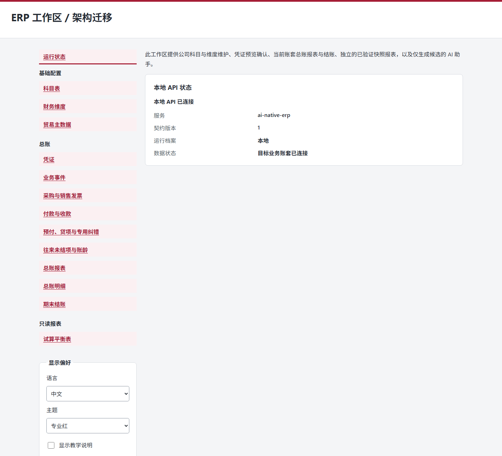
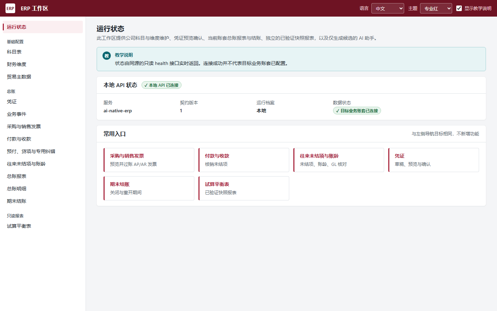
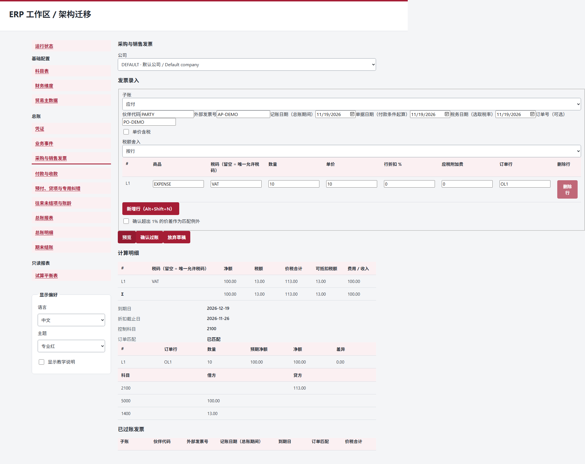
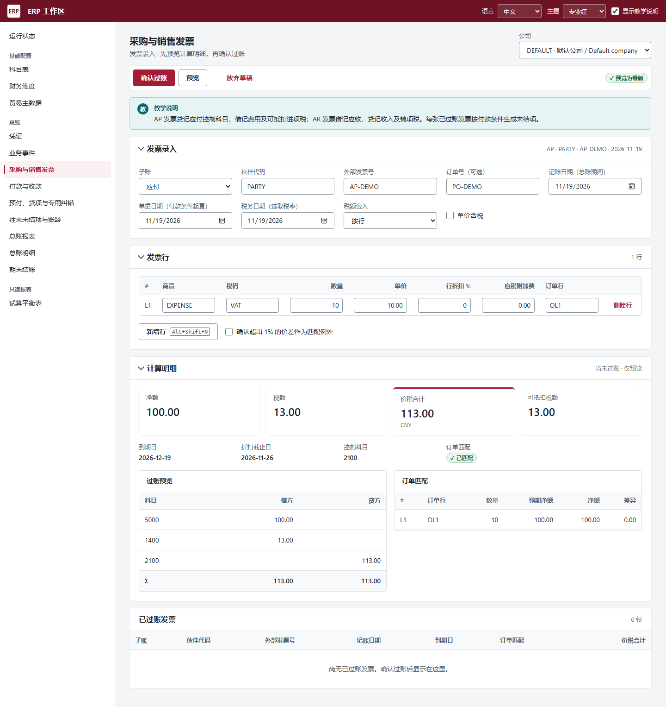
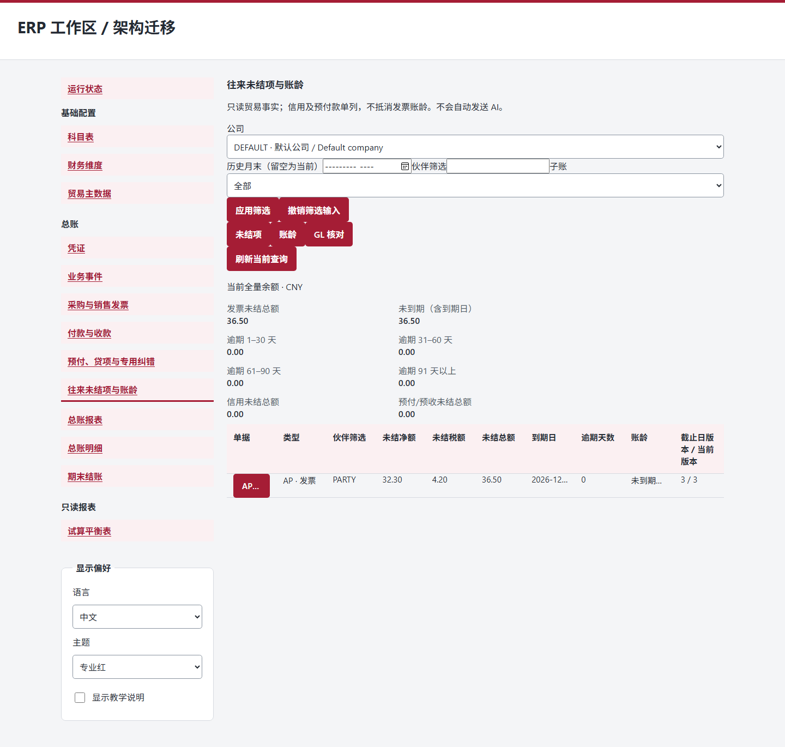
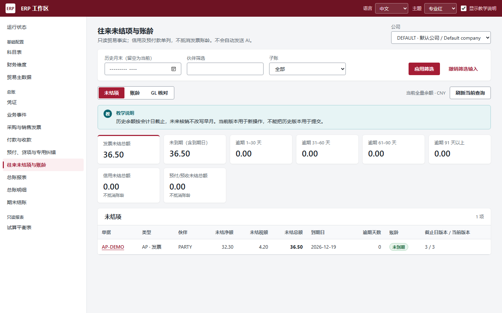

# UI-1 界面设计规范与逐步改进方案

- 角色：设计/产品负责人　状态：待评审　适用：`packages/web`（现行 React 工作区）
- 目标：在现有 web 界面上**分步调整**，做到好看、简洁；**业务功能与流程不变**，不推倒重来。
- 约束来源：[产品规范 PG-03/PG-04](../product-guidelines.md)（参考 Dynamics 365 的信息组织方式，不复制 Microsoft/Fluent 的视觉、图标、文字和素材；默认红、可选绿；中英双语；纯键盘可用；教学模式可关闭且关闭后不隐藏风险或必填信息）。
- 本目录文件：
  - [`tokens.css`](tokens.css)：设计 token，唯一来源。UI-01 原样复制到 `packages/web/src/theme/tokens.css`。
  - [`check-contrast.mjs`](check-contrast.mjs)：WCAG AA 对比度检查，`node design/ui/check-contrast.mjs`，任一不达标即非零退出。
  - [`prototypes/`](prototypes/)：高保真静态 HTML 原型（`prototype.css` 是组件参考实现，`prototype.js` 生成外壳并切换主题/语言/教学）。直接用浏览器打开，可加参数 `?theme=green&lang=en&teaching=0`。
  - [`capture-prototypes.mjs`](capture-prototypes.mjs)：重新生成 `screenshots/after/`（`node design/ui/capture-prototypes.mjs`；没有 Playwright 自带 Chromium 时使用系统 Edge）。
  - `screenshots/before/`：现状截图，取自 v0.2.0 Demo（[docs/demo/v0.2.0](../../docs/demo/v0.2.0/)，虚构数据，宽 1440）。
  - `screenshots/after/`：原型截图。
- 实施拆分：[UI-01..UI-08](../tasks/README.md#ui-1界面逐步改进)。

## 1. 现状问题（main `037b3ce`）

| # | 问题 | 证据 |
| --- | --- | --- |
| P1 | 所有按钮都是实心主色，没有主次之分。“预览 / 确认过账 / 放弃草稿”、“应用筛选 / 撤销筛选输入”、视图切换和行内“删除行”长得一样，误点成本高 | `styles.css` 只有一种 `button` 样式；[发票](screenshots/before/trade-invoices.png)、[报表](screenshots/before/trade-reports.png) |
| P2 | 导航是一列带下划线的粉色链接，选中态只有底边线，分组标题和链接层级弱；显示偏好放在导航底部，要滚动才能看到 | [运行状态](screenshots/before/overview.png) |
| P3 | 顶栏标题“ERP 工作区 / 架构迁移”是开发期文案，不像产品；顶栏只有一条主色细线 | `labels.ts` `shell.title` |
| P4 | 表单标签与输入框行内挤在一起（`伙伴代码[PARTY]外部发票号[AP-DEMO]…`），宽度不一，难以扫读 | 发票截图第 2 行 |
| P5 | 发票页横向溢出（截图宽 2000px），行编辑表格输入框无结构，“删除行”大实心按钮 | 发票截图 |
| P6 | 没有页头和操作栏：页面标题、公司上下文、主操作分散；没有 FastTab 式分组卡片，长表单一屏到底 | 全部页面 |
| P7 | 报表视图切换（未结项 / 账龄 / GL 核对）和操作按钮无区别，看不出当前视图 | 报表截图 |
| P8 | 汇总金额是普通 `dl` 列表，没有层次；金额列左对齐、未用等宽数字 | 报表截图 |
| P9 | 教学说明只是灰字加左边线，与正文边界说明混在一起 | `.teaching` |
| P10 | 警告与错误都用同一种黄色，靠文字区分 | `.issues`、`[role=alert]` |
| P11 | 内容无最大宽度和统一间距，大片空白与拥挤并存 | 全部页面 |

## 2. 设计原则

1. **原创、克制**：沿用 Dynamics 365 的信息组织（左侧分组导航、页头 + 操作栏、FastTab 分组、列表 + 详情、工作区卡片），视觉、图标和文案自行设计。不用图标字体，状态用文字 + 符号（✓ ! ×）。
2. **层次靠排版和留白，不靠颜色**：一屏只有一个主色实心按钮；其余是次要（描边）或轻量（文字）按钮。
3. **金额优先**：金额右对齐、等宽数字；合计与关键 KPI 放大加粗。
4. **结构不变**：只换样式和布局容器，不改字段、顺序语义、按钮文字（除 `shell.title`）、ID、role 和可访问名称。
5. **两套主题只换主色**：语义色（信息、成功、警告、错误、教学）两套主题相同，保证红主题下错误与主色可区分（错误另有符号和边框）。

## 3. 设计 token

完整定义见 [`tokens.css`](tokens.css)。命名 `--{类别}-{用途}`；组件只能引用 token，不写裸色值。

### 3.1 颜色

| token | 红（默认） | 绿 | 用途 |
| --- | --- | --- | --- |
| `--color-primary` | `#a51d35` | `#216346` | 主按钮、链接、选中指示 |
| `--color-primary-hover` / `-active` | `#8c1729` / `#73121f` | `#1a5239` / `#14402c` | 悬停、按下 |
| `--color-primary-soft` / `-soft-border` | `#fbeff1` / `#efc6ce` | `#ebf5ef` / `#b9dbc7` | 导航选中底、选中行 |
| `--color-on-primary` | `#ffffff` | `#ffffff` | 主色上的文字 |
| `--color-appbar` | `#6e1323` | `#153f2d` | 顶栏底色 |
| `--color-on-appbar` / `--color-appbar-muted` | `#ffffff` / `#f3d5db` | `#ffffff` / `#cfe6d9` | 顶栏文字 |

中性色与语义色两主题相同：

| token | 值 | 用途 |
| --- | --- | --- |
| `--color-bg` | `#f4f5f7` | 页面底 |
| `--color-surface` / `-surface-alt` | `#ffffff` / `#f8f9fb` | 卡片 / 表头、悬停行、只读字段 |
| `--color-border` / `-border-strong` | `#dde1e6` / `#8a939e` | 分隔线 / 输入框边框 |
| `--color-text` / `-text-muted` / `-text-disabled` | `#1d232b` / `#545e6b` / `#8a939e` | 正文 / 次要 / 禁用 |
| `--color-info` / `-success` / `-warning` / `-danger` | `#1c5a9c` / `#1b6a3a` / `#6e4a00` / `#b0261c` | 文字色，均配 `-bg`、`-border` |
| `--color-teach` / `-teach-bg` / `-teach-border` | `#0d6670` / `#e7f4f5` / `#9fd0d4` | 教学提示（青色，区别于主色和语义色） |
| `--color-focus` | `#185ca8` | 焦点框（沿用现值；顶栏上改为白色） |

具体值以 `tokens.css` 为准，本表仅便于评审；两处不一致时改表。

### 3.2 对比度（WCAG 2.1 AA，`check-contrast.mjs` 实测）

每个主题检查 24 对（文字 ≥ 4.5:1，非文字 ≥ 3:1），**全部通过**。最低值：

| 对 | 红 | 绿 | 要求 |
| --- | --- | --- | --- |
| 输入框边框 on 卡片 | 3.11 | 3.11 | ≥ 3 |
| 错误文字 on 错误底 | 5.85 | 5.85 | ≥ 4.5 |
| 成功 / 教学文字 on 各自底色 | 5.92 | 5.92 | ≥ 4.5 |
| 次要文字 on 页面底 | 6.03 | 6.03 | ≥ 4.5 |
| 主色 on 浅主色（导航选中） | 6.62 | 6.41 | ≥ 4.5 |
| 白字 on 主按钮 | 7.43 | 7.15 | ≥ 4.5 |
| 顶栏次要文字 on 顶栏 | 8.62 | 8.97 | ≥ 4.5 |

改 token 后必须重跑；UI-01 把同样的检查移植为 `packages/web/test` 下的单元测试，CI 中持续生效。

### 3.3 字体、字号、间距、圆角、阴影

- 字体：`Segoe UI, Microsoft YaHei UI, PingFang SC, Noto Sans CJK SC, system-ui`；等宽 `Cascadia Mono, Consolas`。不引入网络字体（本地优先、离线可用）。
- 字号 / 行高：`xs 12/16`（辅助、徽标、导航分组）、`sm 13/18`（字段标签、表头）、`md 14/20`（正文，默认）、`lg 16/24`（卡片标题、顶栏标题）、`xl 20/28`（页面标题 h2）、`2xl 24/32`（KPI 数值）。字重只用 400 和 600。
- 间距：4px 基数，`--space-1..10` = 4、8、12、16、20、24、32、40（`--space-0` = 2）。卡片内边距 16×20，卡片间距 16，页面边距 20×32。
- 圆角：`sm 4`（按钮、输入框、徽标外框）、`md 6`（卡片、KPI、消息条）、`lg 10`（保留）、`pill`（徽标、指示条）。
- 阴影：`shadow-1`（卡片，1px 细影 + 描边感）、`shadow-2`（浮层，下拉/对话框）、`shadow-3`（保留）。不叠加多层阴影。
- 尺寸：顶栏 48、导航 248、控件高 36（窄屏或粗指针 44）、**表格行 44（付款与收款 48）**、内容最大宽 1440。

## 4. 布局模板

### 4.1 外壳

```
┌ appbar（主题色深底）──────────────────────────────────────────┐
│ [ERP] ERP 工作区                     语言[中文▾] 主题[专业红▾] ☑显示教学说明 │
├ nav 248 ─────┬ main#workspace-main ──────────────────────────┤
│ 运行状态      │ page-header：h2 + 边界说明 ……… 公司[▾]          │
│ 基础配置      │ command-bar：[主操作] [次操作] | [轻操作]  状态徽标  │
│   科目表      │ 内容（FastTab / 卡片 / 表格），最大宽 1440         │
│ ……           │                                               │
└──────────────┴───────────────────────────────────────────────┘
```

- **顶栏**：品牌块 + `h1`（`shell.title` 改为“ERP 工作区 / ERP workspace”，`shell.documentTitle` 同步）；右侧是显示偏好 `fieldset`（`legend` 视觉隐藏），保留 `#workspace-language`、`#workspace-theme`、`#workspace-teaching` 三个 ID 和 label。偏好**始终可见、可 Tab 到达**，不放进弹出菜单。
- **导航**：`nav[aria-label]` 内按现有分组输出；分组标题 12px 次要色；链接 36px 高、无下划线；当前页 `aria-current="page"`（NavLink 自带）显示浅主色底 + 左侧 3px 指示条 + 600 字重。链接 `href` 不变。
- **窄屏（≤ 760px）**：导航变为顶栏下方的横向滚动条（粘顶），当前页自动滚入视野；控件高 44；偏好文字标签视觉隐藏但保留可访问名称。见 [窄屏截图](screenshots/after/trade-invoices-narrow.png)。
- 跳转链接 `shell.skip` 保持第一个可聚焦元素。

### 4.2 页头与操作栏

- `page-header`：左侧 `h2`（E2E 依赖 `main h2`，不能换级别）+ 一行边界说明（现有 `*.boundary` 文案）；右侧上下文字段（公司选择，ID 不变）。
- `command-bar`（`role="toolbar"`）：顺序为主操作（实心，至多一个）→ 次操作（描边）→ 分隔 → 轻操作（文字，如放弃、撤销）；右侧放状态徽标（如“预览为最新”“预览已过期”）。不改按钮的文字、`type` 和禁用逻辑。

### 4.3 列表页（主数据、凭证、已过账单据）

`page-header` → `filter-bar`（标签在上的字段 + 右侧“应用 / 撤销”）→ 可选视图切换（`segmented`）→ `card` 内 `grid`。行操作用轻量小按钮，主键列可用 `cell-link` 打开详情。虚拟化列表的行高保持 44/48。

### 4.4 单据 / 表单页（发票、付款、预付与纠错、凭证草稿）

`page-header` → `command-bar` → 教学提示（开启时）→ FastTab：**常规**（`form-grid`）→ **行**（可编辑 `grid` + “新增行”次按钮）→ **计算明细 / 过账预览**（KPI + `facts` + 分录表）→ `card`：已过账列表。

### 4.5 详情 / 报表页

`page-header` → `filter-bar` → 视图切换 + 范围说明 + 刷新 → KPI 行 → 明细表 / 来源详情卡片。

## 5. 核心组件

| 组件 | 规则 | 对应现状 |
| --- | --- | --- |
| Button | `primary`（每屏 ≤ 1 个）、`secondary`（描边）、`subtle`（文字）、`danger`（描边红，仅不可逆操作的确认）、`sm` 28px 用于行内。禁用态灰底灰字，不只降透明度 | 现 138 个 `<button>` 全部实心 |
| Field | 标签在上（13px 次要色），输入框 36px、4px 圆角、`border-strong`；`hint` 12px；错误时边框变红 + 下方 `error-text` + 字段 `aria-invalid`/`aria-describedby`（已有的保持） | 行内 label |
| FormGrid | `auto-fill, minmax(200px, 1fr)`：1440 宽约 5 列，平板 2–3 列，窄屏 1 列；长字段 `span-2` | 无 |
| FastTab | 卡片 + 标题栏（`h3 > button[aria-expanded][aria-controls]`）+ 右侧摘要；默认展开；**含错误时自动展开且不能折叠隐藏错误**（PG-04） | 无 |
| DataGrid | 表头 40px `surface-alt`、粘顶；行 44px；金额列 `num` 右对齐等宽；悬停 `surface-alt`；选中 `primary-soft`；合计行 `tfoot` 加粗 | `.virtual-table` 等 |
| Badge | 圆角胶囊 + 符号 + 文字：成功 ✓、警告 !、错误 ×、信息 i；不只靠颜色 | 纯文字 |
| KPI | 卡片：标签 13px、数值 24px 600、可选副文字；关键值 `emphasis` 顶部 3px 主色条 | `dl` |
| Facts | 键值网格（`dl`），标签在上 | `dl` 两列 |
| MessageBar | `info/success/warning/error`，浅底 + 左侧 4px 实色条 + 符号；错误保留 `role="alert"`，其余 `role="status"` 维持现状 | `.issues` 黄色 |
| Segmented | 视图切换按钮组，**仍是 `<button>`**、名称不变，用 `aria-pressed` 表示当前视图 | 普通按钮 |
| FilterBar | 卡片内一行字段 + 右侧动作 | 行内 |
| EmptyState | 居中次要色一句话；空、未配置、失败三种状态文案和样式区分（失败用 MessageBar error） | 文本 |
| TeachingTip | 见 §6 | `.teaching` |

## 6. 教学提示

- 样式：青色浅底卡片 + 圆形“教”标记（英文 “T”可选，原型统一用“教”作为装饰，`aria-hidden`）+ 标题“教学说明 / Teaching note” + 正文。区别于主色、语义色和边界说明。
- 位置：页头 / 操作栏之下、第一个内容块之上；字段级教学用字段 `hint` 位置的小号青色文字。
- **关闭时不渲染**（沿用现有 `preferences.teaching &&`），不留空位。
- 关闭教学**不能**隐藏：边界说明、风险提示、必填标记、错误和警告（PG-04）。凡属这些的文字现在若写在 `.teaching` 中，实施任务需改为 MessageBar 或边界说明，而不是一起隐藏。见 [教学关闭截图](screenshots/after/trade-reports-teaching-off.png)。
- 语义：`<aside aria-label="教学说明">`；不打断 Tab 顺序（无可聚焦元素）。

## 7. 可访问性与键盘

- 焦点：`:focus-visible` 2px `--color-focus` 外框、2px 偏移；顶栏上为白色。不移除任何焦点样式。
- Tab 顺序 = 视觉顺序：跳转链接 → 顶栏偏好 → 导航 → 页头上下文 → 操作栏 → 内容。现有快捷键（如 `Alt+Shift+N` 新增行）保留，并在按钮上用 `kbd` 展示。
- 颜色不是唯一信号：状态徽标带符号和文字；错误字段有文字说明。
- 目标尺寸：桌面控件 36px（≥ WCAG 2.2 AA 24px），窄屏或 `pointer: coarse` 44px。
- `prefers-reduced-motion`：只用颜色过渡，无位移动画。

## 8. 必须保持不变的契约（实施任务的硬约束）

| 契约 | 来源 |
| --- | --- |
| `.workspace[data-theme]`、`html[lang]` | `App.test.tsx`、`trade-gui.slow.test.ts` |
| E2E 用 `nav a[href="#/<path>"]` 导航并等待 `main h2` | `trade-gui.slow.test.ts` |
| 所有元素 ID（`#trade-kind`、`#tinv-side`、`#workspace-language` …）与按钮可访问名称（`getByRole("button", { name })`） | 同上及 `packages/web/test/*.test.tsx` |
| 报表视图切换仍是按钮且名称不变 | `trade-reports.test.tsx`、E2E |
| 偏好控件可见、可 Tab 到达；E2E 键盘路径 220 次 Tab 上限内完成 | E2E |
| 虚拟列表 `estimateSize` 44（科目、维度、凭证、发票、贸易主数据）、48（付款与收款）不变 | 各页 `useVirtualizer` |
| 文案只改 `shell.title`、`shell.documentTitle`；其余标签、顺序、业务流程、接口调用不改 | 本规范 |

## 9. 改进前后对比

改后截图由原型生成（宽 1440，整页，中文 + 专业红，教学开启），数据与 v0.2.0 Demo 一致（PARTY、AP-DEMO、PO-DEMO，净额 100.00 / 税额 13.00 / 合计 113.00，未结 36.50）。

| 页面 | 改前 | 改后 | 主要变化 |
| --- | --- | --- | --- |
| 运行状态 |  |  | 顶栏 + 偏好上移（P2/P3）；状态卡片用徽标；工作区“常用入口”卡片（仅链接到既有导航目标，不新增功能，UI-07 可选） |
| 采购与销售发票 |  |  | 操作栏主次（P1）；FastTab + 标签在上表单（P4/P6）；行表格结构化、不再横向溢出（P5）；KPI + 分录预览并排（P8） |
| 往来未结项与账龄 |  |  | 筛选栏；视图切换 `aria-pressed`（P7）；账龄 KPI，信用 / 预付单列并注明“不抵消账龄”；金额右对齐（P8）；教学提示青色卡片（P9） |

其他变体：[发票 · 英文 + 绿](screenshots/after/trade-invoices-en-green.png)、[报表 · 绿](screenshots/after/trade-reports-green.png)、[报表 · 教学关闭](screenshots/after/trade-reports-teaching-off.png)、[发票 · 390 窄屏](screenshots/after/trade-invoices-narrow.png)。

## 10. 实施方式

- 样式文件拆分：`src/theme/tokens.css`（token）、`src/theme/base.css`（重置、排版、焦点）、`src/theme/components.css`（§5 组件，类名同原型）、`src/theme/shell.css`；页面专属样式放 `src/pages/<page>.css` 并由页面组件 import，使逐页任务互不冲突。`styles.css` 在 UI-01 中缩减为兼容层，到 UI-08 删除。
- 共享组件只做薄封装（如 `PageHeader`、`CommandBar`、`FastTab`、`TeachingTip`、`Badge`），不改变子元素和事件；能用类名解决的不新建组件。
- 截图证据：每个任务在 PR 中附改前 / 改后（中文 + 红、英文 + 绿，1440 与 390 宽），存放在 PR 描述或 `design/ui/screenshots/<任务>/`；用虚构夹具，禁止真实账套。
- 任务表与验收标准见 [design/tasks/README.md 的 UI-1 小节](../tasks/README.md#ui-1界面逐步改进)。
