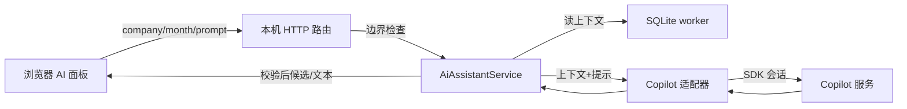

# AI 助手

本页说明 AI 助手**能做什么、数据怎么流、怎么启用、不可用时怎么办**。事实来源是 [design/ai-assistant-facts.md](../design/ai-assistant-facts.md)（下称“事实清单”，`F` 编号指其条目，每条带固定到提交的代码位置）；本页只概括，不复制，细节与代码位置以事实清单为准。用户界面操作见[总账用户指南](user/ledger.md)。旧 ADR-SME-005 中的 AI 部分已被取代（D560）。

## 1. 它做什么，不做什么

两个功能，都只在凭证页的 AI 面板里（F1、F10）：

- **起草**：根据一句描述生成一张凭证**候选**。只能填入编辑器作为**新草稿**，仍须你自己保存、预览、确认过账；不保存、不排队、不过账（F5、F10）。
- **讲解**：用中文纯文本解释所选期间的报表与结账状态；是请求时的快照，不是实时保证（F9）。

**起草**的模型输出必须通过服务端校验，解析后且合格的候选才会再走一遍普通凭证的只读预览；不合格的显示为“无效”，只能放弃（F4、F7、F11）。“填入编辑器”只适用于起草候选；讲解只返回有长度上限的文本，不经凭证预览，也不能采纳。讲解用中文、标注快照时点等只是写在提示词里的要求，服务端不强制语言或措辞。维度只接受你在描述里明确写出的 `CODE=VALUE`（F6）。起草只允许在打开的期间（F3）。

## 2. 数据流

要点（F13–F19）：

- 路由先过本机财务边界（防浏览器跨站，**不是身份认证**，本项目无登录），再只允许 POST、`application/json`。
- 上下文在 SQLite worker 读取，调用模型时不在数据库事务内。
- 编辑器里未保存的草稿**不**发送（F17）。

## 3. 隐私：什么会离开本机

**会离开本机**（F15、F16、F20）：你的描述；公司编码、币种、小数位、结账方式；所选期间；报表快照标记；科目表和维度目录。起草只含启用且可手工记账的科目；讲解另含该期间的完整报表对象（最小货币单位），其中包括**所有科目**的调整后试算余额明细（`trial.rows`，不限于起草允许的科目，也不只是合计），以及结账状态计数（草稿、排队、前期未结）。面板（`ai.disclosure`，`packages/web/src/ui/ai-labels.ts`）只给出一段摘要提示（描述、科目、维度、期间；讲解另含请求时财务快照），**并未逐项列出**上述全部内容，例如它没有说明讲解会带上所有科目的余额明细。请以本节为准。不要输入秘密。

隔离措施（F21–F25）：每次调用用临时目录；会话关闭全部工具、MCP、技能、配置发现和权限请求；出现工具事件即判失败；日志只记请求 ID 与错误类型，不记提示词或回复。

**未验证或未记录**，如实保留为缺口：

- 交给 SDK 的环境变量：**现行行为（SEC-02 合并前）**仍是只去掉三个键（F22），其余已设置的变量一并交给 SDK 工厂；SDK 子进程是否原样收到本进程环境未验证。SEC-01 安全评审已完成并经 Product/Design 验收（[评审：#364 评论 7148351359](https://github.com/lingshf/ai-native-erp/issues/364#issuecomment-7148351359)；验收：D568，见[决定索引](../design/decisions.md)与事实清单 §6-3）：结论是改为显式白名单，由 [SEC-02](../design/tasks/SEC-02-copilot-env-allowlist.md) 实施，**尚未实施**，白名单未生效。**不要**据此认为子进程收到全部变量，也不要认为已被隔离或已改白名单。SEC-02 合并后本节再按新行为改写。
- Copilot 服务端如何保存和使用这些数据，仓库无记录，本页不复述也不推断，请以 GitHub 官方说明为准：[Application card: GitHub Copilot Agents（含 Copilot SDK 与 CLI）](https://docs.github.com/copilot/responsible-use/copilot-cli)。该链接是否确为合适的官方页面待 Product/Design 核对。

## 4. 教学模式

关闭教学模式时界面不提供“讲解”，进行中的讲解被中止并回到起草（F12）。这是**前端展示规则，不是访问控制**：服务端不检查教学模式（D563，出现多用户、教师锁定或远程访问时重评）。

## 5. 启用与配置

默认**关闭**（`.env.example` 中 `AI_MODEL` 为空）。三个条件全满足才启用（F27）：

| 变量 | 要求 |
| --- | --- |
| `AI_MODEL` | 显式模型名，不能为空或 `auto`（F24：会话只允许该模型，不自动换模型） |
| `AI_PROVIDER` | 省略或 `copilot` |
| `AI_TIMEOUT_MS` | 1–300000 的整数，默认 30000 |

另需数据库已打开（见[运维与故障排查](operations.md)的 health 说明）。上述条件不满足时不构建 AI 服务，不阻止启动，两个接口返回通用 `UNAVAILABLE`（503），手工记账不受影响（F33）。Copilot 认证不是启用条件，而是完成请求所需：服务已启用但未认证、模型不可用时，请求按下表 `unavailable` 返回 `AI_UNAVAILABLE`（503）。环境变量通用说明见[运维与故障排查](operations.md#启动与环境变量)。

## 6. 失败与排查

| 原因 | HTTP | 可重试 | 常见情形（F28–F32） |
| --- | --- | --- | --- |
| `unavailable` | 503 | 是 | 服务已启用但提供方失败：未认证、模型不在可用列表等（`AI_UNAVAILABLE`；未启用时是上文的通用 `UNAVAILABLE`） |
| `timeout` | 504 | 是 | 超过 `AI_TIMEOUT_MS`（SDK 自身另有 300000 ms 上限） |
| `cancelled` | 400 | 否 | 服务端对取消的映射，仅在仍能发出响应时才有；点“取消”只中止浏览器请求，界面显示已取消，并不会收到 HTTP 400 |
| `busy` | 409 | 是 | 同一进程同时只处理一个 AI 调用，稍后再试；其他功能不受影响 |
| `response` | 502 | 否 | 空回复、超长、多条最终回复、出现工具事件、模型被换 |
| `cleanup` | 503 | 接口标记为是，但实际须重启 | SDK 进程停不下来；本次服务进程内 AI **永久停用，须重启服务** |

## 7. 取舍与已知缺口

- 发送内容的边界见第 3 节（起草与讲解不同，讲解含全部科目余额），且不开放任何工具：牺牲模型自主性，换取“只产出候选”的可审计边界。
- 候选不自动保存：多一步人工，换取过账责任始终在用户。
- 讲解的教学模式限制只在前端（D563），服务端不加固。
- 缺口：SEC-02 环境白名单尚未实施（SEC-01 评审已验收，见第 3 节）；Copilot 服务端数据处理只链接官方页面，链接待 Product/Design 核对；本页未经 QA 演练，也未经事实所有者复核。
