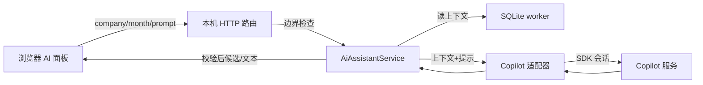

# AI 助手

本页说明 AI 助手**能做什么、数据怎么流、怎么启用、不可用时怎么办**。事实来源是 [design/ai-assistant-facts.md](../design/ai-assistant-facts.md)（下称“事实清单”，`F` 编号指其条目，每条带固定到提交的代码位置）；本页只概括，不复制，细节与代码位置以事实清单为准。用户界面操作见[总账用户指南](user/ledger.md)。旧 ADR-SME-005 中的 AI 部分已被取代（D560）。

## 1. 它做什么，不做什么

两个功能，都只在凭证页的 AI 面板里（F1、F10）：

- **起草**：根据一句描述生成一张凭证**候选**。只能填入编辑器作为**新草稿**，仍须你自己保存、预览、确认过账；不保存、不排队、不过账（F5、F10）。
- **讲解**：用中文纯文本解释所选期间的报表与结账状态；是请求时的快照，不是实时保证（F9）。

**起草**的模型输出必须通过服务端校验，解析后且合格的候选才会再走一遍普通凭证的只读预览；不合格的显示为“无效”，只能放弃（F4、F7、F11）。界面按钮“采纳为新草稿（仅填入）”只适用于起草候选；讲解只返回有长度上限的文本，不经凭证预览，也不能采纳。讲解用中文、标注快照时点等只是写在提示词里的要求，服务端不强制语言或措辞。维度只接受你在描述里明确写出的 `CODE=VALUE`（F6）。起草只允许在打开的期间（F3）。

## 2. 数据流

要点（F13–F19）：

- 路由先过本机财务边界（防浏览器跨站，**不是身份认证**，本项目无登录），再只允许 POST、`application/json`。
- 上下文在 SQLite worker 读取，调用模型时不在数据库事务内。
- 编辑器里未保存的草稿**不**发送（F17）。

## 3. 隐私：什么会离开本机

**会离开本机**（F15、F16、F20）：你的描述；公司编码、币种、小数位、结账方式；所选期间；报表快照标记；科目表和维度目录。起草只含启用且可手工记账的科目；讲解另含该期间的完整报表对象（最小货币单位），其中包括**所有科目**的调整后试算余额明细（`trial.rows`，不限于起草允许的科目，也不只是合计），以及结账状态计数（草稿、排队、前期未结）。面板（`ai.disclosure`，`packages/web/src/ui/ai-labels.ts`）只给出一段摘要提示（描述、科目、维度、期间；讲解另含请求时财务快照），**并未逐项列出**上述全部内容，例如它没有说明讲解会带上所有科目的余额明细。请以本节为准。不要输入秘密。

隔离措施（F21–F25）：每次调用用临时目录；会话关闭全部工具、MCP、技能、配置发现和权限请求；出现工具事件即判失败；日志只记请求 ID 与错误类型；适配器另有三条固定文本的 `console.error` 行（`copilot-ai.ts:41,115`、`copilot-ai-cleanup.ts:69`），不含提示词或回复。

**未验证或未记录**，如实保留为缺口：

- 交给 SDK 的环境变量（F22）：**SEC-02 起**，适配器交给 SDK 工厂的 `env` 只含白名单：用户明确设置 `COPILOT_GITHUB_TOKEN` 时只含这一项，否则为空对象。子进程实际收到的环境会多出补入项：SDK 1.0.31 自行加入 `COPILOT_HOME`、`COPILOT_DISABLE_KEYTAR`；在 Windows 上，Node/libuv 还会从 ERP 进程补入 11 个系统变量（含 `PATH`、`TEMP`、`USERNAME`、`USERPROFILE` 等；这 11 个键来自 Node v26.13.0 的对照实测，换 Node 版本须重测）。因此子进程环境**不是只含白名单**，也不应描述为“已隔离”。本进程其他变量（`GH_TOKEN`、`GITHUB_TOKEN`、代理与证书变量、`ERP_SQLITE_FILE` 等 ERP 配置、其他凭据）不由 ERP 交给 SDK。传输方式固定为 stdio。Windows 补入项的认定见 D570，运行证据见 SEC-02 的 PR。原生 CLI 离线启动只有 Linux 证据，Windows 未验证（D571）。仍未验证：原生 CLI 对这些补入键的依赖；真实认证是否兼容（令牌、存量登录、`gh` 回退）；代理与自定义 CA；子进程环境的端到端隔离。SEC-02 之前（历史）：适配器只去掉三个键，其余变量一并交给 SDK 工厂。来源：SEC-01 评审（[#364 评论 7148351359](https://github.com/lingshf/ai-native-erp/issues/364#issuecomment-7148351359)）与 D568（见[决定索引](../design/decisions.md)、[SEC-02](../design/tasks/SEC-02-copilot-env-allowlist.md)）。
- Copilot 服务端如何保存和使用这些数据，仓库无记录，本页不复述也不推断，仅链接 GitHub 官方的 Copilot Agents 负责任使用说明：[Responsible use of GitHub Copilot Agents](https://docs.github.com/en/copilot/responsible-use/agents)。它不是服务端数据处理说明。模型托管与提供方的数据承诺另见官方说明：[Hosting of models for GitHub Copilot](https://docs.github.com/en/copilot/reference/ai-models/model-hosting)，本页不复述其中承诺；GitHub 自身服务端如何保存与使用这些数据仍无专门说明，是缺口。

## 4. 教学模式

关闭教学模式时界面不提供“讲解”，进行中的讲解被中止并回到起草（F12）。这是**前端展示规则，不是访问控制**：服务端不检查教学模式（D563，出现多用户、教师锁定或远程访问时重评）。

## 5. 启用与配置

默认**关闭**（`.env.example` 中 `AI_MODEL` 为空）。三个条件全满足才启用（F27）：

| 变量 | 要求 |
| --- | --- |
| `AI_MODEL` | 显式模型名，不能为空或 `auto`（F24：会话只允许该模型，不自动换模型） |
| `AI_PROVIDER` | 省略或 `copilot` |
| `AI_TIMEOUT_MS` | 1–300000 的整数，默认 30000 |

另需数据库已打开（见[运维与故障排查](operations.md)的 health 说明）。上述条件不满足时不构建 AI 服务，不阻止启动，两个接口返回通用 `UNAVAILABLE`（503），手工记账不受影响（F33）。格式错误或被禁止的请求（403/405/415/400）在 503 检查之前就已拒绝。Copilot 认证不是启用条件，而是完成请求所需：服务已启用但未认证、模型不可用时，请求按下表 `unavailable` 返回 `AI_UNAVAILABLE`（503）。环境变量通用说明见[运维与故障排查](operations.md#启动与环境变量)。

**Copilot 认证与环境变量（SEC-02 起，行为变化）**：AI 适配器只把 `COPILOT_GITHUB_TOKEN`（明确设置且非空时）交给 Copilot SDK，不再把服务进程的其他环境变量一并交出（F22）。以前如果靠 `GH_TOKEN`、`GITHUB_TOKEN` 或其他继承来的变量让 AI 可用，升级后 AI 可能变为不可用（`AI_UNAVAILABLE`）。迁移方法：可改为设置 `COPILOT_GITHUB_TOKEN`。这**不保证**能恢复以前所有的认证方式：令牌认证是否兼容、存量登录、`gh` 回退、代理与自定义 CA 都未验证。ERP 不再交出 `PATH` 等变量，但 Windows 系统仍会为子进程补入 `PATH` 等少量系统变量（第 3 节）。Windows 上键名不分大小写；其他平台须写成大写的 `COPILOT_GITHUB_TOKEN`。

## 6. 失败与排查

| 原因 | HTTP | 可重试 | 常见情形（F28–F32） |
| --- | --- | --- | --- |
| `unavailable` | 503 | 是 | 服务已启用但提供方失败：未认证、模型不在可用列表等（`AI_UNAVAILABLE`；未启用时是上文的通用 `UNAVAILABLE`） |
| `timeout` | 504 | 是 | 超过 `AI_TIMEOUT_MS`（该值最大 300000 ms；适配器传给 `sendAndWait` 的 300000 ms 是 ERP 自己的参数，不是 SDK 自带上限，服务端计时器总是先触发或同时触发） |
| `cancelled` | 400 | 否 | 服务端对取消的映射，仅在仍能发出响应时才有；点“取消”只中止浏览器请求，界面显示已取消，并不会收到 HTTP 400 |
| `busy` | 409 | 是 | 同一进程同时只处理一个 AI 调用，稍后再试；其他功能不受影响 |
| `response` | 502 | 否 | 空回复、超长、多条最终回复、出现工具事件、模型被换 |
| `cleanup` | 503 | 接口标记为是；是否须重启取决于能否确认终止 | 只有**无法确认 SDK 进程已终止**（已中断路径直接 `forceStop`，重试后仍无法确认）时，AI 才在本进程内**永久停用，须重启服务**，后续调用也会受影响。强制终止最终成功，或仅临时目录删除失败，则**不必重启**、不停用 AI。本次结果与后续调用要分开看：只有原结果失败时，清理失败才覆盖为 `cleanup`；已拿到回答时适配器保留回答，只记日志（`copilot-ai-cleanup.ts:41-59`、`copilot-ai.ts:38-42,112-116`） |

## 7. 取舍与已知缺口

- 发送内容的边界见第 3 节（起草与讲解不同，讲解含全部科目余额），且不开放任何工具：牺牲模型自主性，换取“只产出候选”的可审计边界。
- 候选不自动保存：多一步人工，换取过账责任始终在用户。
- 讲解的教学模式限制只在前端（D563），服务端不加固。
- 交给 SDK 的环境变量只留 `COPILOT_GITHUB_TOKEN`（SEC-02，第 3、5 节）：牺牲靠 `GH_TOKEN` / `GITHUB_TOKEN` 等继承变量“碰巧可用”的兼容性，换取缺省最小的交出范围。
- 缺口：原生 CLI 离线启动只有 Linux 证据，Windows 未验证（D571）；原生 CLI 对补入键的依赖、真实认证兼容、代理与自定义 CA、SDK 子进程环境的端到端隔离仍未验证（第 3 节）；模型托管与提供方的数据承诺见官方说明 [Hosting of models for GitHub Copilot](https://docs.github.com/en/copilot/reference/ai-models/model-hosting)（本页不复述承诺）；GitHub 自身服务端如何保存与使用数据仍无专门说明，是缺口（Copilot Agents 负责任使用说明不是服务端数据处理说明，不作证据）；本页未经 QA 演练。
- 复核记录（范围仅限两项）：设计在 [#386 评论 7148480305](https://github.com/lingshf/ai-native-erp/pull/386#issuecomment-7148480305) 核对了官方链接是否属实，以及第 3、7 节是否符合 SEC-02 任务书 R7 时点 2；核对时的 head 是 7aabc4f，之后的措辞修改未另行复核。不扩大到整页，也不代表做过 QA 演练。第 3、5、7 节已由 SEC-02 按新行为改写，上述核对不覆盖改写后的内容。
