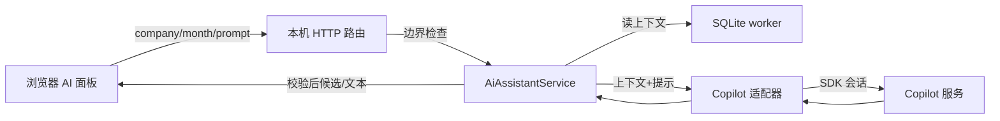

# AI 助手

本页说明 AI 助手**能做什么、数据怎么流、怎么启用、不可用时怎么办**。事实来源是 [design/ai-assistant-facts.md](../design/ai-assistant-facts.md)（下称“事实清单”，`F` 编号指其条目，每条带固定到提交的代码位置）；本页只概括，不复制，细节与代码位置以事实清单为准。用户界面操作见[总账用户指南](user/ledger.md)。旧 ADR-SME-005 中的 AI 部分已被取代（D560）。

## 1. 它做什么，不做什么

两个功能，都只在凭证页的 AI 面板里（F1、F10）：

- **起草**：根据一句描述生成一张凭证**候选**。只能填入编辑器作为**新草稿**，仍须你自己保存、预览、确认过账；不保存、不排队、不过账（F5、F10）。
- **讲解**：用中文纯文本解释所选期间的报表与结账状态；是请求时的快照，不是实时保证（F9）。

模型输出必须通过服务端校验，再走一遍普通凭证的只读预览；不合格的显示为“无效”，只能放弃（F4、F7、F11）。维度只接受你在描述里明确写出的 `CODE=VALUE`（F6）。起草只允许在打开的期间（F3）。

## 2. 数据流

要点（F13–F19）：

- 路由先过本机财务边界（防浏览器跨站，**不是身份认证**，本项目无登录），再只允许 POST、`application/json`。
- 上下文在 SQLite worker 读取，调用模型时不在数据库事务内。
- 编辑器里未保存的草稿**不**发送（F17）。

## 3. 隐私：什么会离开本机

**会离开本机**（F15、F16、F20）：你的描述；公司编码、币种、小数位、结账方式；所选期间；报表快照标记；科目表和维度目录。起草只含启用且可手工记账的科目；讲解另含该期间调整后的报表金额（最小货币单位）和结账状态计数（草稿、排队、前期未结）。界面在面板顶部披露这些，不要输入秘密。

隔离措施（F21–F25）：每次调用用临时目录；会话关闭全部工具、MCP、技能、配置发现和权限请求；出现工具事件即判失败；日志只记请求 ID 与错误类型，不记提示词或回复。

**未验证或未记录**，如实保留为缺口：

- 交给 SDK 的环境变量只去掉三个键（F22）；SDK 子进程是否原样收到本进程环境未验证，是否改白名单是安全评审候选 SEC-01（事实清单 §6-3）。**不要**据此认为子进程收到全部变量，也不要认为已被隔离。
- Copilot 服务端如何保存和使用这些数据，仓库无记录，请看官方说明（事实清单 §6-4）。

## 4. 教学模式

关闭教学模式时界面不提供“讲解”，进行中的讲解被中止并回到起草（F12）。这是**前端展示规则，不是访问控制**：服务端不检查教学模式（D563，出现多用户、教师锁定或远程访问时重评）。

## 5. 启用与配置

默认**关闭**（`.env.example` 中 `AI_MODEL` 为空）。三个条件全满足才启用（F27）：

| 变量 | 要求 |
| --- | --- |
| `AI_MODEL` | 显式模型名，不能为空或 `auto`（F24：会话只允许该模型，不自动换模型） |
| `AI_PROVIDER` | 省略或 `copilot` |
| `AI_TIMEOUT_MS` | 1–300000 的整数，默认 30000 |

另需数据库已打开（见[运维与故障排查](operations.md)的 health 说明）和可用的 Copilot 认证。不满足不会阻止启动，两个接口返回 503，手工记账不受影响（F33）。环境变量通用说明见[运维与故障排查](operations.md#启动与环境变量)。

## 6. 失败与排查

| 原因 | HTTP | 可重试 | 常见情形（F28–F32） |
| --- | --- | --- | --- |
| `unavailable` | 503 | 是 | 未启用、未认证、模型不在可用列表、配置无效 |
| `timeout` | 504 | 是 | 超过 `AI_TIMEOUT_MS`（SDK 自身另有 300000 ms 上限） |
| `cancelled` | 400 | 否 | 你点了“取消”或连接关闭 |
| `busy` | 409 | 是 | 同一进程同时只处理一个 AI 调用，稍后再试；其他功能不受影响 |
| `response` | 502 | 否 | 空回复、超长、多条最终回复、出现工具事件、模型被换 |
| `cleanup` | 503 | 接口标记为是，但实际须重启 | SDK 进程停不下来；本次服务进程内 AI **永久停用，须重启服务** |

## 7. 取舍与已知缺口

- 只发送最小必要上下文，且不开放任何工具：牺牲模型自主性，换取“只产出候选”的可审计边界。
- 候选不自动保存：多一步人工，换取过账责任始终在用户。
- 讲解的教学模式限制只在前端（D563），服务端不加固。
- 缺口：SEC-01 环境白名单评审未做；Copilot 服务端数据处理无仓库内记录；本页未经 QA 演练，也未经事实所有者复核。
