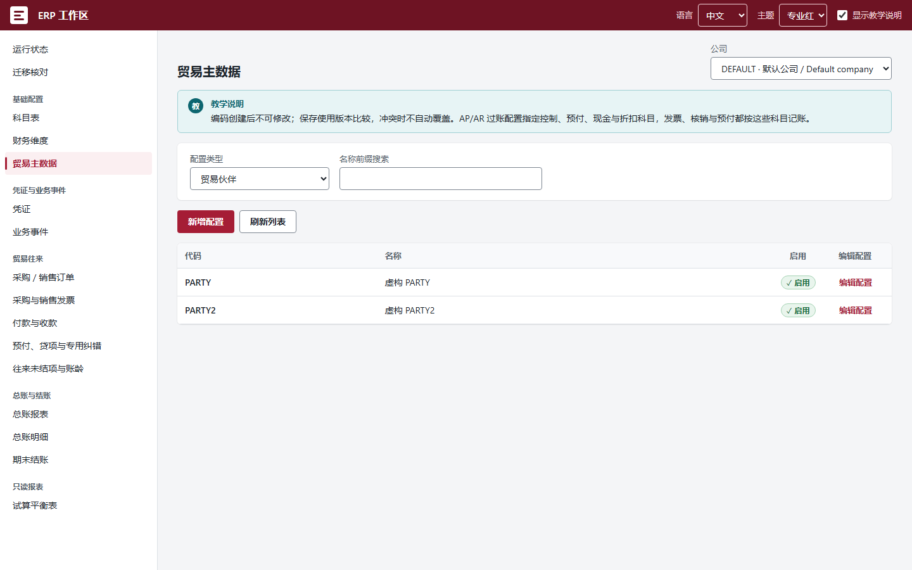

# v0.17.0 Demo（DEMO-18）

本 Demo 用临时演示账套 `erp-demo-<guid>`，端口 **4203**（不是 4173），不连接任何真实旧账或 `.bak`。**证明页面在真实 Chrome 下正常渲染、键盘行为正确，不是逐像素对比。**

## 1 演示内容

1. **贸易主数据“刷新列表”**（TLIST-02，[#284](https://github.com/lingshf/ai-native-erp/pull/284)）：1440 与 390 px 的排布，以及原生键盘（Tab / Enter / 空格）。
2. **发票列表拆分**（REFAC-09，[#285](https://github.com/lingshf/ai-native-erp/pull/285)）：页面外观不变；1440 中英文与 390 英文（TLIST-01 的 S17 遗留项）。
3. **缺 dist 拦截**（RUNMAIN-01，[#283](https://github.com/lingshf/ai-native-erp/pull/283)）：`run-main.ps1` 迁移之前调用 `assert-web-dist.ps1`；证据见 §3 的 `web-dist: ok` 行。

脚本：`scripts/capture.mjs`（新）、`run-main.ps1`（改：调用 `assert-web-dist`）、`steps-demo18.ps1`；造数复用 v0.4.0 的 `prepare.mjs`、`seed-trade.mjs`，v0.10.0 的 `seed-invoicing.mjs`、`seed-sales.mjs`，v0.14.0 的 `seed-credit.mjs`。Demo 证据脚本，按 D446 例外，不属于产品与 CI 代码。

## 2 截图（真实运行，`screenshots/`）

| 文件 | 内容 |
| --- | --- |
| `trade-master-zh-red-1440.png`、`trade-master-en-green-1440.png` | 贸易主数据，“新增配置”之后是“刷新列表” |
| `trade-master-zh-red-390.png`、`trade-master-en-green-390.png` | 390 px，两个按钮同一行 |
| `trade-invoices-list-zh-red-1440.png`、`trade-invoices-list-en-green-1440.png` | 发票列表（REFAC-09 后） |
| `trade-invoices-list-en-green-390.png`、`trade-orders-list-en-green-390.png` | 英文 390 px 的筛选条 |

## 3 真实运行结果

- **序列**（D489 / D490 / D491 授权，运行器各一次）：两个全新 worktree（app 在 PR 头，tooling 在 main `1638445`）的 `npm ci` 在窗口开始前完成（D489 把步骤 0 并入窗口）（均退出码 0）→ `npm run build`（退出码 0）→ **步骤 0** `run-main.ps1 -SkipCapture -Shots <目录>`（退出码 0）→ capture 干跑（`run-main.ps1`，含 capture，退出码 0）→ 真实 `slot-run.ps1 -Ports 4203`（R3，退出码 0）。
- `runner start head=319778cc86481d03037b24eb8d978d161ba169cc rules=R3 ports=4203 status=[]`（运行器自己再构建一次，`dist check … newer=True`）；`tooling head=1638445c536467d488f3f455ecdbefbdc4686c7b`。产品代码与 main `1638445` 相同（本分支只改文档）。
- **D487：run-main 证据**（浏览器外 `-SkipCapture`，[`logs/skipcapture.out.log`](logs/skipcapture.out.log)）：含 `web-dist: ok …dist-index=2026-11-23T22:43:19Z head-commit=2026-11-23T22:40:44Z`，随后迁移、造数、`readiness ok`、`capture skipped (dry-run)`、`port 4203 released`。
- **D487：capture 证据**（窗口内干跑，TEMPLATE 第 17 条，[`logs/capture-dry-run.out.log`](logs/capture-dry-run.out.log)）：`capture exit 0`，23 项显式检查全部通过（[`logs/capture-log-dry-run.json`](logs/capture-log-dry-run.json)）。
- **真实运行**：[`logs/slot-summary-real.log`](logs/slot-summary-real.log)：预检连续 6 次 `counted=0` 才进入步骤，`ports free phase=before-steps`，`step demo-capture exit=0 counted-after=0`，`runner done … status=[]`；端口 4203 事后无监听。输出：[`logs/demo-capture-real.out.log`](logs/demo-capture-real.out.log)、[`logs/processes-real.tsv`](logs/processes-real.tsv)、[`logs/capture-log-real.json`](logs/capture-log-real.json)。
- **SR-X6 行：0 条**（采样器没有输出 SR-X6 行，`processes-real.tsv` 无计入进程，被排除的进程见 slot-summary 的 SR-X1 / SR-X2 行）。
- 内容断言全部通过：`capture-log-real.json` 有 10 个条目，其中 1 个条目含 23 项显式 `checks`（全部 `ok`，0 失败），另外 9 个是取证记录（8 个页面 / 390 px 记录、1 个键盘记录），记录不是检查，不计入 23；贸易主数据列表有行（2 行），1440 下无横向溢出，无页面错误。
- **键盘记录**（TLIST-02，真实 `page.keyboard.press`，`capture-log-real.json` 的 `trade-master-keyboard-record`，en-green 1440）：
  - 焦点从“New configuration”按 Tab 到“Refresh list”；
  - Enter 触发 1 次列表请求（`/api/v1/trade/tradeParty?company=DEFAULT&limit=100`）；
  - 空格触发 1 次同样的请求；
  - 点“New configuration”打开编辑器后，该按钮禁用；从搜索框按 Tab 到“Refresh list”，Enter 触发 1 次请求，编辑器仍然打开（`editorStillOpen` 为 true）。
- **390 px 记录**（`capture-log-real.json` 中 `step` 为 `k7-390` 的四条）：`scrollWidth` 都是 **390**（≤ 390）；贸易主数据按钮（left–right）：中文 新增配置 16–106、刷新列表 114–204；英文 New configuration 16–168.6、Refresh list 176.6–280.1；英文订单页与发票页的 Apply 97.1–168.2、Clear 176.2–242.4、Refresh list 250.4–354。都在 0–390 内，没有换行。

## 4 失败与处置（原样记录，不作为发布证据）

- **D490，步骤 0 第一次调用**：`run-main.ps1 -SkipCapture` 没带 `-Shots`，在参数绑定时失败，脚本主体没有运行（没有启动服务、没有开 4203、没有造数）：
  `run-main.ps1 : Cannot process command because of one or more missing mandatory parameters: Shots.`（`MissingMandatoryParameter`，退出码 1）。协调者批准用 `-Shots` 重跑一次（不算 D444 重试）。另外：`npm ci` 与构建先于步骤 0，因为 `assert-web-dist` 需要 dist。
- **D491，第一次 capture 干跑失败**（[`logs/capture-dry-run1-failed.out.log`](logs/capture-dry-run1-failed.out.log)）：`CAPTURE FAILED: locator.waitFor: Timeout 10000ms exceeded. waiting for locator('#trade-editor') to be visible`（`capture.mjs:248`，退出码 1）。原因：`FastTab` 把 id 只放在正文 `<id>-body` 上（`packages/web/src/ui/components/index.tsx`），`#trade-editor` 不存在；是 capture 选择器的错，不是产品问题。失败前产出的 8 张截图只作诊断，没有保留、没有用作发布证据。修复只改 `capture.mjs`：改等 `#trade-editor-body #trade-code` 可见（提交 `319778c`），然后新的干跑与真实运行通过。因为该提交晚于 dist，`assert-web-dist` 报 `stale`（退出码 4，按 D481 提示），干跑前重新 `npm run build` 一次。
- **D486 的教训**：新写的 `capture.mjs` 没有可在浏览器外跑的预演，选择器错误只能在窗口内的干跑发现；这正是 TEMPLATE 第 17 条（新 capture 脚本必须在窗口内先干跑）的目的。
- **D488**：RUNMAIN-01 开发期间两次占用 4203 属协调偏差，不作为发布证据。
