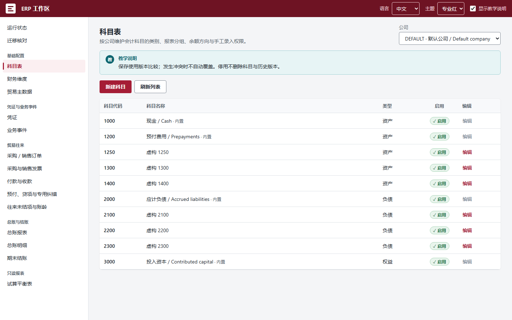
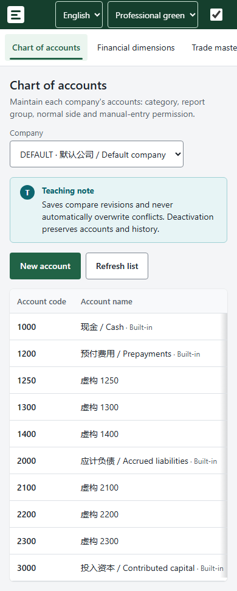

# v0.18.0 Demo（DEMO-19）

本 Demo 用临时演示账套 `erp-demo-<guid>`，端口 **4203**（不是 4173），不连接任何真实旧账或 `.bak`。**证明页面在真实 Chrome 下正常渲染、键盘行为正确，不是逐像素对比。**

SHA 角色与时间线（含步骤 4 的两次调用失败与 D498 / D499）、证据清单见 [`run-through.md`](run-through.md)，本文不重复。

## 1 演示内容

1. **科目表“刷新列表”**（TLIST-03，[#288](https://github.com/lingshf/ai-native-erp/pull/288)）：1440 中英文排布；390 px 下页面不横向溢出、两个按钮都在视口内；原生键盘（Tab / Enter / 空格），编辑器打开时同样可用。
2. **订单列表拆分**（REFAC-10，[#291](https://github.com/lingshf/ai-native-erp/pull/291)）：页面外观不变；1440 中英文，列表有行、筛选栏三个按钮可见（只证明拆分后正常渲染，没有拆分前对比图）。

脚本：`scripts/capture.mjs`（新）、`run-main.ps1`（改：只把 capture 路径换成 v0.18.0；仍先调用 `assert-web-dist.ps1`）、`steps-demo19.ps1`；造数复用 v0.4.0 的 `prepare.mjs`、`seed-trade.mjs`，v0.10.0 的 `seed-invoicing.mjs`、`seed-sales.mjs`，v0.14.0 的 `seed-credit.mjs`。Demo 证据脚本，按 D446 例外，不属于产品与 CI 代码。

## 2 截图（真实运行，`screenshots/`，共 6 张）

| 文件 | 内容 |
| --- | --- |
| `accounts-zh-red-1440.png`、`accounts-en-green-1440.png` | 科目表：“新建科目”之后是“刷新列表” |
| `accounts-zh-red-390.png`、`accounts-en-green-390.png` | 390 px，两个按钮同一行 |
| `trade-orders-list-zh-red-1440.png`、`trade-orders-list-en-green-1440.png` | 订单列表（REFAC-10 后），筛选栏 应用 / 清除 / 刷新列表 |

## 3 真实运行结果

真实运行为 `slot-run.ps1 -Ports 4203`（R3），退出码 0，demo-capture 退出码 0（`logs/slot-summary-real.log`，被测运行器头与工具头见 run-through §1）。结果取自 `logs/capture-log-real.json`：**17 项显式检查全部通过，另有 7 条取证记录，记录不计入检查数**。

- **390 px（两个按钮的矩形来自记录 `accounts-*-390`）**：页面 `scrollWidth` 均为 390；中文按钮 `新建科目` left 16 / right 106、`刷新列表` left 114 / right 204；英文 `New account` 16 / 132.9、`Refresh list` 140.9 / 244.4，都在 0–390 内，同一行（top 395 / 415）。
- **原生键盘（`page.keyboard.press`，英文，1440）**：焦点从 “New account” Tab 到 “Refresh list”；Enter 与空格各触发 1 次 `/api/v1/accounts?company=DEFAULT&limit=100`；编辑器打开时 “New account” 与 “Refresh list” 都未禁用，Tab 同样到 “Refresh list”，Enter 触发 1 次请求，编辑器仍打开。
- **订单列表**：中英文各一张，列表有行，筛选栏按钮文字与顺序正确（脚本中不符即中止）。
- 干跑与真实运行的两份 JSON 字节相同。
