# v0.3.0 Demo 脚本

**时长**约 25 分钟。**主题**：UI-1 全站新界面，加迁移核对页。**数据**：全新的临时演示账套（虚构数据），**端口 4193**，不连接 4173 账套，不使用真实旧账、`.bak` 或用户主检出。

## 截图来源

本目录截图复用 [`design/ui/screenshots/final/`](../../../design/ui/screenshots/final/) 的终版截图（UI-08，#82）：由 [`capture.mjs`](../../../design/ui/screenshots/final/capture.mjs) 在全新临时账套上用**虚构夹具**采集（DPR 1、整页），不连 4173、不读 `.bak`。页面中的 `PARTY`、`AP-DEMO`、`DEMO` 等是虚构编码。完整 95 张（19 页 × 中/英、红/绿、1440/390 与教学关闭）见该目录和[设计一致性审查](../../../design/reviews/UI-1.md)。迁移核对页只能用夹具截图：真实页面需要一个已核对的隔离目标库，见第 4 节。

## 1. 准备（演示前）

```powershell
npm ci; npm run build
# 每次创建独占的新目录；迁移失败即停止，绝不复用旧账套
$dir = Join-Path ([IO.Path]::GetTempPath()) ("erp-demo-" + [guid]::NewGuid().ToString("N"))
[IO.Directory]::CreateDirectory($dir) | Out-Null
$db = Join-Path $dir "demo.sqlite"
npm run storage:admin -- migrate --provider sqlite --file $db
if ($LASTEXITCODE -ne 0) { throw "migrate 失败，停止；仅可清理本次目录 $dir" }
$env:ERP_SQLITE_FILE = $db; $env:ERP_PORT = "4193"; $env:ERP_HOST = "127.0.0.1"; $env:ERP_PROFILE = "local"   # 不得使用 4173
npm run start:local
```

打开 `http://127.0.0.1:4193/`。演示后停止本次启动的进程，只删除本次的 `$dir`。迁移会应用到 016（含 `settlements_report` 索引）。

数据准备（科目、期间准入、贸易主数据、采购订单 `PO-DEMO`）与 [v0.2.0 Demo 第 2 节](../v0.2.0/README.md#2-数据准备在科目表期末结账贸易主数据页完成)相同，端口改为 4193；日期取演示当天所在财年。贸易 GUI 主路径的逐步金额见根 [README「贸易 GUI 主路径验收」](../../../README.md#贸易-gui-主路径验收m1-07)。

## 2. 演示脚本

| # | 页面与操作 | 要点 | 截图 |
| --- | --- | --- | --- |
| 1 | 运行状态 | 深色品牌顶栏；语言 / 主题 / 教学说明在右上角；左侧 248px 分组导航（基础配置 / 总账 / 只读报表） | 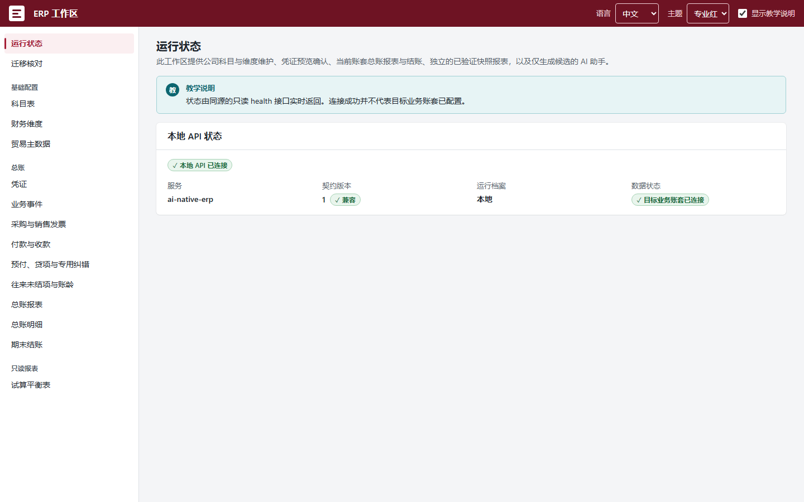 |
| 2 | 科目表 | 列表页模板：页头 + 命令栏 + 卡片表格；新建科目在 FastTab 中 | 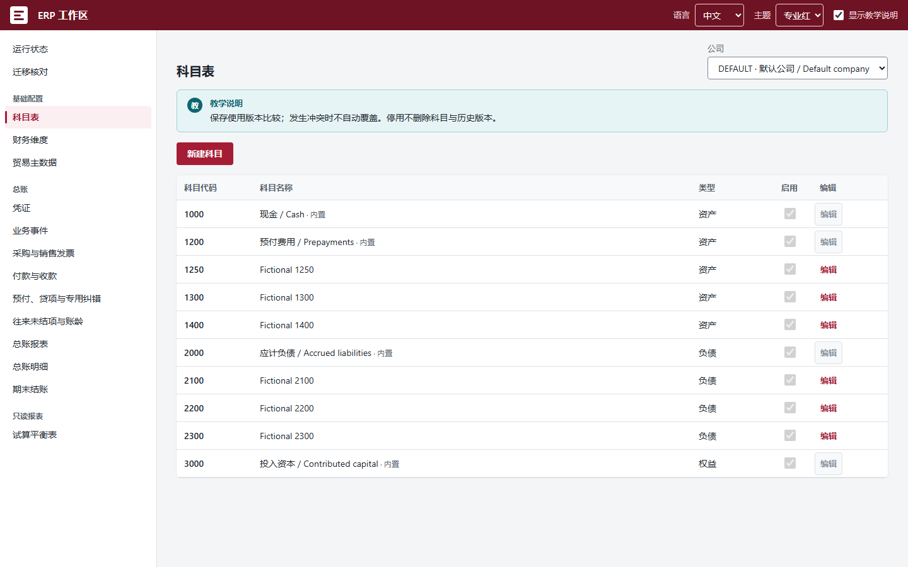 |
| 3 | 贸易主数据 | 筛选栏 + 列表 + FastTab“配置详情” | 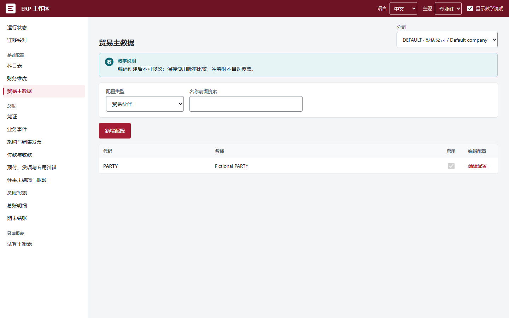 |
| 4 | 凭证 → 新建 | “常规”“分录行”两个 FastTab；借贷合计行，不平衡时显示“借贷不平”（仅提示）。预览仍是对话框 | 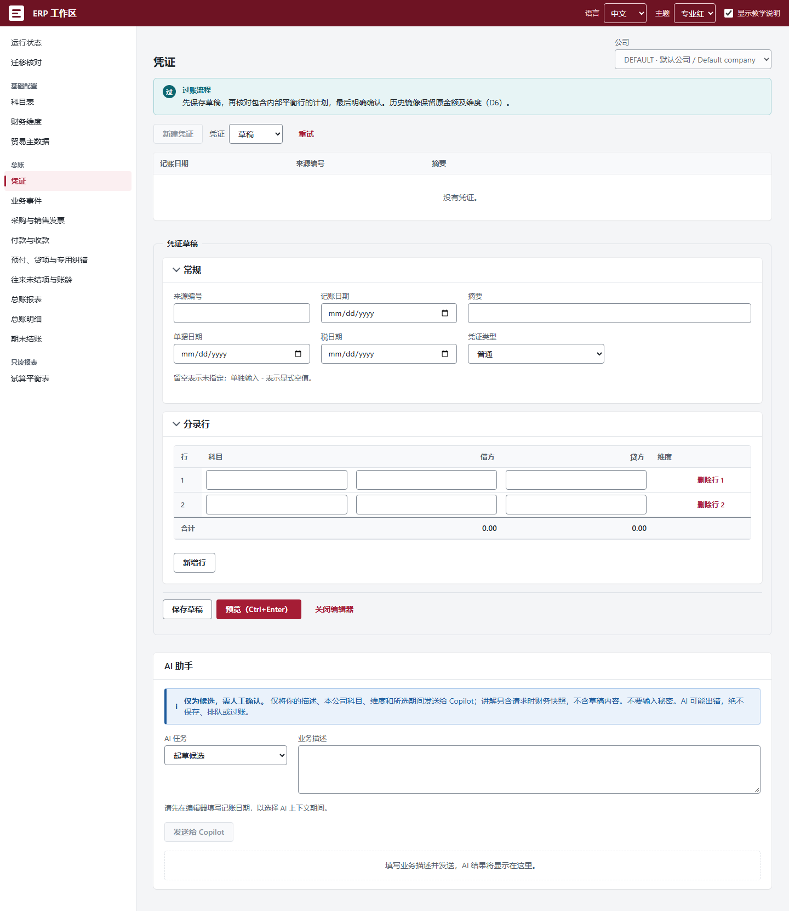 |
| 5 | 采购与销售发票 | 命令栏（预览 / 确认过账 / 放弃草稿）；行表在自身区域滚动；Alt+Shift+N 新增行 | 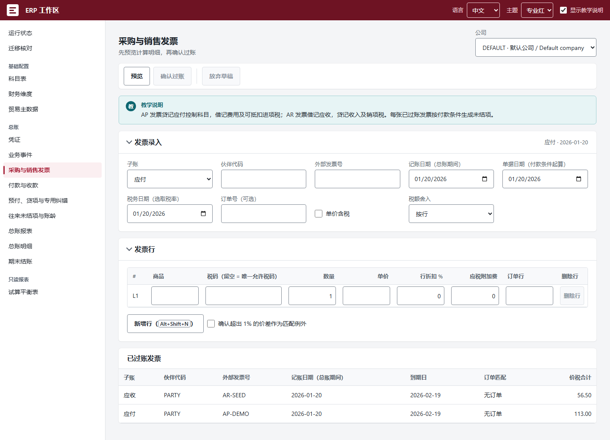 |
| 6 | 付款与收款 | 核销分配表和 KPI（应付 / 已分配 / 剩余） | 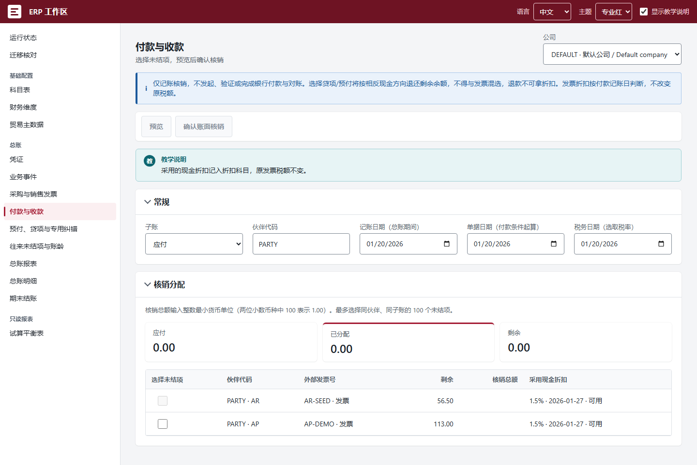 |
| 7 | 往来未结项与账龄 | 分段视图（未结项 / 账龄 / GL 核对）、KPI 卡、带符号的账龄徽标 | 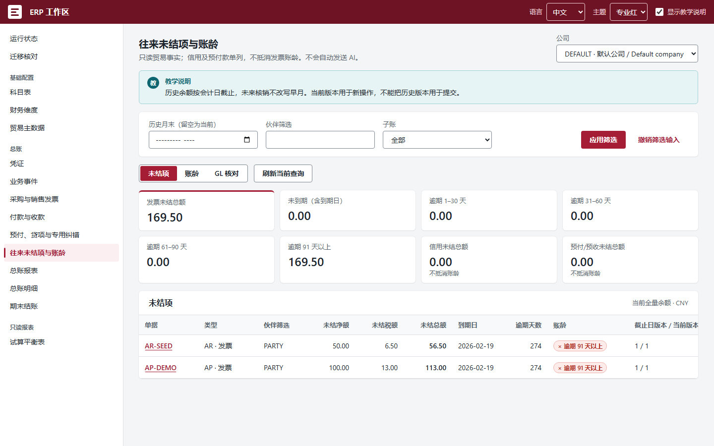 |
| 8 | 总账报表 | 筛选栏、KPI 卡、对账徽标“✓ 一致 / × 不一致” | 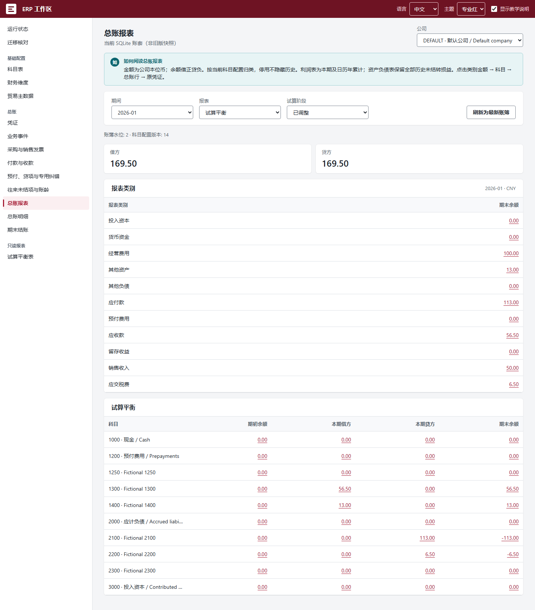 |
| 9 | 期末结账 | 操作栏：预览结账 → 确认结账 → 开放下一期间；“期间列表”卡片；结账区在准入区上方 | 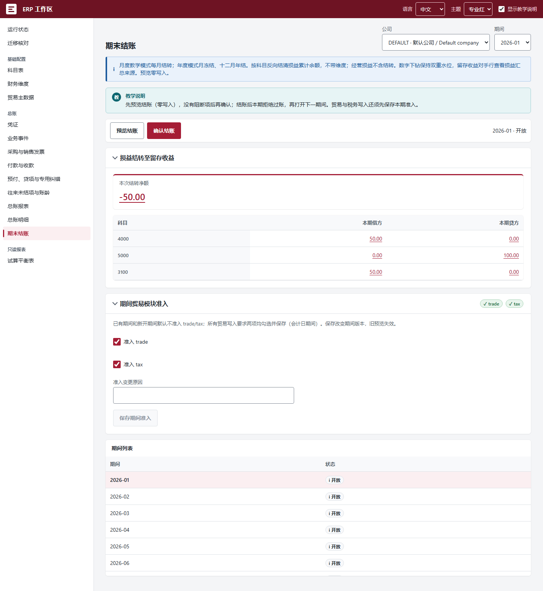 |
| 10 | 迁移核对 | 只读：状态徽标、结论块（✓ 通过 / ! 待确认 / × 阻断 / 差异）、差异卡；无确认 / 演练 / 切换按钮 | 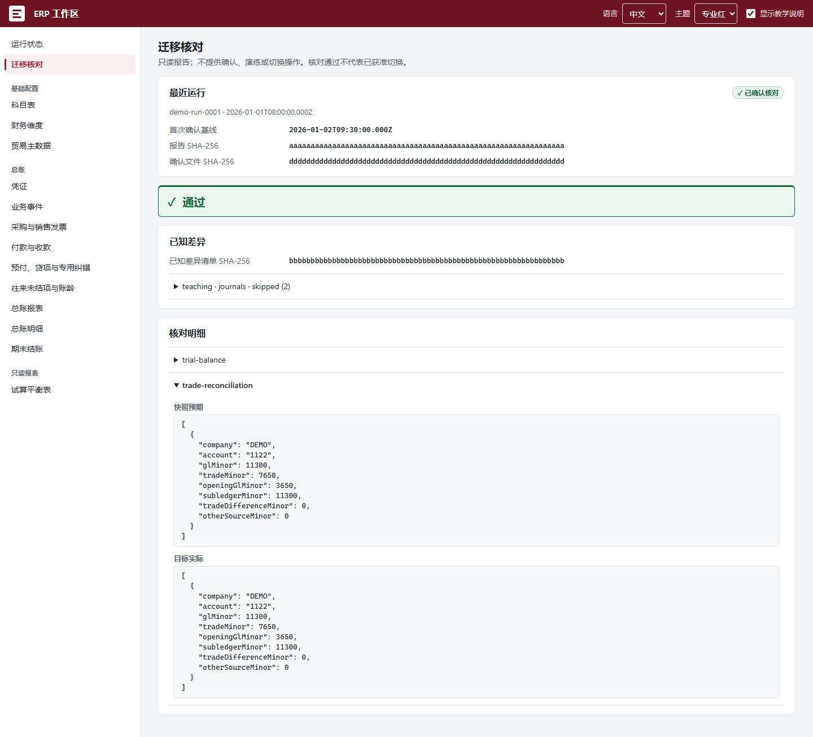 |

## 3. 教学开关与窄屏

| 场景 | 操作与预期 | 截图 |
| --- | --- | --- |
| 教学关闭 | 取消“显示教学说明”：教学卡片消失，页面只保留业务操作；页头里的**边界说明**和风险提示仍在，AI 面板的“仅为候选，需人工确认。”也始终显示 | 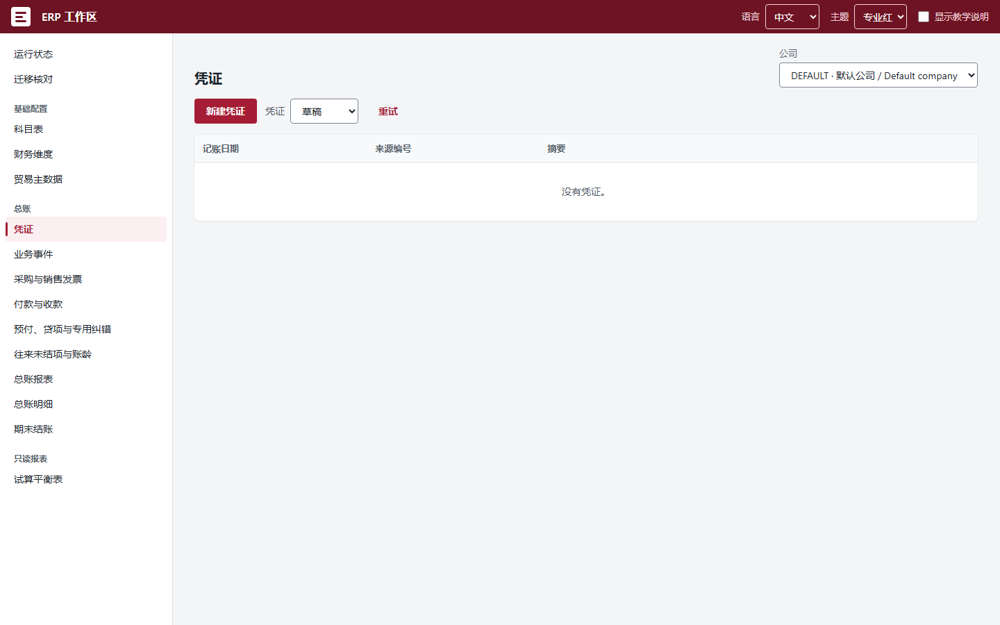 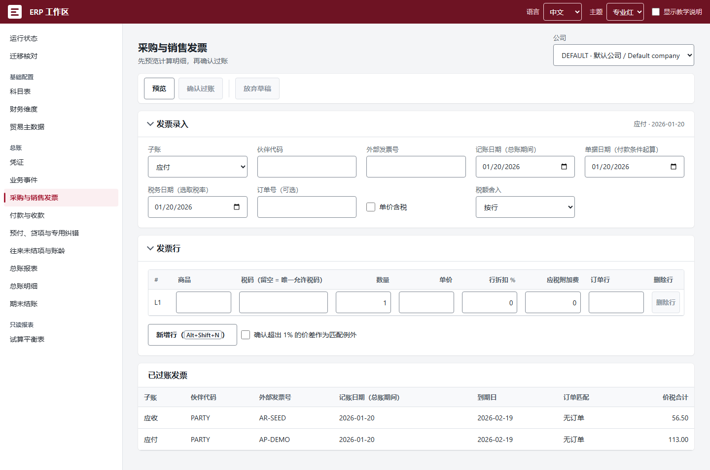 |
| English + 专业绿 | 顶栏语言选 English、主题选专业绿 | 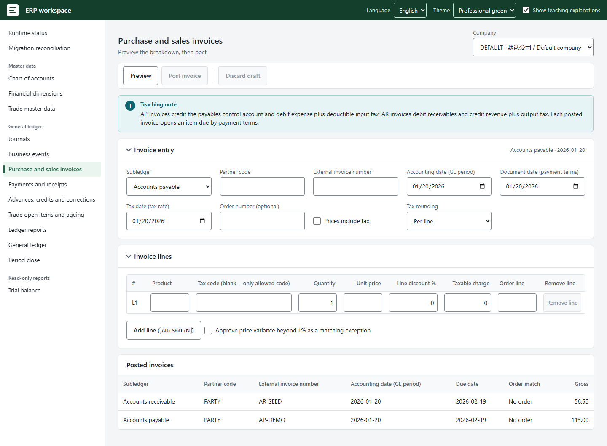 |
| 窄屏 390 px | 导航变为横向条；按钮、输入、选择等控件 ≥ 44px（表格内金额链接高 44px、宽 26–41px）；表格在卡片内滚动，页面无横向溢出 | 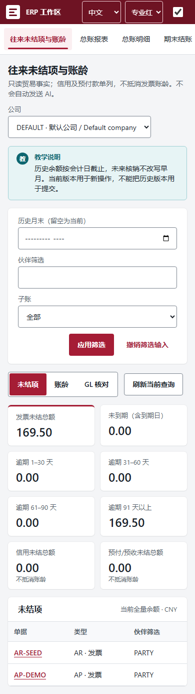 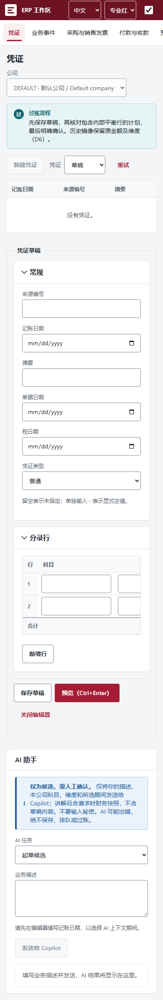 |

## 4. 迁移核对（可选，需要隔离目标库）

迁移核对页只读，显示**已保存**的报告：报告由 `legacy-import` 结束时自动保存，或由 `legacy-reconcile --confirm` 更新。`legacy-reconcile --check` 只读、不保存报告，只在终端输出结论，并给出 `--confirm` 所需的 `knownDifferencesSha256`。重现需要一个隔离的**虚构**快照目录、新目标库，该库必须与演示账套分开，且不得使用真实旧账：

```powershell
# 六项决定全部显式给出；导入范围含 AP/AR 控制科目时必须追加 --opening-items（即使各科目都声明为 empty）
npm run storage:admin -- legacy-import --snapshot-dir <虚构快照目录> --target <全新目标.sqlite> --drafts import-as-draft --receipts archive-only --source-events archive-only --transfer-queue archive-only --seals archive-only --audit archive-only --opening-items <期初明细.json>
npm run storage:admin -- legacy-reconcile --snapshot-dir <同一快照目录> --target <目标.sqlite> --check   # 只读，不保存
npm run storage:admin -- legacy-reconcile --snapshot-dir <同一快照目录> --target <目标.sqlite> --confirm <确认.json>   # 确认文件只含 knownDifferencesSha256
$env:ERP_SQLITE_FILE = "<目标.sqlite 绝对路径>"; $env:ERP_PORT = "4193"   # 再启动 start:local，打开 /#/migration
```

期初明细文件格式与规则见[备份与旧账工具](../../user/backup-and-legacy.md#期初未结项m2-03bd25--d30)。要点：

- 判定顺序：真实差异 > 适用的期初门禁 > 未确认的已知差异 > 通过（差异 > 阻断 > 待确认 > 通过）；不含 AP/AR 控制科目时门禁不适用；
- 子账通过不等于演练放行，演练（M2-05）与切换（M2-06）尚未开始，另需授权。
## 5. 范围与限制

- 界面改版不改会计规则；除第 4 节的迁移入口与期初门禁外，演示的业务操作与 v0.2.0 相同。
- 终版截图由夹具采集，数据为虚构；本脚本未在发布 PR 中重新采集实机截图（以 #82 的 95 张逐像素验证结果为证）。
- 非库存订单仍只有 API；M2-05 / M2-06 未开始。
