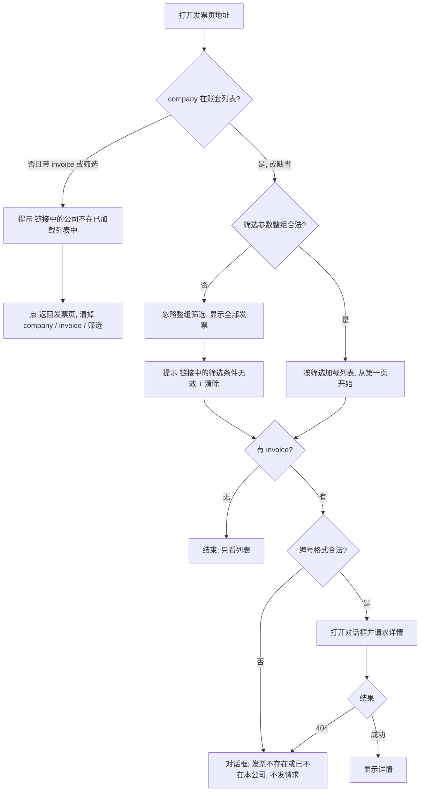
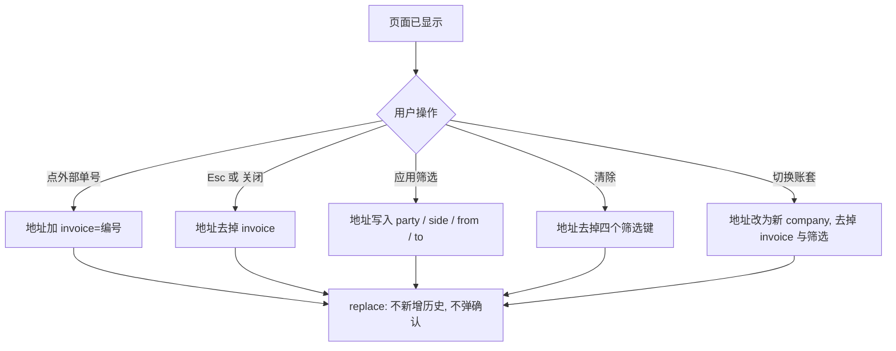

# 发票深链接与地址栏筛选流程（v0.12.0，TINV-07 #208）

页面：发票页 `#/trade-invoices`。图中提示名取自界面中文标签；与代码不一致时以代码和测试为准（`packages/web/src/TradeInvoices.tsx`、`TradeInvoiceDetail.tsx`，标签 `ui/trade-labels.ts`）。参数分三组：账套 `company`、详情 `invoice`、筛选 `party / side / from / to`。判定规则的完整逐项表见 `design/tasks/S12.md` 的 P1–P19。

## 总图：打开一个带参数的地址

说明：

- 打开和刷新时**不改写地址**，非法参数原样留在地址栏，只在用户下一次操作时才被整理。
- `company` 缺省或为空时用当前 / 第一个账套；账套不在列表里但地址不带 `invoice` 或筛选时，同样回落到默认账套。
- 编号属于别的账套时服务端返回 404，显示同一句“不存在”，不泄露它是否存在。

## 细节：操作如何写地址

说明：

- 每次写入都带 `company`；`cursor`、每页条数不写地址；未知参数原样保留；重复参数取第一个，写入时整理为一个。
- “后退”不属于本图：它仍直接离开发票页，有未保存草稿时问一次，取消后地址、对话框和草稿保持不变（取消会丢弃前进历史，D275）。
