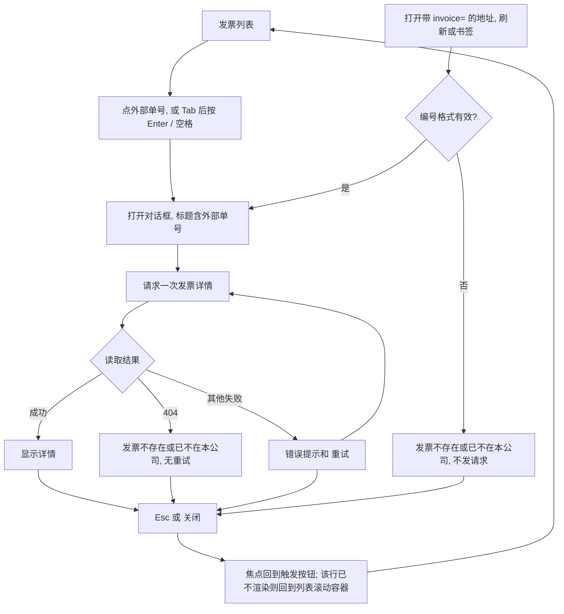
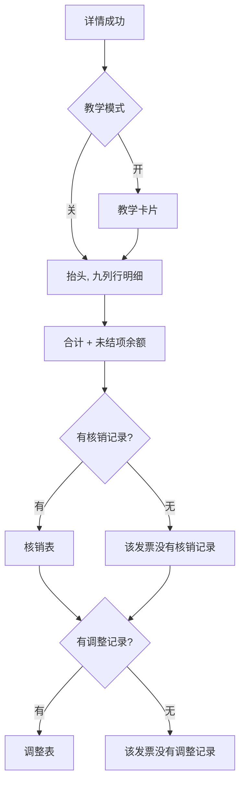
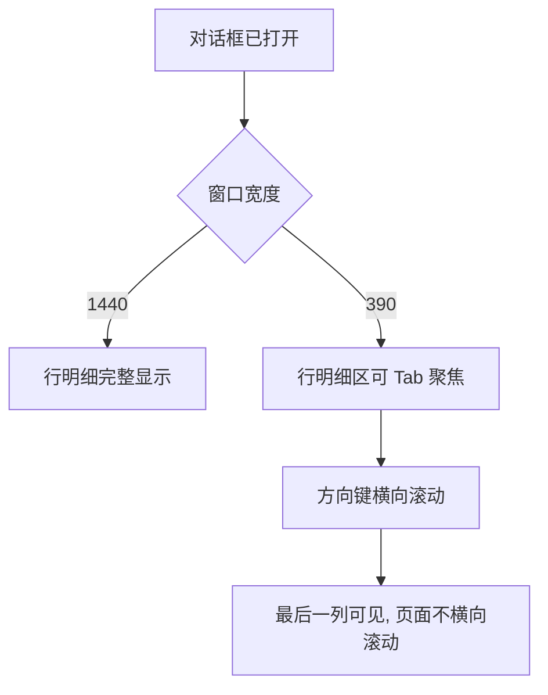

# 发票详情对话框流程（v0.11.0；深链接 v0.12.0）

页面：发票页 `#/trade-invoices` 的发票列表。图中按钮和提示名取自界面中文标签；与代码不一致时以代码和测试为准（`packages/web/src/TradeInvoices.tsx:1286–1297`、`packages/web/src/TradeInvoiceDetail.tsx`）。

## 总图：打开、读取、关闭

说明：

- 每次打开都重新请求一次，不用缓存（`TradeInvoiceDetail.tsx:47–56`）。
- 对话框内 Tab 循环，不跳到页面其他控件（`:65–86`）。
- 焦点：关闭后回到该行的外部单号按钮；若该行已不再渲染（包括深链打开的发票不在已加载页），回到列表滚动容器（`TradeInvoices.tsx:1212–1223`）。
- TINV-07（v0.12.0）：打开时地址写入 `?company=…&invoice=<documentId>`，关闭时去掉 `invoice`（保留 `company=` 和已应用筛选）。都用 replace（`history.replaceState`），不新增浏览器历史、不触发离开确认；筛选、已加载页和滚动位置不变。草稿未保存时后退照常确认一次，取消后地址、对话框和草稿都保留。
- 深链打开时标题的外部单号取已加载行，否则取详情响应；读取前标题为“发票详情”。
- 非法参数：`invoice=` 为空不打开；格式不是 36 位 documentId 时显示“不存在”且不发请求（`TradeInvoiceDetail.tsx:28`、`:51–56`）；未知 id、其他公司的发票由服务端返回 404，同样显示“不存在”，无重试。地址里的账套不存在时不打开对话框，见筛选流程。
- 与 `fromOrder` 同时出现时：`fromOrder` 照旧带入草稿后从地址去掉，`invoice` 和筛选保留。
- 详情读取失败和 404 的文案：`:96–126`。

## 细节：详情内容

说明：区块顺序见 `TradeInvoiceDetail.tsx:184–330`；教学卡片 `:186–192`。

## 细节：390 宽与键盘

说明：滚动区是 `<section tabIndex=0>`（`:205–210`）；断言见 #199 / #200 的端到端场景。
