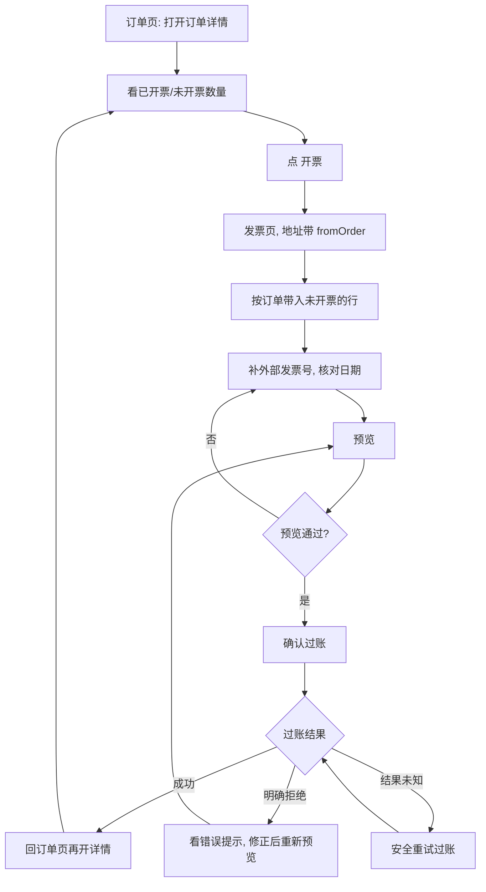
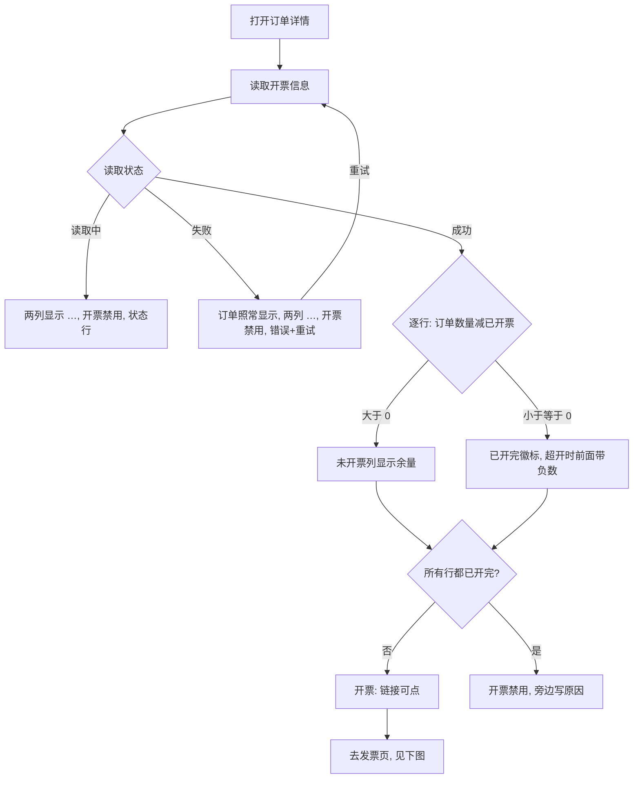
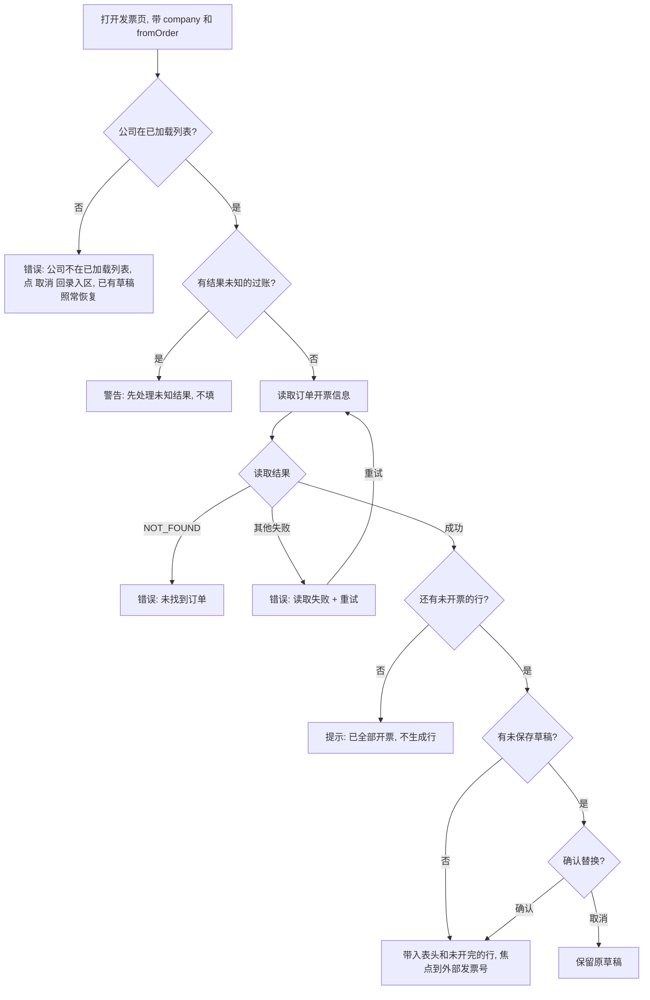

# 从订单开票流程（v0.8.0）

页面：订单页 `#/trade-orders` 的订单详情，和发票页 `#/trade-invoices`。“开票”只带入一份发票**草稿**，不过账；过账仍走发票页的“预览 → 确认过账”。图中按钮和提示名取自界面中文标签；与代码不一致时以代码和测试为准。

## 总图：从订单到过账

## 细节：订单详情的数量与“开票”入口

每次打开订单详情（保存后、按订单号查询、点列表里的订单号）都读一次开票信息，不沿用缓存。

## 细节：发票页按订单带入

链接形如 `#/trade-invoices?company=<公司>&fromOrder=<订单号>`。请求只处理一次，处理时就从地址里去掉 `fromOrder`，刷新不会再填。

说明：

- 带入的数量是订单数量减去已开票数量（精确小数）；已开完的行不带入；草稿里的行号重新编为 L1、L2…，每行保留订单行号用于过账匹配。
- “公司不在已加载列表”分支不读订单、不显示录入区；点“取消”或改选其他公司后，这次带入请求被丢弃，回到录入区，该账套已有的草稿（包括尚待处理的过账）照常恢复。
- TINV-07：从首次渲染起就按地址里待处理的 `fromOrder` 拦截，即使公司列表已在缓存里，也不会在去掉 `fromOrder` 之前先显示默认账套；公司列表未确认（加载中、重新拉取中或失败）时不显示录入区。
- 只有错误码 `NOT_FOUND` 显示“未找到订单”；其他失败（包括其他 400、503、网络错误）显示“读取订单失败”并可重试。
- 打开教学模式时，带入成功后教学提示末尾多一句“数量按订单未开票数量带入……”。
- 过账时仍按订单逐行匹配校验（数量不超剩余、单价偏差等规则见[贸易](../user/trade.md#采购与销售发票)），本图不重复。
