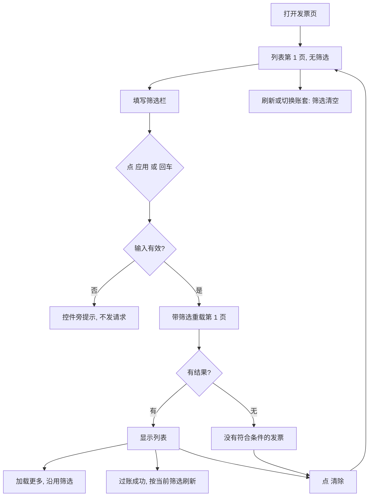
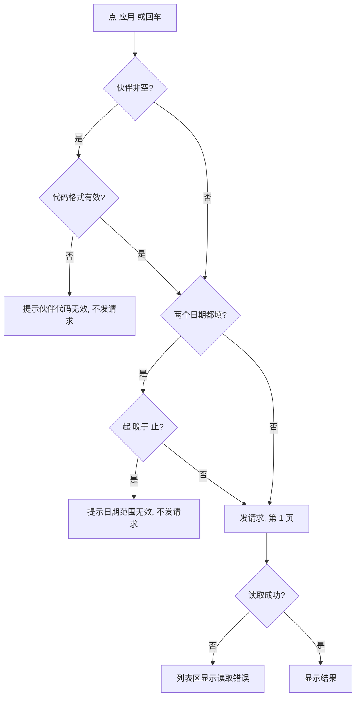
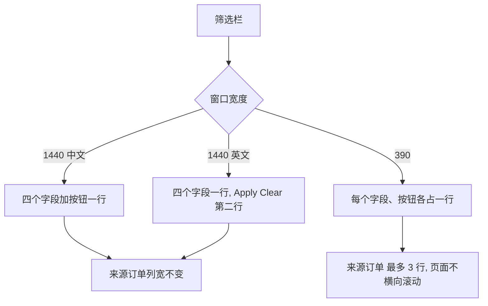

# 发票列表筛选流程（v0.10.0）

页面：发票页 `#/trade-invoices` 的发票列表。图中按钮和提示名取自界面中文标签；与代码不一致时以代码和测试为准（`packages/web/src/TradeInvoices.tsx:1073–1226`、`:1288`）。

## 总图：筛选与列表

说明：

- 筛选项：伙伴（伙伴代码）、方向（全部 / 采购 AP / 销售 AR）、记账日期起、记账日期止（闭区间）。`:1162–1226`
- 一张发票都没有时显示原来的空列表文案，不是“没有符合条件的发票”。
- 筛选只在页面状态里，不写地址栏，不影响浏览器历史；只改筛选栏不会弹离开确认。刷新、切换账套后清空。`:1077–1078`
- 取消离开确认会截断前进历史（D275，沿用 v0.9.0）。

## 细节：输入校验

说明：

- 提示通过 `aria-describedby` 与控件关联；校验见 `TradeInvoices.tsx:1114–1121`。
- 方向没有“无效”状态（只能选下拉项）。
- 伙伴不存在时服务端返回空页，界面显示“没有符合条件的发票。”。

## 细节：窄屏布局

说明：来源 #189 正文 §6.2 与端到端场景 `trade-gui-scenario.ts:1420–1429`、`:1448`。
