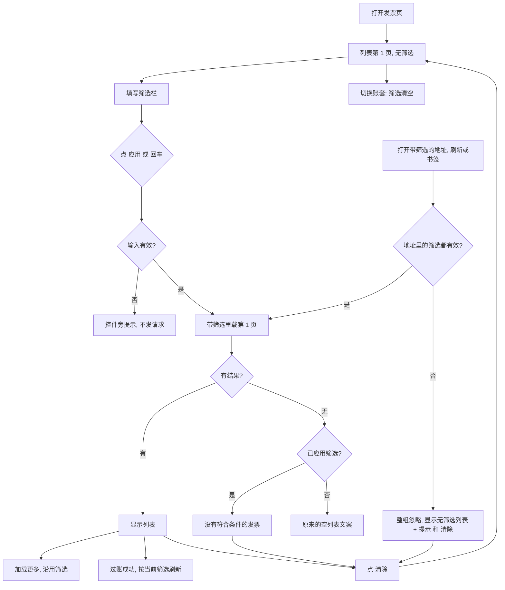
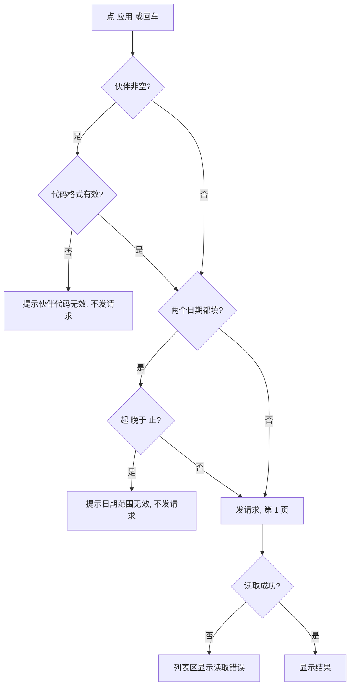
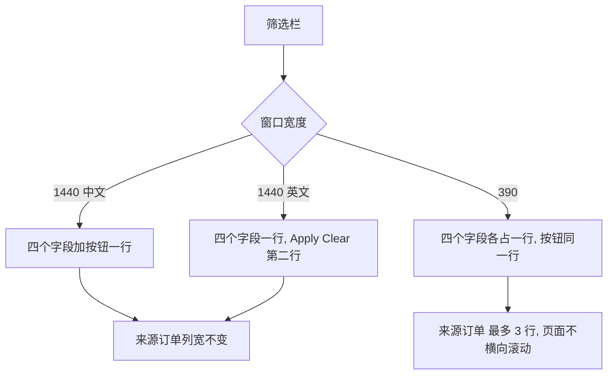

# 发票列表筛选流程（v0.10.0；地址栏 v0.12.0）

页面：发票页 `#/trade-invoices` 的发票列表。图中按钮和提示名取自界面中文标签；与代码不一致时以代码和测试为准（`packages/web/src/trade-invoices/invoice-list.tsx:23–326`、挂载处 `packages/web/src/TradeInvoices.tsx:195`）。

## 总图：筛选与列表

说明：

- 筛选项：伙伴（伙伴代码）、方向（全部 / 采购 AP / 销售 AR）、记账日期起、记账日期止（闭区间）。`:1162–1226`
- 空列表文案按“是否已应用筛选”选择（`:1402`）：已应用筛选且无结果显示“没有符合条件的发票。”；没有已应用的筛选且列表为空显示原来的空列表文案。不按账套里发票总数判断。
- TINV-07（v0.12.0）：已应用的筛选写入地址栏 `?company=…&party=…&side=…&from=…&to=…`，只用 replace（`history.replaceState`，`:353–362`），不新增浏览器历史；所以只应用或清除筛选不会弹离开确认，后退仍回到进入发票页之前的页面。刷新和书签按地址恢复筛选；未应用的草稿筛选不进地址。
- 地址里的筛选按服务端同一校验（`tradeInvoiceListQuerySchema`，`linkFilter` `:1122`）；任一项无效（伙伴格式、方向、日期、起晚于止）则整组忽略，列表显示无筛选结果，筛选栏上方提示“链接中的筛选条件无效，已忽略；当前显示全部发票。”并给出 清除。
- 切换账套时地址里的筛选和打开的发票一并清除，只留 `company=`。
- 地址里的账套不存在时不显示任何账套的列表，提示“链接中的公司不在已加载列表中，未打开”并给出 返回发票页（`:369`）。
- 取消离开确认会截断前进历史（D275，沿用 v0.9.0）。

## 细节：输入校验

说明：

- 提示通过 `aria-describedby` 与控件关联；校验见 `trade-invoices/invoice-list.tsx:73–89`。
- 方向没有“无效”状态（只能选下拉项）。
- 伙伴不存在时服务端返回空页，界面显示“没有符合条件的发票。”。

## 细节：窄屏布局

说明：来源 #189 正文 §6.2 与端到端场景 `trade-gui-scenario.ts:1420–1429`、`:1448`。
