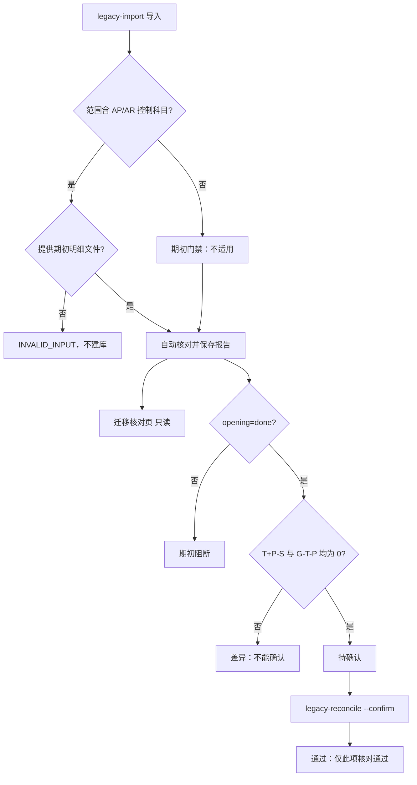

# 迁移核对页与 D26 门禁（M2-03b / M2-04 / M2-04b）

迁移核对页（`/#/migration`）只读，只显示命令行生成并保存的报告。判定优先级：**差异 > 阻断 > 待确认 > 通过**。

- T = 贸易 GL，S = 子账，P = 期初未结项原始金额，G = 全部 GL。M2-04 首批的 T−S、G−T 只作展示，不作判定。
- 子账通过不等于演练放行；演练（M2-05）和切换（M2-06）尚未开始，另需用户授权。
- 期初未结项可核销、可用预付 / 预收应用，**不能**开贷项或取消（D30）。
