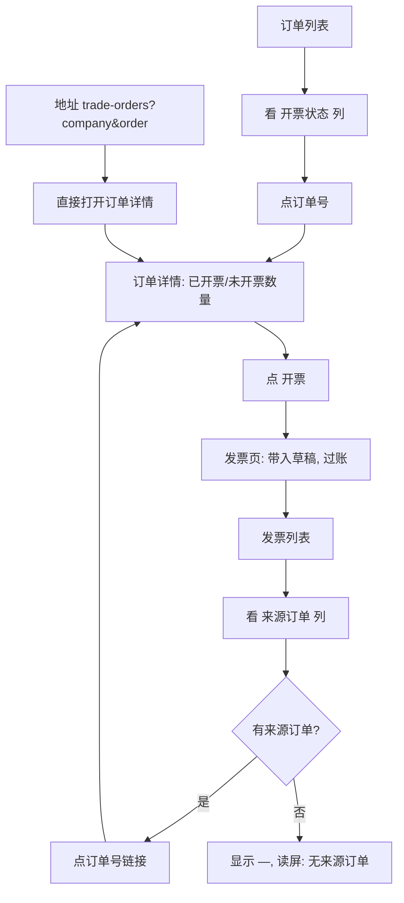
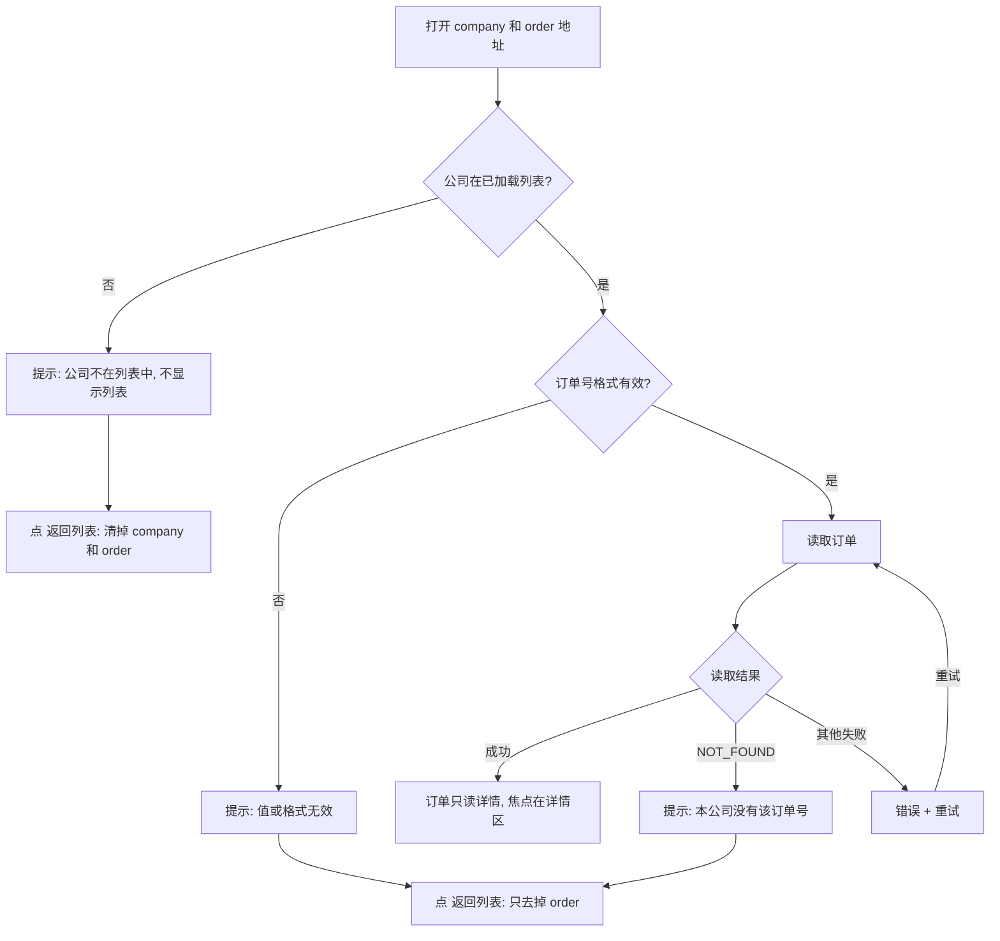
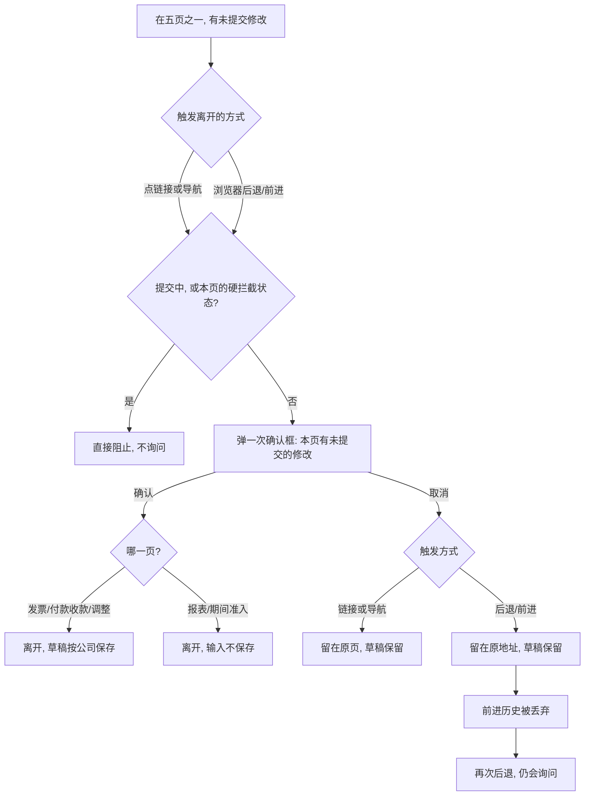

# 订单与发票互相追溯、统一离开确认流程（v0.9.0）

页面：订单页 `#/trade-orders`、发票页 `#/trade-invoices`，以及发票、付款与收款、调整、报表、期间准入五页的离开确认。图中按钮和提示名取自界面中文标签；与代码不一致时以代码和测试为准。从订单开票本身见[从订单开票流程](invoice-from-order-flow.md)。

## 总图：订单 ↔ 发票

## 细节：订单页深链接

地址形如 `#/trade-orders?company=<公司>&order=<订单号>`。参数出现就校验，空值也算。

说明：

- 只带 `company` 时只切换公司；缺省 `company` 时在当前公司下打开 `order`。
- “返回列表”在订单号无效 / 订单不存在时只去掉 `order`：地址里原本有 `company` 就保留，没有就继续没有，不会补写。焦点回到订单列表的折叠按钮；公司不在列表时焦点回公司下拉框。
- 改选公司会重写 `company` 并去掉 `order`，打开另一张订单会重写 `order`。
- 有未保存的订单草稿时沿用订单页自己的离开确认。

## 细节：五页统一离开确认

适用：发票、付款与收款、预付 / 贷项 / 纠错、往来报表、期间准入。订单页和主数据编辑器文案不同，后退 / 前进的处理用同一个共享模块。

说明：

- 发票、付款与收款、调整页的草稿和待处理过账按公司保存在 sessionStorage，返回同一公司时恢复；报表、期间准入页没有这类草稿。
- 报表、期间准入页旧版有未提交修改时直接阻止跳转，现在确认后可以离开。仍直接阻止（不询问）的情况：提交进行中或结果未知；付款与收款、调整、期间准入页还包括存在待重试的请求；期间准入页还包括本地待确认记录无法读取。发票页的待重试不硬拦截：它算未保存修改，后退会询问，确认后可以离开；报表页没有提交状态。
- 取消后再次后退，仍会再询问一次，确认才离开。
- 取消后退 / 前进通过在当前位置之后重新加入原地址实现，不调用 `history.go`，所以原来在前方的历史项会被丢弃（D275 已接受的限制）。
- 第一个字符输入后紧接着后退也会询问；真实 Chrome 中后退不弹框的问题已在 v0.9.0 修复。
