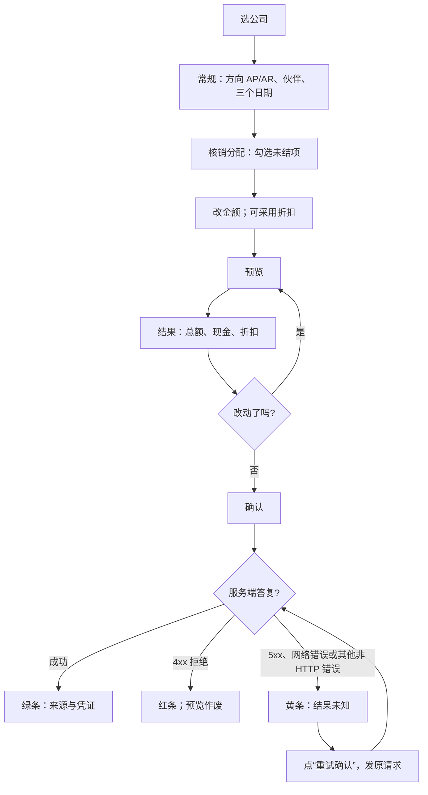
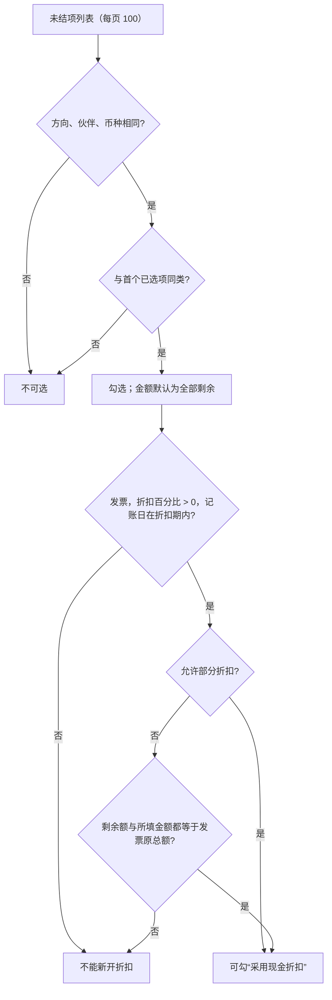
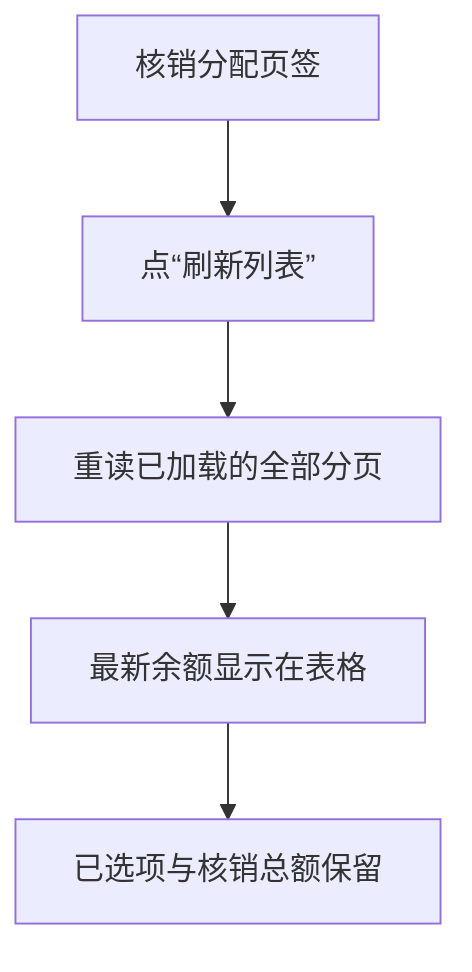
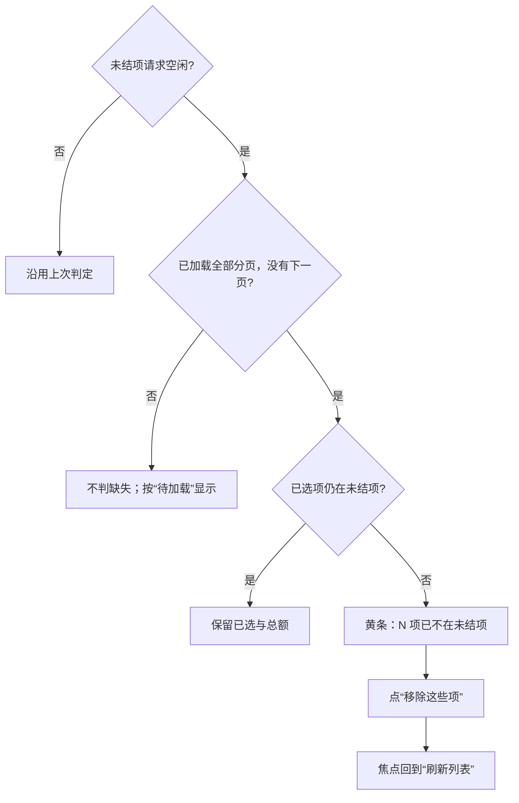
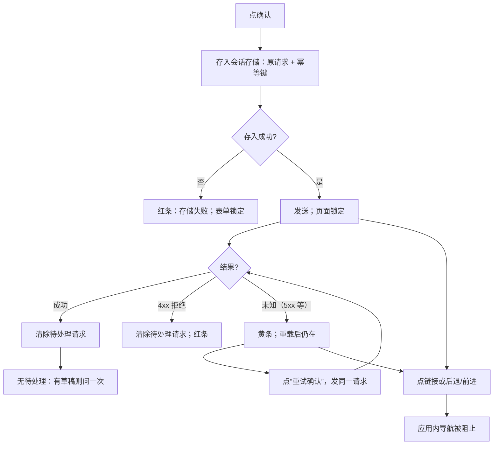

# 付款与收款页流程

页面：侧栏“贸易往来”→“付款与收款”。付款（AP）与收款（AR）是同一页，由“方向”区分。这是**账面核销**，不表示银行已支付。操作步骤见[贸易](../user/trade.md#付款与收款)；本页只画界面路径，以代码为准（`packages/web/src/TradeSettlements.tsx` 与 `packages/web/src/trade-settlements/`）。

## 总览：从选伙伴到确认

- “结果未知”不只是没有答复：5xx、网络错误，以及其他不被归为 4xx 的失败都按未知处理（`settlement-commands.ts` 的 `confirmSettlement`）。
- 重试走黄条上的“重试确认”按钮，用原请求和原幂等键；此时“确认”按钮是锁定的，不能用它重试。
- 改方向或伙伴会**清空已选项**；改日期、金额、折扣勾选会使旧预览作废，须重新预览。
- 预览按钮在没有已选项时不可用；确认按钮在没有预览时不可用。
- 成功后草稿换成新的付款编号并清空已选项，然后重读未结项列表。

## 核销分配：能选什么

- 折扣期指记账日在单据日期与折扣截止日之间（含）。不允许部分折扣时，只核销过一部分的发票即使这次付清余额也不能采用折扣。
- 折扣控件在已选行上可能仍可见，但条件不满足时不能新勾选（已勾选的可取消）。

- “同类”指发票与非发票（预付、贷项）不能混选；一次最多选 100 项（`MAX_SELECTED_ITEMS`）。
- 改某项金额会取消该项的折扣勾选；符合折扣条件不等于采用折扣，必须勾选。
- 超过 100 行未结项时出现“加载更多”；行数多时表格虚拟滚动。

## 刷新列表（v0.21.0）

- 刷新（v0.21.0 起）不清空草稿，也不弹离开确认；确认结果未知时仍可用，见 `settlement-allocation-tab.tsx`、`use-open-items.ts`。

### v0.21.0 之后的 main：“已不在未结项”提示（TSET-01，#320）

这条路径**不在 v0.21.0 标签里**，只在其后的 main 上；发布版本未定，以所用版本的界面为准。

- 判定条件是请求空闲、没有下一页，而不只是“刷新完已加载分页”（`settlement-missing-notice.tsx`）。提示出现后，预览前须先移除这些项。

## 结果未知与离开页面

- 有待处理请求时表单整体锁定，重试发送的是**原请求和原幂等键**，不会重复过账。
- 从发送开始，到结果成功或被 4xx 拒绝为止，应用内链接和浏览器后退/前进都被**直接阻止**，不询问；结果变成“未知”之后仍然阻止，直到重试得到明确结果。
- 没有待处理请求、但有未提交的草稿（已填伙伴或已选项）时，应用内导航会弹一次确认；草稿在会话存储中，返回同一公司时恢复。
- 关闭或刷新浏览器标签页（unload）不是应用内阻止：有待处理请求或未提交草稿时由浏览器自己的原生提示询问，用户仍可选择离开。（`use-invoice-leave-guard.ts`）
