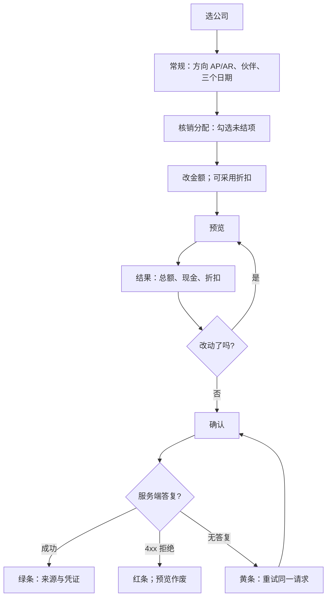
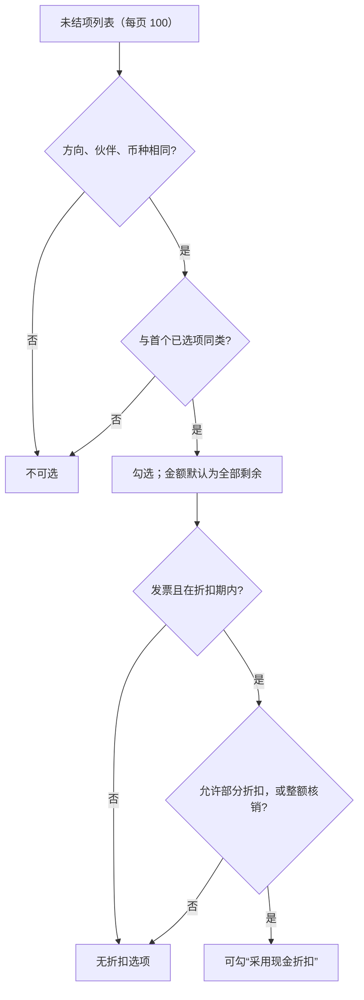
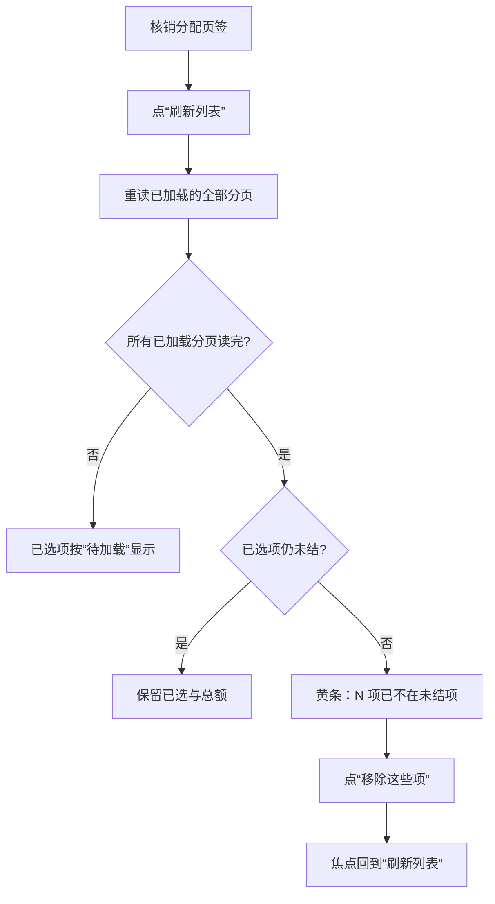
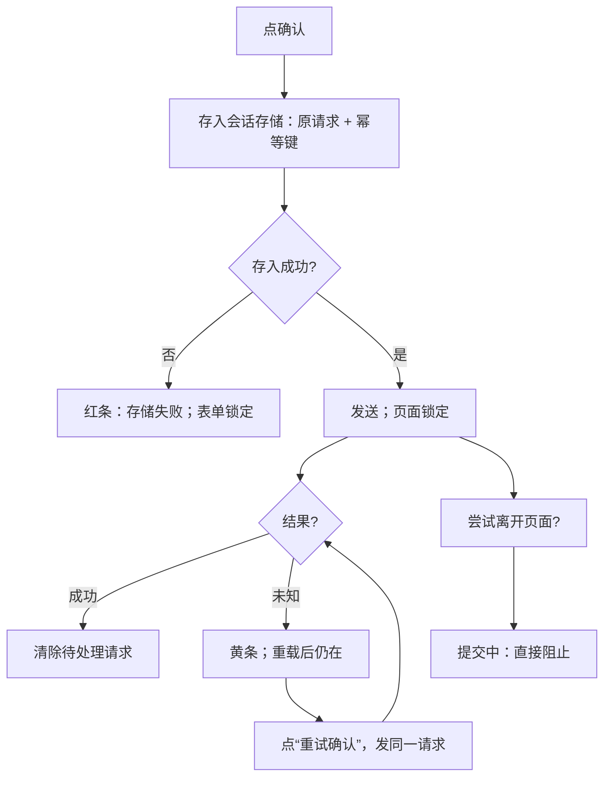

# 付款与收款页流程

页面：侧栏“贸易往来”→“付款与收款”。付款（AP）与收款（AR）是同一页，由“方向”区分。这是**账面核销**，不表示银行已支付。操作步骤见[贸易](../user/trade.md#付款与收款)；本页只画界面路径，以代码为准（`packages/web/src/TradeSettlements.tsx` 与 `packages/web/src/trade-settlements/`）。

## 总览：从选伙伴到确认

- 改方向或伙伴会**清空已选项**；改日期、金额、折扣勾选会使旧预览作废，须重新预览。
- 预览按钮在没有已选项时不可用；确认按钮在没有预览时不可用。
- 成功后草稿换成新的付款编号并清空已选项，然后重读未结项列表。

## 核销分配：能选什么

- “同类”指发票与非发票（预付、贷项）不能混选；一次最多选 100 项（`MAX_SELECTED_ITEMS`）。
- 改某项金额会取消该项的折扣勾选；符合折扣条件不等于采用折扣，必须勾选。
- 超过 100 行未结项时出现“加载更多”；行数多时表格虚拟滚动。

## 刷新列表与“已不在未结项”

- 刷新（v0.21.0 起）不清空草稿，也不弹离开确认；确认结果未知时仍可用，见 `settlement-allocation-tab.tsx`、`use-open-items.ts`。
- 已选项只有在未结项全部加载完后才可能被判为“已不在”；加载未完时不算缺失。预览前须移除这些项。

## 结果未知与离开页面

- 有待处理请求时表单整体锁定，重试发送的是**原请求和原幂等键**，不会重复过账。
- 有未提交的草稿（已填伙伴或已选项）时，离开会弹一次确认；草稿在会话存储中，返回同一公司时恢复。
