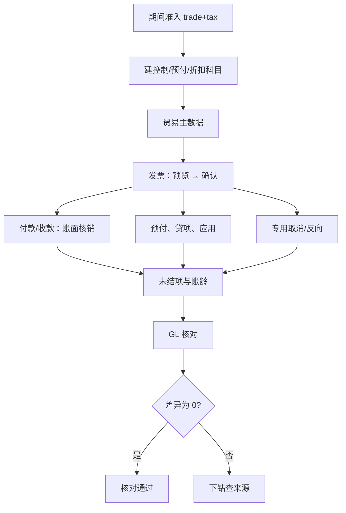
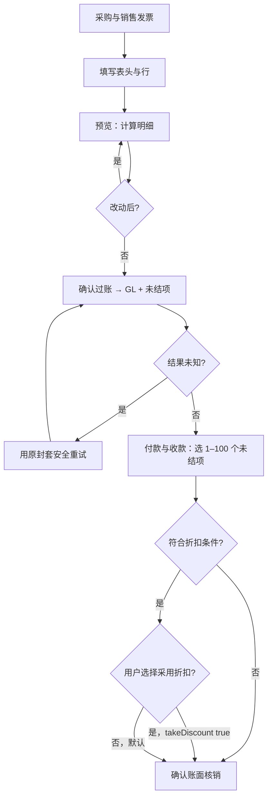
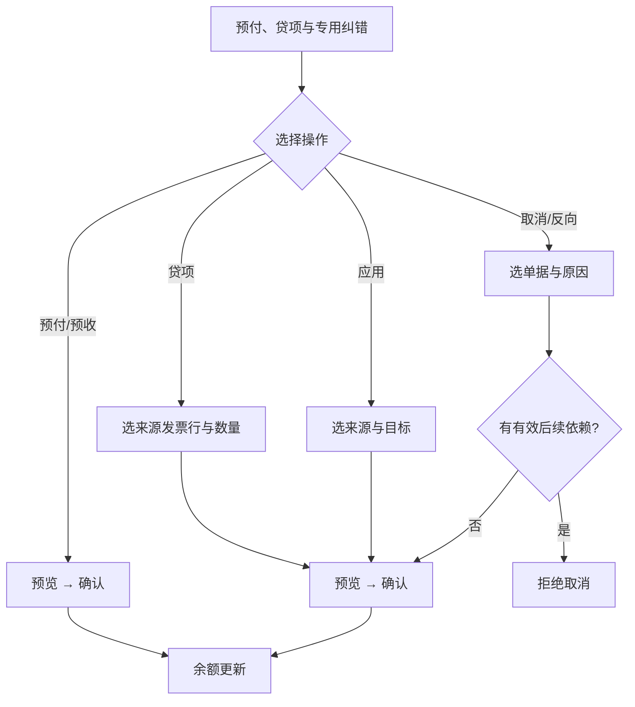
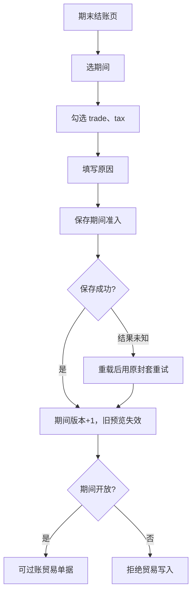
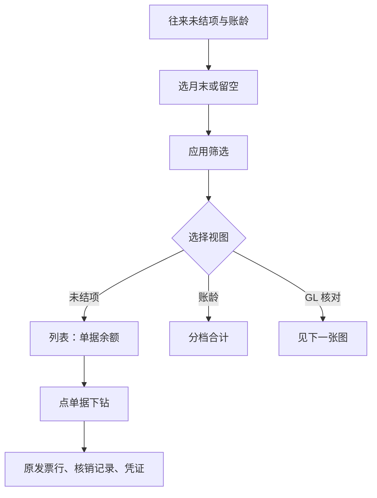
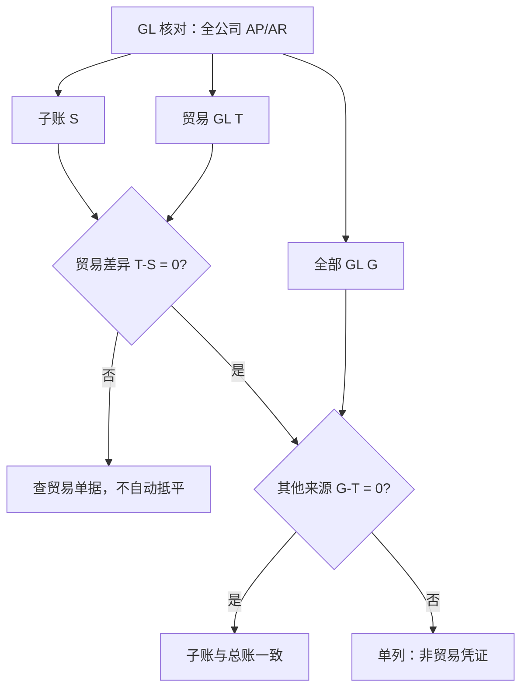
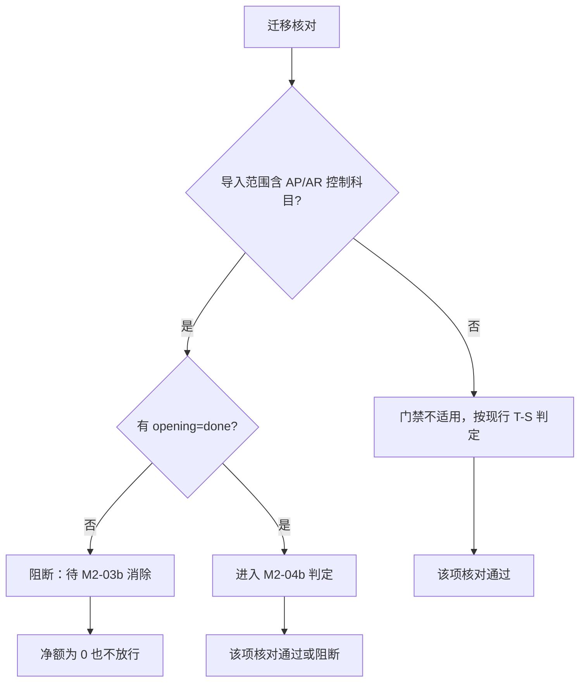

# 贸易流程

## 总图：从准入到核对

## 发票与付款

“用户选择”一步：符合折扣条件不等于采用折扣，只有勾选“采用现金折扣”才计入。

## 预付、贷项与专用纠错

## 期间准入

## 未结项与账龄

## GL 核对口径（v0.2.0）

M1 口径：`tradeDifference = T − S`，`otherSource = G − T`；两者分列，从不自动抵平。其他来源非零不是贸易错误，但也不能当作已核对。

## 迁移核对的期初门禁（D26，未完成）

分两批验收，判定式不同：

| 批次 | 判定 | 无 `opening=done` 时 |
| --- | --- | --- |
| M2-04 首批 | 复用现行口径：`tradeDifference = T − S`，`otherSource = G − T` | 阻断 |
| M2-04b（M2-03b 合并后） | 加入期初项 P：`tradeDifference = T + P − S`，`otherSource = G − T − P` | 阻断 |

P 为期初未结项原始金额；`opening=done` 来自 M2-03b。导入范围含 AP/AR 控制科目时必须提供期初明细文件，即使各科目都声明为 empty。

**子账核对通过只代表这一项核对通过，不代表演练放行。** M2-05 演练放行仍要看全部核对结果和确认，按 M2-05 的规则；M2-05 是演练，M2-06 才是切换。当前 v0.2.0 只有 M1 口径；LEGACY 凭证（来源 `LEGACY`）在核对中列为“其他来源”。