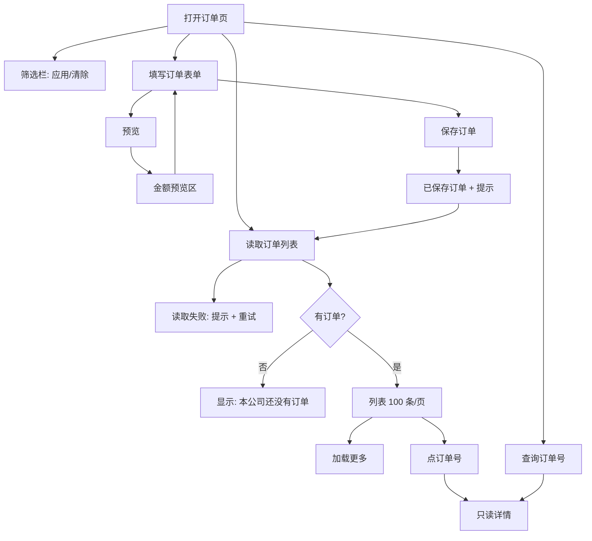
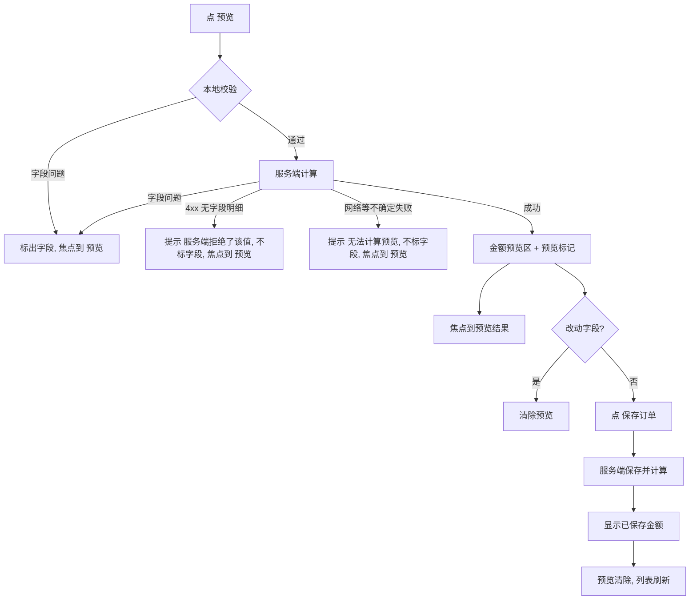
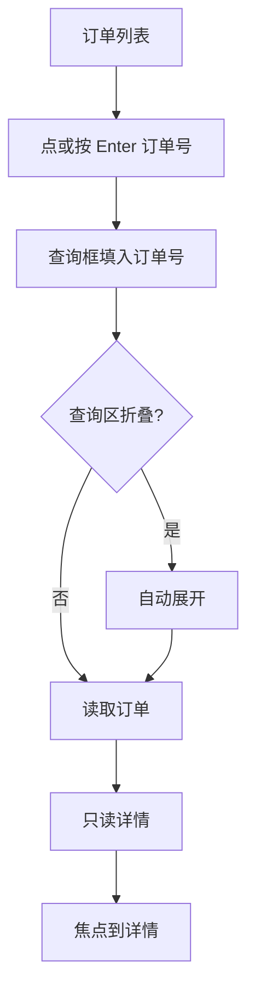
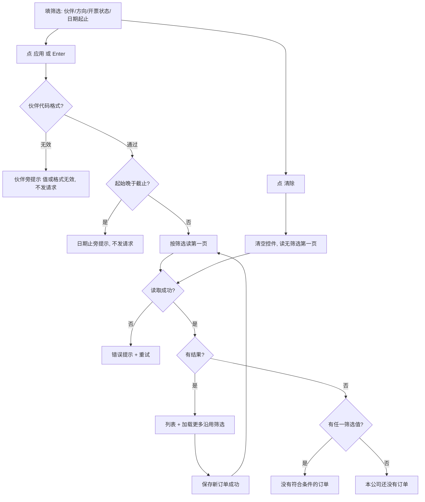

# 采购 / 销售订单页流程（v0.6.0；列表筛选 v0.7.0；筛选写入地址栏 TORD-07）

页面：`#/trade-orders`。订单不过账、不生成凭证。图中按钮名取自界面中文标签；与代码不一致时以代码和测试为准。

v0.8.0 起订单详情有已开票 / 未开票数量和“开票”入口，见[从订单开票流程](invoice-from-order-flow.md)；v0.9.0 起订单列表有“开票状态”列并支持 `?company=&order=` 深链接，见[订单与发票互相追溯流程](order-invoice-trace-flow.md)。

## 总图：列表、预览、保存、查询

## 细节：预览与保存

## 细节：从列表查看

## 细节：列表筛选（v0.7.0）

筛选栏在列表为空时也可用。

四项都留空时点“应用”等同无筛选，空页显示“本公司还没有订单。”。服务端拒绝（如非法值）不在本地拦截，走读取失败分支。

## 细节：筛选写入地址栏（TORD-07）

- 已应用的筛选写入地址 `?company=…&party=…&side=…&invoicing=…&from=…&to=…`，只用 replace（`history.replaceState`），不新增浏览器历史；应用或清除筛选不弹离开确认，也不清掉表单草稿。未应用的草稿筛选不进地址；未设置的筛选不写键。
- 刷新、书签或粘贴链接按地址恢复筛选并读第一页；打开时不改写地址。每次应用、清除、刷新、切换账套各只读一次第一页，写地址不另发请求。
- 地址里的筛选整组校验：任一项非法（伙伴代码格式、方向或开票状态拼写、日期、起始晚于截止）就整组忽略，显示全部订单，并在筛选栏上方提示“链接中的筛选条件无效”，提示里的“清除”一次 replace 去掉筛选键。空值视为未填；同名键只取第一个；`cursor`、`limit` 和未知键保留不用。
- 每次写地址都带 `company`（任务书范围第 3 条）：从无效 / 不存在订单的提示“返回列表”写入当前账套并保留筛选；从未知账套的提示返回时写入页面回退显示的账套（等同切换账套）。
- 切换账套清空筛选与 `order`，用 replace 写地址，并重新只读该账套第一页（不复用此前已加载的多页缓存）；表单有草稿时仍先确认（D423）。
- 订单详情的数量、已开票数量、单价、折扣按界面语言加千分位（未开票数量保持精确值）。