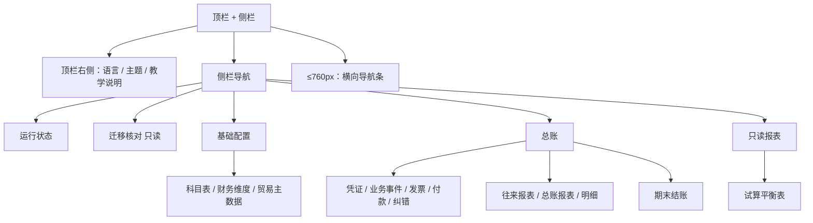
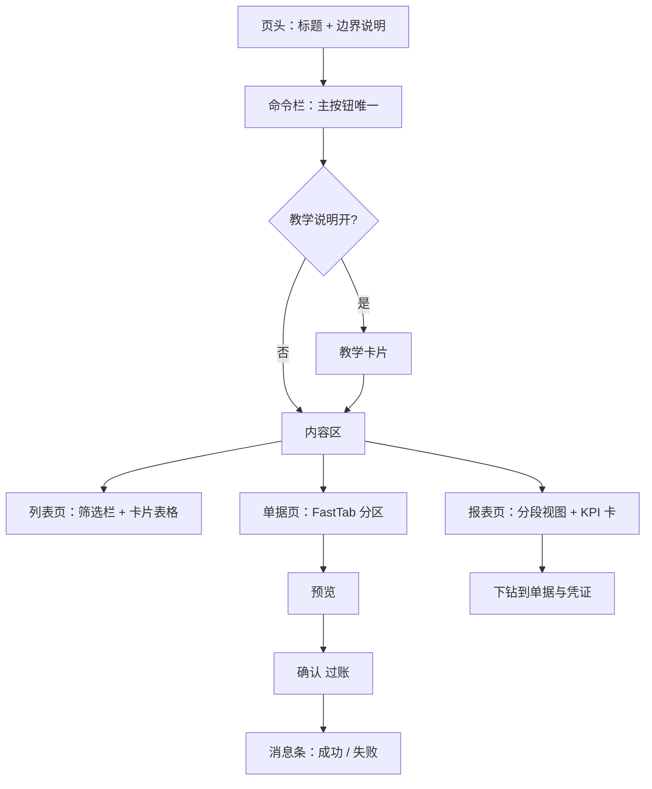

# 界面外壳与页面模板（UI-1）

v0.3.0 起全站共用同一外壳和三类页面模板。下图说明用户如何在页面间移动，以及每类页面的组成。

## 外壳与导航

## 页面模板

## 说明

- “教学说明”只控制教学卡片；页头边界说明、风险 / 错误消息条与 AI 面板的“仅为候选，需人工确认。”始终显示。
- 预览永不自动确认；取消、反向等操作的确认按钮为红色危险按钮。
- 点击区：桌面 36px，窄屏或粗指针 44px；390px 宽无页面横向溢出。
- 规范与模板细节见 [UI-1 设计规范](../../design/ui/README.md)。
