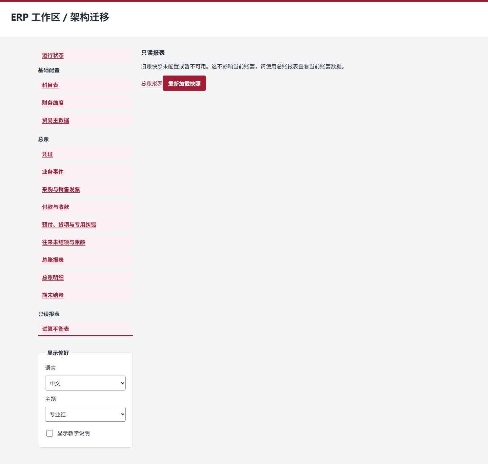

# 备份与旧账工具

备份、快照、导入和确认使用**命令行**；当前工作区提供只读“迁移核对”页。

## 备份与恢复（M0-R5）

```powershell
npm run storage:admin -- backup <db> <out>
npm run storage:admin -- restore <db> <in>   # 先停止服务
```

备份使用 SQLite 在线备份并校验；输出已存在、与目标同名或为保留路径时拒绝。恢复需离线，替换前自动生成带时间戳的完整 `.bak`，失败则校验回滚。不要手动删除 WAL/SHM/journal 文件。

## 旧账快照（M2-01）

```powershell
npm run storage:admin -- legacy-snapshot --source-dir <已停写的隔离源目录> --out-dir <不存在的新目录>
```

仅 Windows；两个路径必填，无默认值；源目录须已停止并隔离（独占句柄，冲突则 `SOURCE_BUSY`），残留 `-journal` 则拒绝。**对真实旧账的操作须另行取得授权**，开发和 CI 只用虚构夹具。生成的快照与备份不得提交到 Git。详见 [legacy-snapshot.md](../legacy-snapshot.md)。

## 导入映射与 dry-run（M2-02）

映射器仅有库代码与测试，没有独立命令行或界面入口；不打开或写入任何目标库。决定 C（草稿、回执、来源事件、队列、封印、审计的处理）无默认值。

## 隔离导入与核对（M2-03 / M2-04）

```powershell
npm run storage:admin -- legacy-import --snapshot-dir <已验证快照目录> --target <全新目标.sqlite> --drafts import-as-draft --receipts archive-only --source-events archive-only --transfer-queue archive-only --seals archive-only --audit archive-only
npm run storage:admin -- legacy-reconcile --snapshot-dir <同一快照目录> --target <目标.sqlite> --check
npm run storage:admin -- legacy-reconcile --snapshot-dir <同一快照目录> --target <目标.sqlite> --confirm <用户确认.json>
```

此示例显式保留草稿，其他五类只归档；它不是对真实旧账操作的授权。不可映射对象仍须先解决才能执行导入。只使用虚构夹具开发、测试和性能验收。

只接受已校验 SHA 的快照、新目标路径和全部六项决定，不读取活动旧账、4173 或 `.bak`；拒绝合并或覆盖已有业务库。同一工具的未完成导入可用同一命令断点续跑。全程持有独占维护锁；硬终止遗留的锁须由操作员确认进程已停止后处理，不会自动删锁。历史凭证来源显示为 `LEGACY`，原结转只落账一次，不补造业务回执、不重复生成结转；`archive-only` 的证据留在原只读快照中。

导入结束时在原维护锁内自动核对，核对读取同一事务内的末批数据，不另写业务数据。**末批、核对报告与最终状态在同一事务提交**：发现实际差异时一起保存报告并标记 `failed`，保留目标供排查，业务运行时拒绝打开；其他情况一起保存报告并转为 `imported`。核对或提交前中断会回滚末批，run 保持 `importing`；以同一快照和六项决定再次执行原导入命令，从已提交游标续跑，不重复导入已提交分录。不会留下 `imported` 却没有报告的正常提交状态。判定优先级为 `difference`（差异）> `blocked`（阻断）> `pending`（待确认）> `pass`（通过），非通过均非零退出。每月每阶段金额、科目余额、维度、期间、草稿、凭证与分录引用和数量共同决定结论，不能只看行数。

`--check` 只以 readonly 连接读取快照和目标，不运行初始化、迁移或种子，不保存报告；计算用的临时表与目标业务库分离，目标文件字节不变。报告列出已知差异的分类、数量、完整旧引用清单及 `knownDifferencesSha256`。用户逐项核实后，自行提供以下 JSON（散列必须复制自本次完整清单，不能用示例占位值）：

```json
{"knownDifferencesSha256":"<本次报告中的 SHA-256>"}
```

确认持有独占维护锁，在同一读事务取 W 并核对，再用写事务复查 `write_seq`，原子保存通过报告、报告 SHA、确认文件原始字节 SHA、首次基线 W 与 `reconciled` 状态；不修改业务数据，不递增 `write_seq`。清单不匹配不会确认。已确认后的重复确认只检查当前序号是否仍为 W：相同则不写任何东西，不同则拒绝，不能重建 W；必须作废整个目标，从快照重新导入。

新增迁移 **015** 专门存放上述报告和确认元数据，数据库约束禁止通过 UPDATE、DELETE、INSERT OR REPLACE 或 REPLACE 改写已确认基线（不依赖 recursive_triggers）；未确认报告仍可正常刷新。run 上预留 nullable `opening` 阶段标记和 **`opening_details_sha`**（64 位小写十六进制 SHA-256）。M2-03b 应在首次建立 run 时把用户明细文件原始字节的 SHA 写入该列，续跑时比较同一列绑定输入身份；它不属于 `choices` 中的六项决定 C，`opening=done` 也不能替代此 SHA。本任务只预留存储，不实现明细文件读取或导入。新导入目标自动使用最新结构；旧版 014 的隔离导入目标可只读检查，需确认时请从同一快照导入一个新的 015 目标，而不是由核对命令隐式升级。

配置 `ERP_SQLITE_FILE` 为隔离目标后，在工作区导航“迁移核对”（`/#/migration`）查看已存报告；`/api/v1/migration` 仅接受同源 GET，不执行核对或财务写入。未确认或失败的目标只开放报告，不初始化业务账套。页面支持中/英、红/绿和原生键盘展开明细。报告是保存时的结论，不是实时业务健康证明。

**核对通过不等于允许切换。** 演练（M2-05）和切换（M2-06）仍需另行取得用户授权，本功能没有演练、切换或写操作按钮。

D25 / D26 的统一规则是 **AP/AR 期初未结项解释控制科目期初 GL，不能留下未解释差额**。本功能直接调用现有 `tradeReconciliation`，在目标最后过账日逐科目展示 `subledgerMinor`、`glMinor`、`tradeGlMinor`、`otherSourceMinor`、`tradeDifferenceMinor`、`differenceMinor`，首批只用于显示，不另写公式。

期初门禁只认 run 上 M2-03b 阶段的 `opening=done` 标记（由 M2-03b 绑定明细文件 SHA 及逐科目 `detail`/`empty` 声明）。`accounts_in_scope` 中存在 AP/AR 控制科目而 run 无此标记时，报告独立 `blockers` 明确标注“待 M2-03b 消除”，判 `blocked`；控制科目净额为 0、三个差额全为 0，或完全没有分录时也一样阻断。它不进入已知差异清单，确认文件不能豁免；run 保持 `imported`。没有 AP/AR 控制科目时不适用此门禁。

按 D26，本 PR 先交付首批核对与门禁验收。M2-03b 把 P 纳入同一 `tradeReconciliation` 后，M2-04b 小跟进再启用 P 差额判定，并补“有效期初项通过、篡改期初项金额或删除明细判差异”的验收；本任务不实现未结明细导入，也不声称完成 M2-04b。M2-05 仍需等待 M2-03b、M2-04b 及用户授权。

目前导入的 AP/AR 余额只有 LEGACY 凭证，没有未结项，不能用付款/收款核销；仍由上述门禁阻断。旧账没有子账，M2-03b 将要求独立、按 SHA 绑定的期初未结明细文件：只要范围含 AP/AR 控制科目，即使各科目都声明为 `empty` 也必须提供。**迁移尚未完成**：顺序仍是 M2-04 首批 → M2-03b → M2-04b → M2-05 → M2-06。

## 只读旧账报表

导航“只读报表 → 试算平衡表”及 `/api/v1/legacy/*` 读取已验证的旧快照。未配置快照时（上下文接口返回有效 503）页面显示中性的“未配置或暂不可用”，说明不影响当前账套，并链接到“总账报表”，可显式“重新加载快照”；网络、无效响应与实际报表读取失败仍显示错误。运行状态页只请求 health。当前账套的报表请用“总账报表”。




