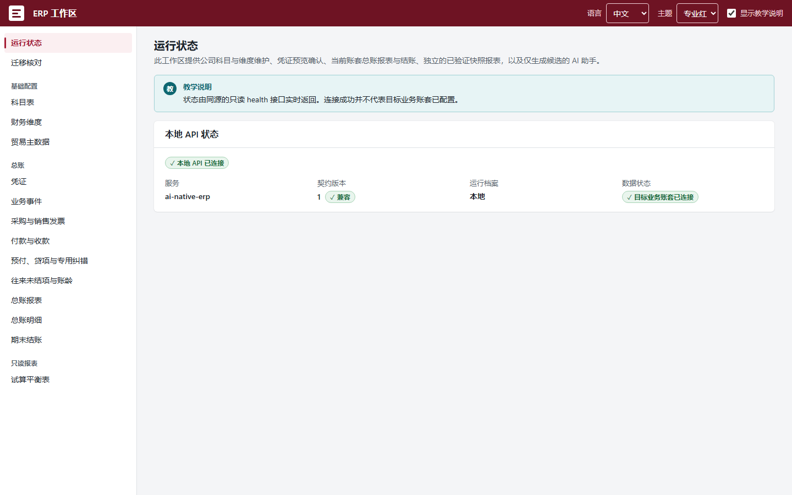

# 快速上手

## 启动

需要 Node.js 26.x、npm 11。详细命令见仓库根目录 [README](../../README.md)。要点：

1. `npm ci`，`npm run build`。
2. 创建**新的**目标库（迁移到 020）：`npm run storage:admin -- migrate --provider sqlite --file <新文件>.sqlite`。
3. 设置 `ERP_SQLITE_FILE`（绝对路径）和可选的 `ERP_PORT`（默认 4180），运行 `npm run start:local`。
4. 浏览器打开 `http://127.0.0.1:<端口>/`。

不要把原有账或快照选为目标库。首次连接新库会自动建立 DEFAULT 月度教学公司（CNY、精度 2、当前财年）、八个内置科目和 12 个开放期间，**不创建示例凭证**。未设置 `ERP_SQLITE_FILE` 时只启动未配置壳，财务请求返回 503。

## 界面布局

顶栏（右侧为语言、主题和“显示教学说明”）与左侧导航（窄屏为横向条）。详见[界面指南](ui-guide.md)。导航分组：

- **运行状态**：服务健康、是否已配置数据。
- **迁移核对**：只读的旧账迁移核对报告（见[备份与旧账工具](backup-and-legacy.md)）。
- **基础配置**：科目表、财务维度、贸易主数据。
- **总账**：凭证、业务事件、采购与销售发票、付款与收款、预付/贷项与专用纠错、总账报表、总账明细、期末结账。
- **只读报表**：试算平衡表（读取旧快照，见[备份与旧账工具](backup-and-legacy.md)）。
- **顶栏右侧偏好**：语言（中文/English）、主题（专业红/绿）、“显示教学说明”。

偏好保存在当前浏览器，不随账套保存。
