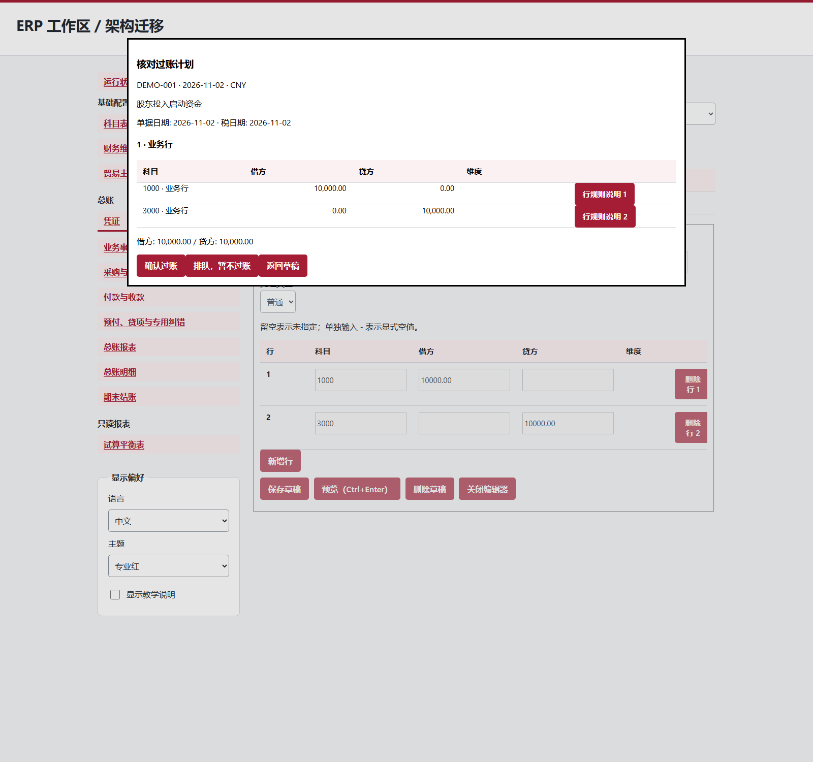
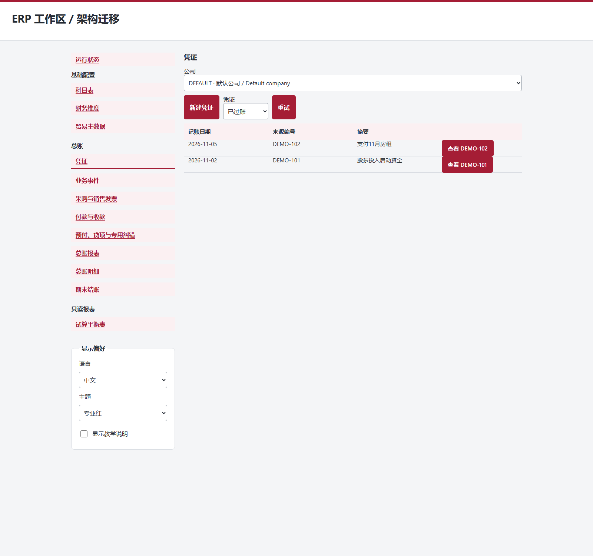
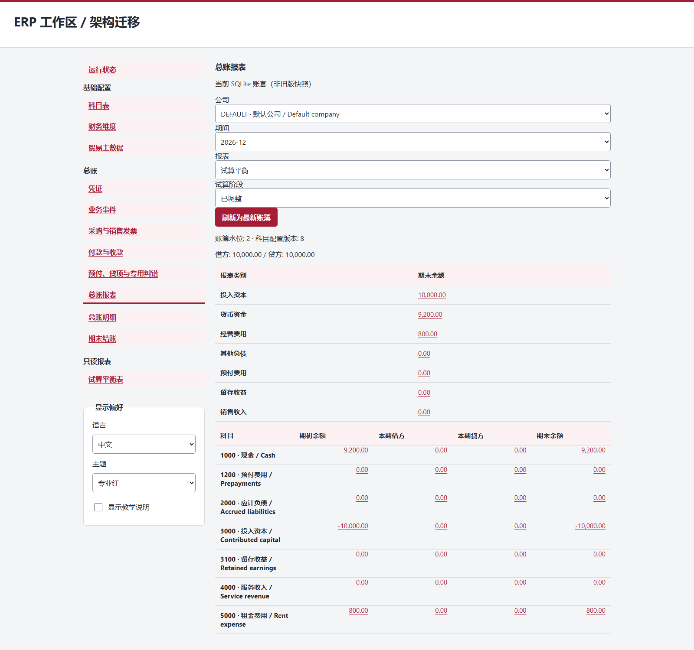

# 总账

截图均来自临时演示账套（虚构数据）。

## 科目与维度

- 内置八个科目受保护（代码 1000/1200/2000/3000/3100/4000/5000/5100）；可新建科目、编辑自有科目。
- 科目的“正常方向”只是余额解释，不限制合法的反向记账。
- 控制科目（AP/AR/TAX）不能手工记账，只能由贸易单据过账。
- **财务维度**：六类维度，可设必填/禁止/默认/派生规则；保存时检查引用存在，应用时检查启停与有效期。每笔分录最终维度最多 32 个。
- 保存冲突（409）保留输入，需明确重新载入；字段错误（400）定位到字段。

## 凭证

1. **新建凭证**：填来源编号、记账日期、摘要，可选单据日期/税日期（省略则等于记账日期），至少两行科目与借/贷金额。
2. **保存草稿**：草稿可不完整；这是唯一的保存入口。
3. **预览（Ctrl+Enter）**：只读，不保存。有未保存改动时预览会提示先保存并重新预览，确认按钮禁用。
4. **确认过账**：同一事务内重读科目/期间/维度并重算指纹，原子写入凭证、回执、审计并删除草稿；重复提交同键同内容返回原回执。
5. **排队，暂不过账**：把凭证放入待转队列。

已过账凭证不可修改。纠错用 D6 镜像：逐行精确反向，替换会原子生成反向凭证和新凭证，重分类必须全额；纠错日期不得早于原凭证及后代链的最晚日期。只有**记账日期**决定期间、维度有效期和报表归属。

## 业务事件与队列

现金服务收付及取消、统计事件、清算匹配，以及普通凭证待转队列。过账规则的现金科目与对方科目必须显式命中，没有默认科目。

## 总账报表与明细

选择公司、期间、报表（试算平衡、利润表、资产负债表、对账）与试算阶段。金额可逐级下钻：报表组 → 科目 → GL 行 → 原凭证。页面显示“账簿水位”；若出现 409，说明账簿已变化，需点“刷新为最新账簿”，旧数据会被隐藏。

## 期末结账

结账向导：预览（只读）→ 确认（事务内重算）。**打开下一期间是独立操作**，确认不会自动推进。结转凭证并非总会生成：年度模式 1–11 月只冻结（frozen），不关闭；年度 12 月或月度教学模式下，无损益余额则正常关闭（closed）且不生成零金额凭证，有损益余额则生成结转凭证后关闭。未知的确认结果只会重试原命令。

## AI 助手（仅候选）

凭证编辑器旁可“起草候选”或“讲解”。只发送你的描述、本公司科目、维度和所选期间给 Copilot，不要输入秘密。AI 的输出只能填入**新草稿**供你检查，绝不保存、排队或过账。需要配置 `AI_PROVIDER`/`AI_MODEL` 并具备可用的 Copilot 认证；未配置时该功能不可用。
