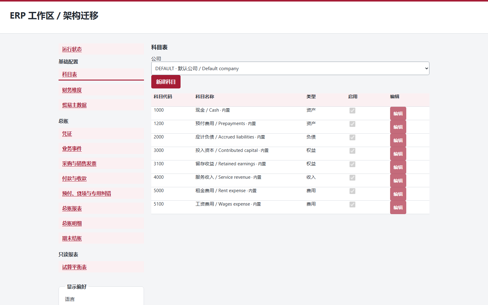
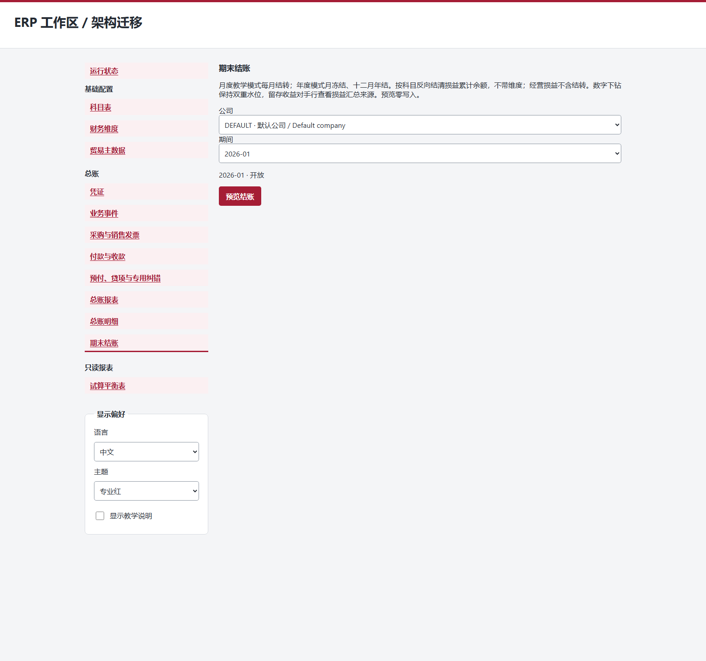

# 总账

截图均来自临时演示账套（虚构数据）。

## 科目与维度

- 内置八个科目受保护（代码 1000/1200/2000/3000/3100/4000/5000/5100）；可新建科目、编辑自有科目。
- **刷新列表**（v0.18.0，TLIST-03 #288）：“新建科目”之后有“刷新列表”按钮（英文 “Refresh list”），按当前公司从第一页重新读取科目；所选公司和正在编辑的内容保留，不弹确认，编辑器打开时仍可用。键盘 Tab 在“新建科目”之后多一站，Enter / 空格触发。
- 科目的“正常方向”只是余额解释，不限制合法的反向记账。
- 控制科目（AP/AR/TAX）不能手工记账，只能由贸易单据过账。
- **财务维度**：六类维度，可设必填/禁止/默认/派生规则；保存时检查引用存在，应用时检查启停与有效期。每笔分录最终维度最多 32 个。
- **财务维度的“刷新列表”**（v0.19.0，TLIST-04 #296）：“新建配置”之后有“刷新列表”按钮（英文 “Refresh list”），按当前公司、类型与上级维度从第一页重新读取列表；所选项和正在编辑的内容保留，不弹确认，编辑器打开时仍可用。键盘 Tab 在“新建配置”之后多一站，Enter / 空格触发。
- **页头说明**（v0.12.0，UI-16 #210）：科目表、财务维度、凭证、业务事件四页的标题下各有一句页面说明（如凭证页：“录入手工凭证草稿，预览并确认过账，再查看或反向已过账凭证。”），教学模式关闭时也显示；教学提示本身不变。
- 保存冲突（409）保留输入，需明确重新载入；字段错误（400）定位到字段。

## 凭证

1. **新建凭证**：填来源编号、记账日期、摘要，可选单据日期/税日期（省略则等于记账日期），至少两行科目与借/贷金额。
2. **保存草稿**：草稿可不完整；这是唯一的保存入口。
3. **预览（Ctrl+Enter）**：只读，不保存。有未保存改动时预览会提示先保存并重新预览，确认按钮禁用。
4. **确认过账**：同一事务内重读科目/期间/维度并重算指纹，原子写入凭证、回执、审计并删除草稿；重复提交同键同内容返回原回执。
5. **排队，暂不过账**：把凭证放入待转队列。

已过账凭证不可修改。纠错用 D6 镜像：逐行精确反向，替换会原子生成反向凭证和新凭证，重分类必须全额；纠错日期不得早于原凭证及后代链的最晚日期。只有**记账日期**决定期间、维度有效期和报表归属。

## 业务事件与队列

现金服务收付及取消、统计事件、清算匹配，以及普通凭证待转队列。过账规则的现金科目与对方科目必须显式命中，没有默认科目。

“业务事件”和“待转队列”两个视图在表格上方各有一个“刷新列表”按钮（英文 “Refresh list”，v0.20.0 起）：点它按当前公司从第一页重新读取列表，待转队列还按当前所选状态读取；正在编辑的草稿和已选的状态都会保留，不弹确认，编辑器打开时仍可用。“设置”视图没有这个按钮。转入、撤回在别处完成（例如另一个标签页或 AI 助手）后，用它即可更新，不必切换视图。

## 总账报表与明细

选择公司、期间、报表（试算平衡、利润表、资产负债表、对账）与试算阶段。金额可逐级下钻：报表组 → 科目 → GL 行 → 原凭证。页面显示“账簿水位”；若出现 409，说明账簿已变化，需点“刷新为最新账簿”，旧数据会被隐藏。

**按维度筛选明细（v0.22.0 起，BUG-01 [#382](https://github.com/lingshf/ai-native-erp/pull/382)）**：筛选明细时“维度值”只在填了维度代码后才能输入；清空维度代码会同时清空已输入的值；“查询”只在填了维度时才带上维度与值，不再因孤立的值误显示“选择无效”。

## 期末结账

结账向导：预览（只读）→ 确认（事务内重算）。**打开下一期间是独立操作**，确认不会自动推进。结转凭证并非总会生成：年度模式 1–11 月只冻结（frozen），不关闭；年度 12 月或月度教学模式下，无损益余额则正常关闭（closed）且不生成零金额凭证，有损益余额则生成结转凭证后关闭。未知的确认结果只会重试原命令。同一页还有“期间贸易模块准入”（v0.2.0 新增），决定该期间能否过账贸易单据，见[贸易](trade.md)。v0.12.0（UI-15 #206）起页头有一句说明“先预览再确认结账；贸易与税务写入前，先在本页保存期间准入。”，准入徽标显示“贸易”“税务”（读屏另读“已准入 / 未准入”），复选框改为“准入贸易”“准入税务”；结账逻辑不变。

## AI 助手（仅候选）

凭证编辑器旁可“起草候选”或“讲解”。两者都会把你的描述、本公司基本信息（编码、币种、位数、结账方式）、所选期间、科目表、维度和一个报表快照标记（水位与科目版本）发给 Copilot；“起草”只含可手工记账的启用科目。“讲解”（仅在教学模式开启时出现）还会发送所选期间的完整报表对象，含**所有科目**的调整后余额明细（以最小货币单位计）和结账状态计数（草稿、排队、前期未结），即你的财务数字会离开本机。不要输入秘密。（依据：[AI 助手事实清单](../../design/ai-assistant-facts.md) F15–F18；完整说明见 [AI 助手](../ai-assistant.md)。）AI 起草的候选只能填入**新草稿**供你检查（讲解只是文本，不能采纳），绝不保存、排队或过账。启用条件、环境变量和失败排查见 [AI 助手：启用与配置](../ai-assistant.md#5-启用与配置)（`AI_MODEL` 必填，`AI_PROVIDER` 可省略）；未启用时该功能不可用。
