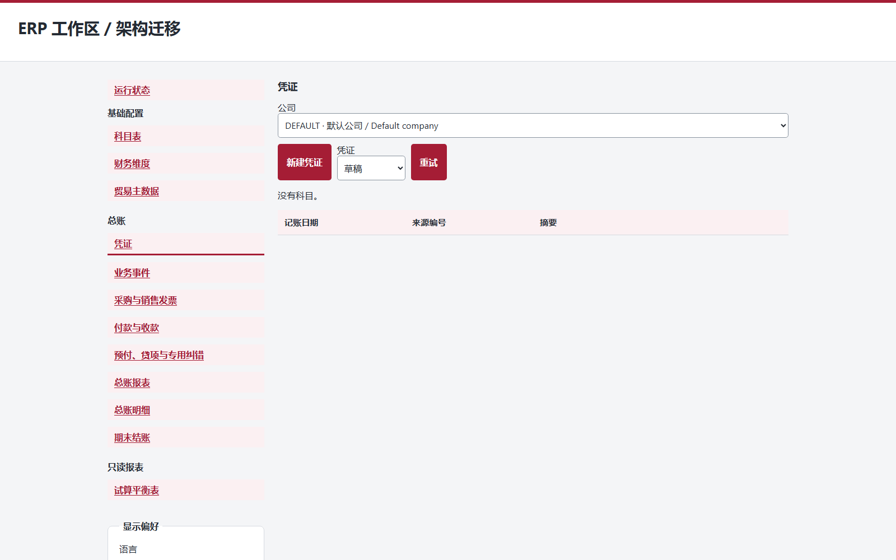
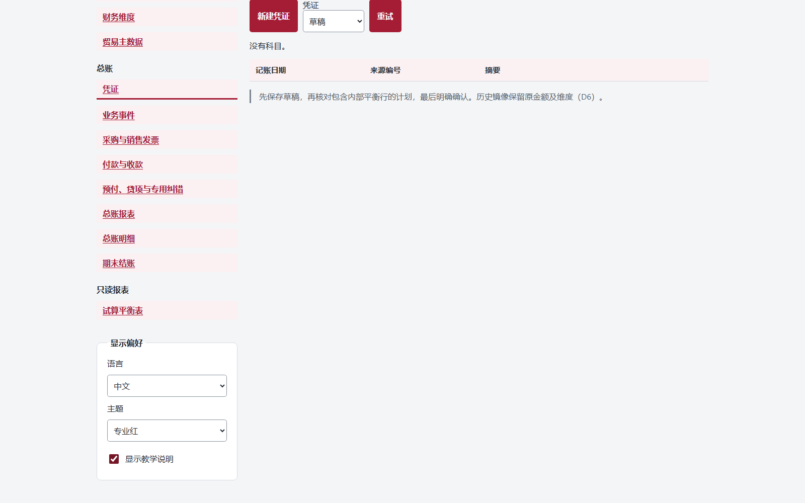

# 教学模式

侧栏“显示偏好”中的 **显示教学说明** 复选框控制教学辅助文字。

| 项目 | 行为 |
| --- | --- |
| 默认值 | **关闭** |
| 保存位置 | 浏览器 localStorage（键 `erp.workspace.preferences.v1`），与语言、主题一起保存；不写入账套 |
| 打开后 | 运行状态、科目表、凭证、业务事件、总账报表、试算报表、采购与销售发票页显示说明文字；凭证页的 AI 助手可给出讲解 |
| 关闭后 | 说明隐藏，页面只保留业务操作 |
| 不改变什么 | 会计规则、校验、过账结果、金额；教学开关绝不触发记账 |

关闭（默认）：

打开后，凭证页多出一行说明：

若浏览器存储被禁用或内容损坏，页面显示偏好警告并回到默认值（关闭）。

> 公司的 `closeMode`（默认 `monthly-teaching`）是会计设置，与“显示教学说明”开关无关。
