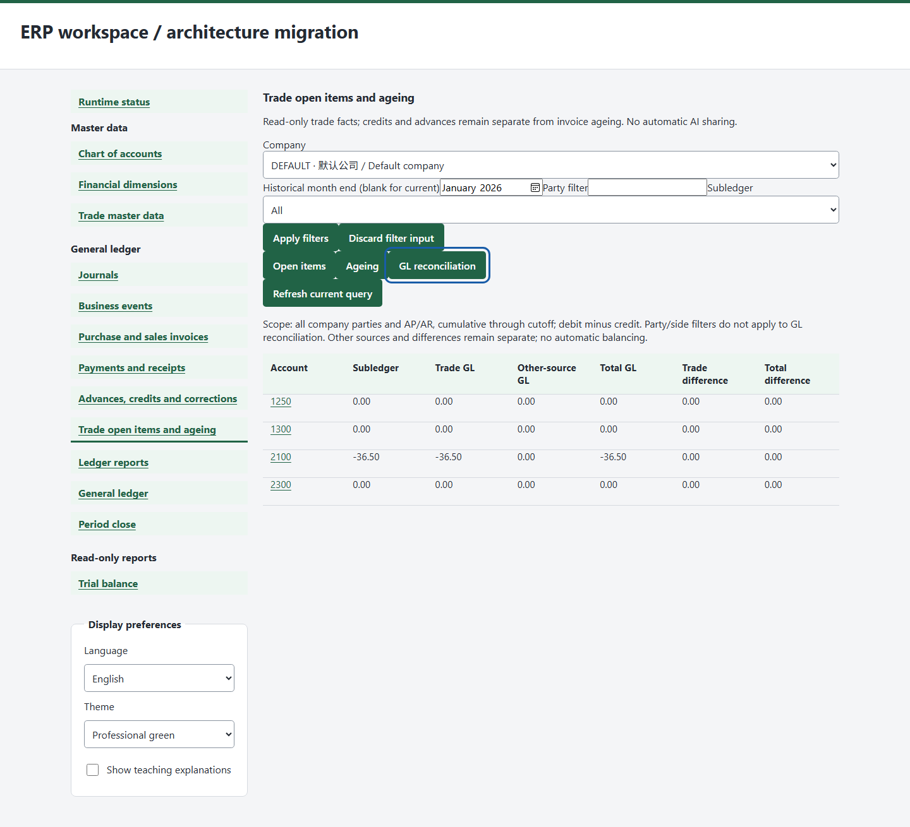
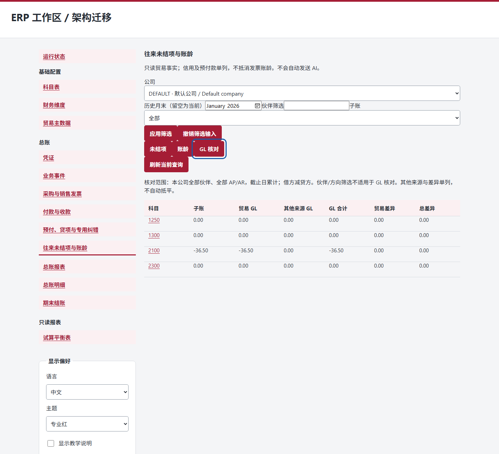

# 贸易主路径演练（全新演示账套）

本页是贸易 GUI 主路径（M1-07）的唯一权威步骤；根 [README](../../README.md) 与 v0.3.0 起各版 Demo 只链接到这里（v0.2.0 Demo 保留当时的步骤表，金额以本页为准）。数据与金额均为虚构；步骤以 `main` 代码和测试为准。其余贸易说明见[贸易](trade.md)。

只使用全新的临时教学账套，不打开 4173、原账、`.bak` 或已有账套。先 `npm run build`，再在 PowerShell 启动独立实例：

```powershell
$demo = Join-Path ([IO.Path]::GetTempPath()) ("erp-trade-demo-" + [guid]::NewGuid())
New-Item -ItemType Directory -Path $demo | Out-Null
$env:ERP_SQLITE_FILE = Join-Path $demo "demo.sqlite"
$env:ERP_PORT = "4187"
$env:ERP_HOST = "127.0.0.1"
$env:ERP_PROFILE = "local"
# 先按迁移手册第 10 节对 $env:ERP_SQLITE_FILE 执行 migrate（docs/migration-runbook.md）
npm run start:local
```

浏览器打开 `http://127.0.0.1:4187`。以下使用默认公司、CNY 两位精度、**同一当天日期**，全部日期位于默认公司的当前财年。各主数据有效期设为该年 01-01 至 12-31。只操作虚构数据；不代表银行付款、实物退货或生产合规验收。

先在「科目表」新建下表六个有效科目，均选择用途 `control`、禁止手工输入；资产正常借方、负债正常贷方。现金 `1000`、收入/折扣 `4000`、费用 `5000` 使用初始内置科目。在「期末结账」选择当天月份，勾选 `trade` 和 `tax`，填写虚构演示原因，明确保存期间准入。

| 科目 | 类别 / 报表组 | 统驭模块 |
| --- | --- | --- |
| 2100 | LIABILITY / payables | AP |
| 1250 | ASSET / prepayments | AP |
| 1300 | ASSET / receivables | AR |
| 2300 | LIABILITY / otherLiabilities | AR |
| 1400 | ASSET / otherAssets | TAX |
| 2200 | LIABILITY / taxLiabilities | TAX |

在「贸易主数据」按顺序新建以下配置。名称任填虚构名称；均启用；未列出的引用留空、维度 `{}`。

| 类型 / 代码 | 字段 |
| --- | --- |
| 付款条件 `N30` | 到期 30 天、折扣 7 天、折扣率 `1.5`、允许部分付款折扣 |
| 税码 `VAT` | ordinary、可抵扣 `100`、进项 `1400`、销项 `2200`；税率 JSON 为 `[{"id":"STANDARD","from":"2026-01-01","to":"2026-12-31","ratePercent":"13"}]`（把年份改成当前财年） |
| 过账配置 `PAY` | AP、统驭 `2100`、预付 `1250`、现金 `1000`、折扣 `4000` |
| 过账配置 `REC` | AR、统驭 `1300`、预收 `2300`、现金 `1000`、折扣 `4000` |
| 伙伴 `PARTY` | both、AP 配置 `PAY`、AR 配置 `REC`、条款 `N30`、允许税码 `VAT` |
| 非库存商品 `EXPENSE` | expense、费用 `5000`、允许税码 `VAT` |
| 非库存商品 `SERVICE` | service、收入 `4000`、允许税码 `VAT` |

在「采购 / 销售订单」页录入采购订单（M1-R1a，v0.3.0 之后的版本；v0.3.0 及更早只有 API）：订单号 `PO-DEMO`、子账保持 AP、伙伴 `PARTY`、订单日期保持默认（当天）；行 `L1`（行号由页面自动编号，不可编辑）：商品 `EXPENSE`、税码 `VAT`、数量 `10`、单价 `10`，折扣保持 `0`。点「保存订单」，页面只显示服务端返回的净额 **100.00**、税 **13.00**、价税合计 **113.00**，不在本地计算；之后的发票匹配及财务主路径全部在 GUI 完成。

| 顺序 / 页面 | 操作与预期 |
| --- | --- |
| 采购与销售发票 | AP、伙伴 `PARTY`、外部号 `AP-DEMO`、订单 `PO-DEMO`；行 `L1`：`EXPENSE`、`VAT`、数量 `10`、单价 `10`、订单行 `L1`，其余金额 `0`。预览显示净额 **100.00**、税 **13.00**、总额 **113.00**、匹配成功；再明确「确认过账」。 |
| 付款与收款 | 伙伴 `PARTY`、AP，选择 `AP-DEMO`；核销金额输入整数最小单位 **5650**，勾选现金折扣。预览核销 **56.50**、现金 **55.75**、折扣 **0.75**、余款 **56.50**，再明确确认账面核销。 |
| 预付、贷项与专用纠错 | 新建 AP 预付，伙伴 `PARTY`、总额 **2000**；预览并确认。选择「应用预付/贷项」，来源选刚创建的预付，目标 `AP-DEMO`、金额 **2000**，预览确认后发票余款 **36.50**、预付余款 **0.00**。 |
| 采购与销售发票 | AR、伙伴 `PARTY`、外部号 `AR-DEMO`；行 `L1`：`SERVICE`、`VAT`、数量 `10`、单价 `10`，不填订单。预览 **113.00**，明确确认。 |
| 预付、贷项与专用纠错 | 「非库存贷项」来源 `AR-DEMO`、原行 `L1`、数量 `2`；预览确认 **22.60**。再「取消单据」选择刚创建的贷项，原发票当前版本填 `2`，填写原因、预览确认；之后选择 `AR-DEMO`、原发票版本留空，填写原因、预览确认取消销售发票。 |
| 往来未结项与账龄 | 当前或当天月份的月末查询：发票未结 **36.50**、贷项/预付 **0.00**。当天仍为未到期；月份变更须「应用筛选」。切换「GL 核对」，`2100` 子账和贸易 GL 均为 **-36.50**，各行贸易差异/总差异 **0.00**。 |

每次返回付款/纠错页都会重新读取未结项，避免跨页新发票或核销后仍显示缓存余额/版本。已部分核销的 `AP-DEMO` 不能直接取消，须先专用反向依赖。预览永不自动确认；会话存储不能写入并逐字读回时不发送确认；未知结果只用原确认封套显式重试。

页面支持 Tab / Shift+Tab、方向键选择、Space 勾选和 Enter 按钮；发票还支持 Alt+Shift+N 新行。可在未提交时切换中/英和红/绿偏好，输入与预览保留，不触发财务提交。下图来自上述全新虚构账套主路径的真实浏览器：





