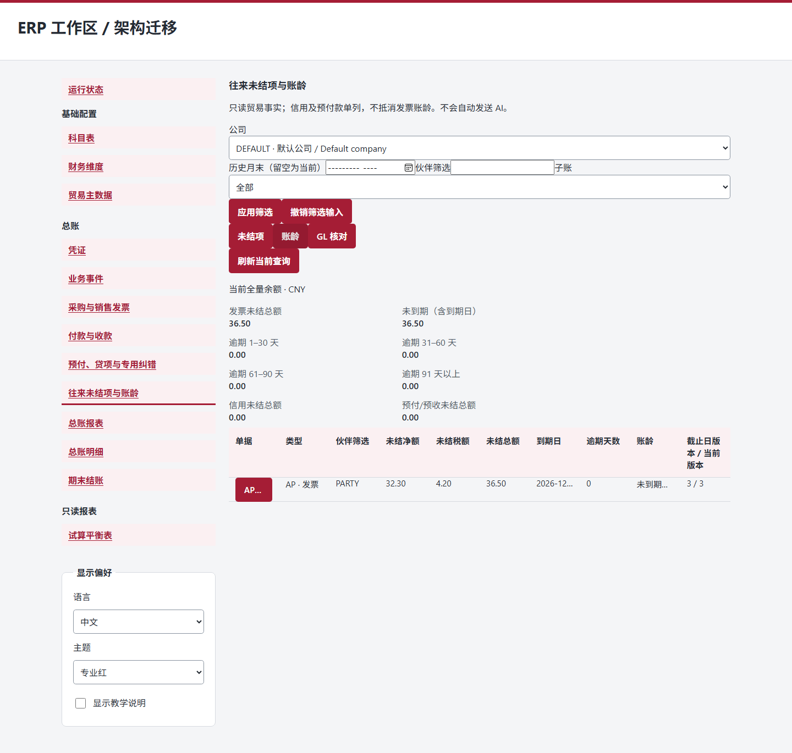
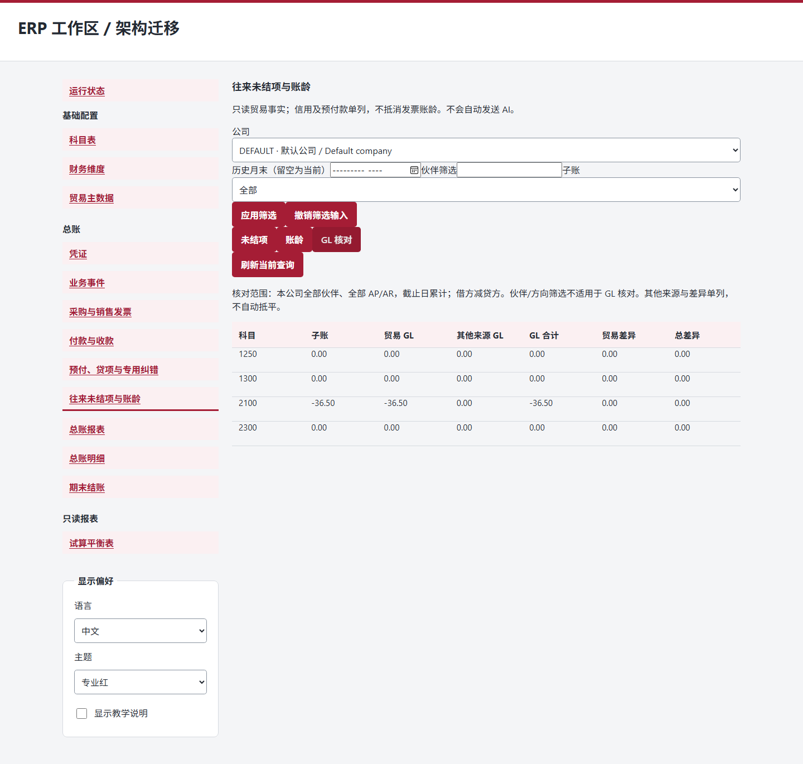

# 往来未结项、账龄与 GL 核对

入口：侧栏“往来未结项与账龄”（`/#/trade-reports`）。只读，不写账，也不会向 AI 发送贸易数据。

## 三个视图

- **未结项**：每张发票、贷项、预付款一行，含未结净额/税额/总额、到期日、逾期天数、账龄档、截止日版本/当前版本。点单据可下钻到原始发票行、核销/动作记录和凭证。
- **账龄**：发票按未到期（含到期当天）、逾期 1–30、31–60、61–90、91+ 天互斥分档。贷项和预付/预收**单列**，不抵消发票，也不进入逾期档。

  
- **GL 核对**：按科目对比子账与总账，列出子账、贸易 GL、其他来源 GL、GL 合计、贸易差异、总差异。范围固定为本公司全部伙伴和 AP/AR，伙伴/方向筛选不适用。差异只列示，**不会自动生成调整凭证抵平**。

  

## 当前余额与月末余额

“历史月末”留空表示当前全量余额（包含已录入的未来日期事实，账龄按服务器 UTC 当天计算）；填 `YYYY-MM` 则为该月最后一日的余额。历史余额由原额减去截止日内的付款、应用、取消、反向得到，之后发生的核销不会改变早月结果。历史版本不能用于新的核销或纠错操作。

## 筛选与刷新

- 修改月份、伙伴、方向后须点“应用筛选”才会查询；“撤销筛选输入”放弃未应用的输入。有未应用输入时，切换页面或公司会被拦截。
- 分页使用游标和快照；翻页期间数据有变化时提示重新读取，不会混合两页。合计针对整个筛选结果，不是当前页。
- 错误可重试；已放弃的月份其迟到响应不会覆盖当前结果。语言、主题、教学偏好切换不丢失输入。

## 如何读 GL 核对

“贸易差异”= 贸易 GL − 子账（`tradeDifference`）；“其他来源”= 全部 GL − 贸易 GL（`otherSource`）；“总差异”= 全部 GL − 子账。**判断贸易子账是否与贸易 GL 一致，看贸易差异是否为 0.00**；其他来源单独列示，不是贸易单据错误，但也不能视为已核对，需另行查明（例如旧账导入凭证）。旧账迁移的期初门禁（D26）尚未交付，见[流程图](../flows/trade-flow.md)。

## 教学说明

打开侧栏“显示教学说明”后，本页显示额外说明；规则与数字不变。见[教学模式](teaching-mode.md)。
