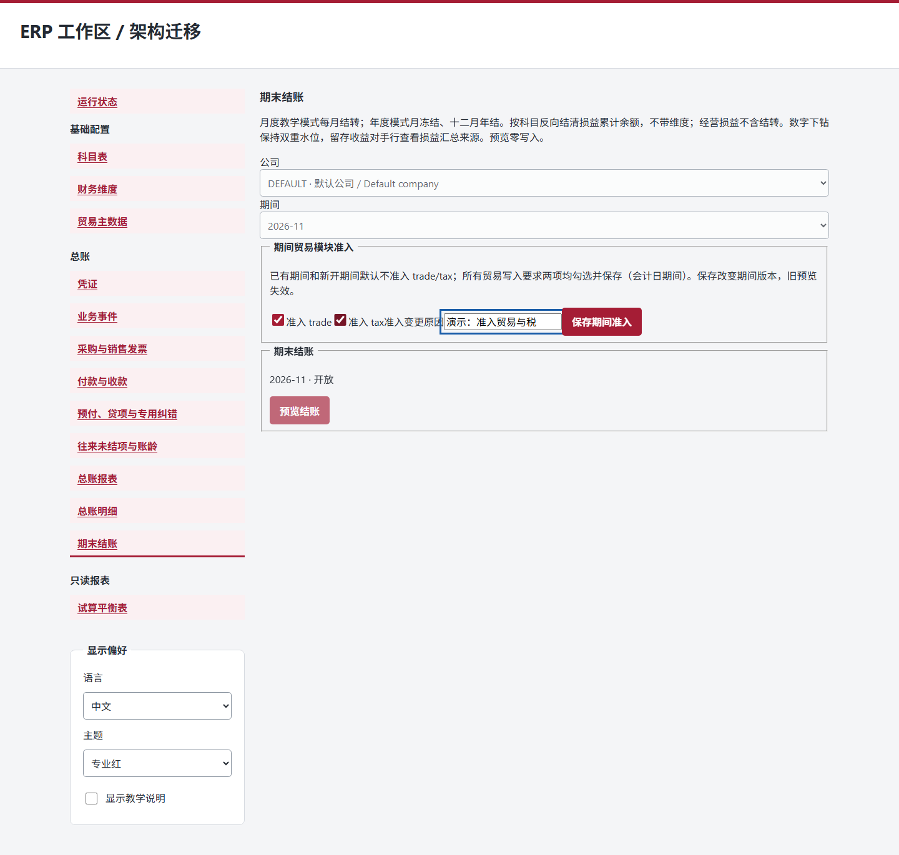
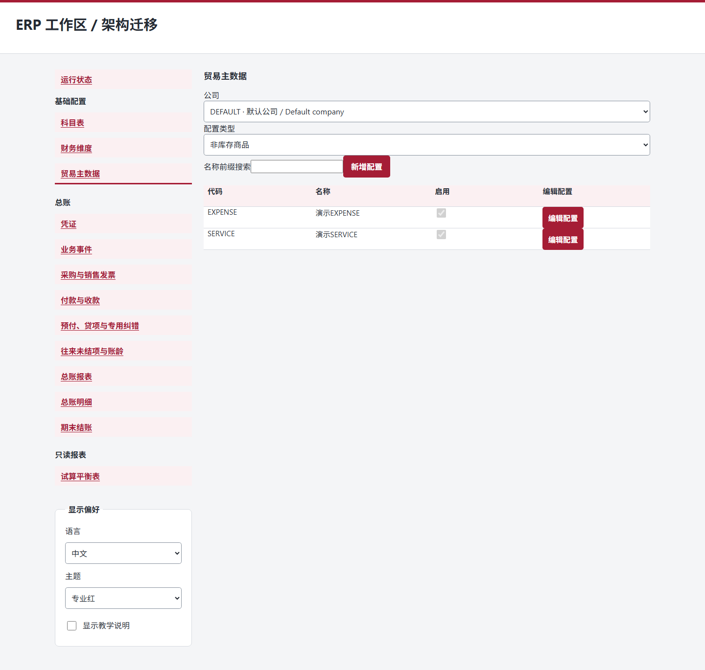
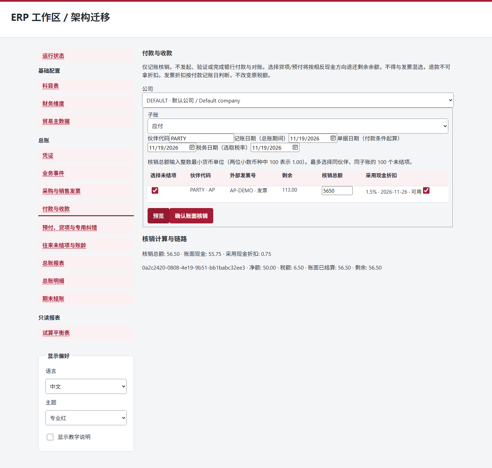
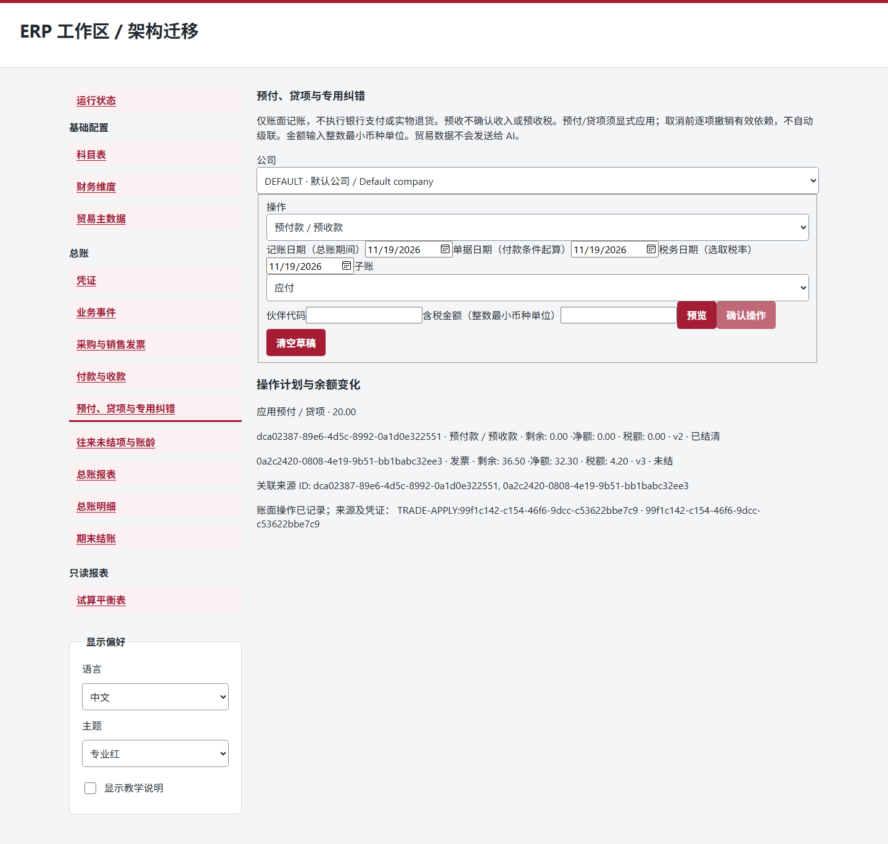

# 贸易 AP/AR

> v0.3.0 界面已统一为新外壳与页面模板，见[界面指南](ui-guide.md)；截图中 v0.2.0 的旧界面仅作流程参考。
>
> v0.2.0 起贸易（M1）功能完整：主数据、发票、付款/收款、预付/贷项/专用纠错，以及[未结项、账龄与 GL 核对](trade-reports.md)。不含库存、实物退货、银行状态。**非库存订单：v0.3.0 及更早只有 API；v0.3.0 之后的 main 新增“采购 / 销售订单”录入页（M1-R1a，#91），见下文。**

## 前置：期间准入、科目与主数据

**1. 期间准入（v0.2.0 新增）。** 新增任何贸易过账前，须在“期末结账”页的“期间贸易模块准入”勾选 **trade** 与 **tax**、填写变更原因并保存。旧期间、新公司的期间和新开的下一期间默认不准入，不会继承。会计日期间还须处于开放状态；无 GL 的应用/反向和专用取消同样受此限制，税日所在期间不另检查。保存准入会改变期间版本，使旧预览失效；准入编辑与结账操作互锁。

> 保存成功后页面会显示“贸易期间准入已保存。”（英文界面为 “Trade period admission saved.”）。**此为 v0.3.0 之后的 main（#94）的提示；v0.3.0 tag 中显示的仍是旧提示“原操作已成功；请以当前期间状态为准。”** 响应丢失后用原封套重试被接受时，也显示同一提示；期间的当前状态仍以页面上方显示为准。

**2. 科目与主数据。** 内置八个科目**不含** AP/AR/税控制科目、预付/预收科目和折扣收入科目。先在“科目表”按用途建立（用途选“控制”、禁止手工输入），再到“贸易主数据”配置：

“配置类型”下拉包含：贸易伙伴、非库存商品、AP/AR 过账配置（控制科目、预付/预收科目、折扣收入科目、现金科目等）、付款条件（到期天数、折扣天数、折扣百分比、是否允许部分付款折扣）、税码。配置按公司隔离，按 revision 乐观并发，可停用但不删除；缺少税配置**不等于免税**。超过 100 行时列表虚拟滚动。

## 采购与销售发票

选择子账（应付/应收），填写伙伴代码、外部发票号、记账日期、单据日期、税日期，以及行（商品、税码、数量、单价、行折扣）。

- 税率按**税日期**，GL 期间按**记账日期**，到期日/折扣日按**单据日期**。
- 可选“单价含税”和税额舍入方式（默认“按行”）。
- 外部发票号按往来方唯一（AP 与 AR 同一规则）。
- 可关联订单行：数量不超剩余，单价偏差在 1% 内；超出须勾选“确认超出 1% 的价差作为匹配例外”。
- 先**预览**（显示计算明细），表单改动后须重新预览，再**确认过账**；网络结果未知时用“安全重试过账”，不会重复记账。

## 采购 / 销售订单（v0.3.0 之后的 main，M1-R1a #91）

左侧导航“总账”组中，“业务事件”与“采购与销售发票”之间新增“采购 / 销售订单”页（v0.3.0 tag 中没有此页，订单只能调用 API）。表头：订单号、子账（AP/AR）、伙伴、币种（只读，公司本位币）、订单日期、价格含税、舍入；订单行：商品、税码、数量、单价、折扣 %，可增删，最多 100 行，行号自动编为 L1、L2…。伙伴、商品、税码候选来自已有主数据，只列启用项；加载失败仍可手工输入。

- **金额由服务端计算**：保存前页面不显示金额；保存后显示服务端返回的每行净额、税额、价税合计和合计，并链接到发票页。订单不过账、不生成凭证。
- 校验：格式错误（如小写订单号）不发请求；服务端字段错误（重复订单号、未知税码等）显示在对应字段上。
- 可按订单号只读查看已保存订单；草稿未保存时离开页面、切换公司或放弃草稿都要先确认。
- 开发票时在发票页填订单号和订单行号（如 `L1`）即可匹配。

### 订单列表与保存前预览（v0.6.0，TORD-03 #132、TORD-04 #138）

流程图见[订单页流程](../flows/trade-order-flow.md)。

- **订单列表**：在“新订单”和“查询订单”之间。列为订单号、子账、伙伴、订单日期、币种、行数、价税合计；按订单号升序，每页 100 条，有更多时点“加载更多”。点订单号（或按 Enter）等同于在“查询订单”里查该号，显示只读详情并把焦点移到详情；查询区折叠时自动展开。保存新订单成功后列表自动刷新。没有订单时显示“本公司还没有订单。”，读取失败可重试。列表没有筛选。
- **预览**：命令栏顺序为“预览 → 保存 → 放弃”。点“预览”由服务端算出每行净额、税额、价税合计和合计，显示在带“预览”标记的“金额预览”区；**预览不保存、不占订单号**。改动任何字段、放弃或保存成功都会清除预览，保存后显示的是服务端已保存的金额。校验失败或网络错误时字段会标出，焦点回到“预览”按钮；预览成功时焦点移到预览结果区。
- 教学说明已补充“预览不保存、不占号”和列表用法；关闭教学模式后卡片不显示。

## 付款与收款

显式选择同公司/伙伴/币种/子账的 1–100 个未结项，按剩余净额/税额分配。符合折扣条件**不等于采用折扣**，须勾选“采用现金折扣”（请求中的 `takeDiscount: true`）才会计入。这是**账面核销**，不表示银行已支付；核销金额为每项总额的最小货币单位。

## 预付、贷项与专用纠错

“操作”包含：预付款/预收款、非库存贷项、应用预付/贷项到发票（可部分应用）、专用取消单据。预收不确认收入/税；贷项不直接减少原发票余额；预付/贷项的退款在付款页处理。通用凭证冲销**不**适用于贸易凭证，必须走专用取消（需新 UUID、原因、关联版本、日期不早于最晚相关事件；有有效后续依赖则拒绝）。

## 教学说明

教学开关打开时，发票、付款与收款、预付 / 贷项 / 纠错、贸易主数据、往来未结项与账龄、期间准入页都显示教学卡片（v0.3.0 起，UI-04/UI-06/UI-07b 补齐）。v0.3.0 之后的 main（M1-R2a，#88）补充：付款与收款说明核销发票时的借贷方向和部分核销；预付 / 贷项 / 纠错说明预付借贷方向与贷项反向记账；贸易主数据说明记账配置决定各科目；期末结账的期间准入新增“期间准入说明”（准入只控制贸易单据能否在该期间记账，不结账）；订单页教学提示为“订单不过账、不生成凭证”。关闭后只隐藏卡片，边界说明始终显示。见[教学模式](teaching-mode.md)。

## 已知限制

- v0.3.0 及更早：订单只有 API（`POST /api/v1/trade/orders`），没有录入界面。v0.3.0 之后的 main 有订单录入页（M1-R1a），当前仍是非库存订单，不含库存、收货。v0.6.0 起订单页有列表和保存前预览，但列表不能按伙伴 / 日期 / 方向筛选。
- 预付/贷项页的未结项选择列表仍是“加载更多”，没有虚拟滚动。v0.3.0 之后的 main（M1-R2b，#90）在取消 / 贷项 / 应用 / 反向时新增“按伙伴代码筛选未结项”输入框（回车或离开输入框生效，由服务端只返回该伙伴的未结项；默认不筛选时请求与选项与之前相同）。
- 预付发票路线与预收税不在范围内。
