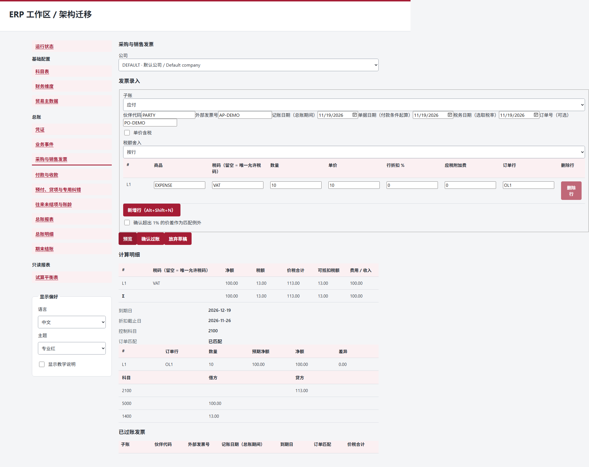

# 贸易 AP/AR

> v0.3.0 界面已统一为新外壳与页面模板，见[界面指南](ui-guide.md)；截图中 v0.2.0 的旧界面仅作流程参考。
>
> v0.2.0 起贸易（M1）功能完整：主数据、发票、付款/收款、预付/贷项/专用纠错，以及[未结项、账龄与 GL 核对](trade-reports.md)。不含库存、实物退货、银行状态。**非库存订单目前只有 API，没有录入界面。**

## 前置：期间准入、科目与主数据

**1. 期间准入（v0.2.0 新增）。** 新增任何贸易过账前，须在“期末结账”页的“期间贸易模块准入”勾选 **trade** 与 **tax**、填写变更原因并保存。旧期间、新公司的期间和新开的下一期间默认不准入，不会继承。会计日期间还须处于开放状态；无 GL 的应用/反向和专用取消同样受此限制，税日所在期间不另检查。保存准入会改变期间版本，使旧预览失效；准入编辑与结账操作互锁。

> 保存成功后页面会显示“原操作已成功；请以当前期间状态为准。”这是已知的提示措辞（同一文案也用于响应丢失后的重试），以页面上方显示的当前期间状态为准。

**2. 科目与主数据。** 内置八个科目**不含** AP/AR/税控制科目、预付/预收科目和折扣收入科目。先在“科目表”按用途建立（用途选“控制”、禁止手工输入），再到“贸易主数据”配置：

“配置类型”下拉包含：贸易伙伴、非库存商品、AP/AR 过账配置（控制科目、预付/预收科目、折扣收入科目、现金科目等）、付款条件（到期天数、折扣天数、折扣百分比、是否允许部分付款折扣）、税码。配置按公司隔离，按 revision 乐观并发，可停用但不删除；缺少税配置**不等于免税**。超过 100 行时列表虚拟滚动。

## 采购与销售发票

选择子账（应付/应收），填写伙伴代码、外部发票号、记账日期、单据日期、税日期，以及行（商品、税码、数量、单价、行折扣）。

- 税率按**税日期**，GL 期间按**记账日期**，到期日/折扣日按**单据日期**。
- 可选“单价含税”和税额舍入方式（默认“按行”）。
- 外部发票号按往来方唯一（AP 与 AR 同一规则）。
- 可关联订单行：数量不超剩余，单价偏差在 1% 内；超出须勾选“确认超出 1% 的价差作为匹配例外”。
- 先**预览**（显示计算明细），表单改动后须重新预览，再**确认过账**；网络结果未知时用“安全重试过账”，不会重复记账。

## 付款与收款

显式选择同公司/伙伴/币种/子账的 1–100 个未结项，按剩余净额/税额分配。符合折扣条件**不等于采用折扣**，须勾选“采用现金折扣”（请求中的 `takeDiscount: true`）才会计入。这是**账面核销**，不表示银行已支付；核销金额为每项总额的最小货币单位。

## 预付、贷项与专用纠错

“操作”包含：预付款/预收款、非库存贷项、应用预付/贷项到发票（可部分应用）、专用取消单据。预收不确认收入/税；贷项不直接减少原发票余额；预付/贷项的退款在付款页处理。通用凭证冲销**不**适用于贸易凭证，必须走专用取消（需新 UUID、原因、关联版本、日期不早于最晚相关事件；有有效后续依赖则拒绝）。

## 教学说明

教学开关打开时，发票、付款与收款、预付 / 贷项 / 纠错、贸易主数据、往来未结项与账龄、期间准入页都显示教学卡片（v0.3.0 起，UI-04/UI-06/UI-07b 补齐）；关闭后只隐藏卡片，边界说明始终显示。见[教学模式](teaching-mode.md)。

## 已知限制

- 订单只有 API（`POST /api/v1/trade/orders`），没有录入界面；发票可匹配已有订单行（M1-R1）。
- 预付/贷项页的未结项选择列表只有“加载更多”，没有虚拟滚动（M1-R2）。
- 预付发票路线与预收税不在范围内。
