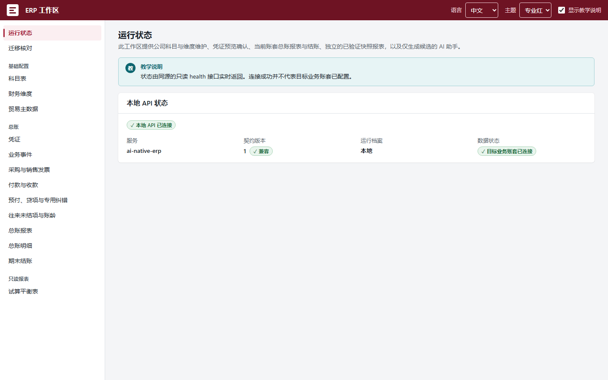

# 界面指南（v0.3.0 新界面）

v0.3.0 起全站使用统一的外壳和页面模板（UI-1）。**业务规则、接口、校验和键盘操作不变**，变的是布局与提示方式。流程图见 [界面外壳与页面模板](../flows/ui-shell-and-templates.md)。

## 外壳

- **顶栏**：深色品牌条（专业红或专业绿）。语言、主题、“显示教学说明”在顶栏右侧（原先在侧栏）。偏好仍只保存在当前浏览器。
- **侧栏**：248px，分组为基础配置 / 总账 / 只读报表，顶部有“运行状态”和“迁移核对”。窄屏（≤ 760px）改为横向导航条，可左右滚动。
- **点击区**：桌面 36px；窄屏或粗指针（触屏）≥ 44px。390px 宽下页面不再横向溢出，宽表格在自身卡片内滚动。

## 页面模板

| 模板 | 用于 | 组成 |
| --- | --- | --- |
| 列表页 | 科目表、财务维度、贸易主数据、凭证、业务事件 | 页头 + 命令栏 + 筛选栏 + 卡片表格；新建 / 配置放在 FastTab |
| 单据页 | 凭证草稿、发票、付款与收款、预付 / 贷项 / 纠错 | FastTab 分区（如“常规”“分录行”）；预览 → 确认；消息条显示结果 |
| 报表页 | 往来未结项与账龄、总账报表 / 明细、期末结账、迁移核对 | 分段视图（`aria-pressed`）、KPI 卡、徽标、下钻链接 |

## 你会注意到的变化

- **徽标带符号**：不靠颜色区分，如账龄“✓ 未到期 / ! 逾期 1–60 天 / × 逾期 60 天以上”，对账“✓ 一致 / × 不一致”。
- **凭证草稿**：“常规”“分录行”两个分区；分录表底部有借贷合计，不平时显示“借贷不平”徽标，**仅为提示**，过账仍以服务端预览为准。预览仍是对话框。
- **付款与收款**：核销分配表上方有 KPI（应付 / 应收、已分配、剩余；核销合计、账面现金、折扣）。取消、反向的确认按钮为红色危险按钮。
- **发票**：预览区有 KPI 与订单匹配徽标；行表在自身区域内滚动；无已过账发票时显示“尚无已过账发票”。
- **期末结账**：操作栏顺序为预览结账 → 确认结账 → 开放下一期间 → 重试原操作；新增“期间列表”卡片；结账区在期间准入区上方。结账规则不变，见[总账](ledger.md)。
- **AI 面板**：卡片化；“仅为候选，需人工确认。”始终显示，不受教学开关影响；候选结果带“候选 · 未保存”或“未通过校验”徽标。
- **凭证已过账列表**：“查看”按钮从行首显示并以省略号结尾。

## 窄屏示例

## 迁移核对页

只读报告页，见[备份与旧账工具](backup-and-legacy.md)与[迁移核对流程图](../flows/migration-page-flow.md)。

> 截图来自虚构夹具，页面中的编码与金额不是真实账套数据。
