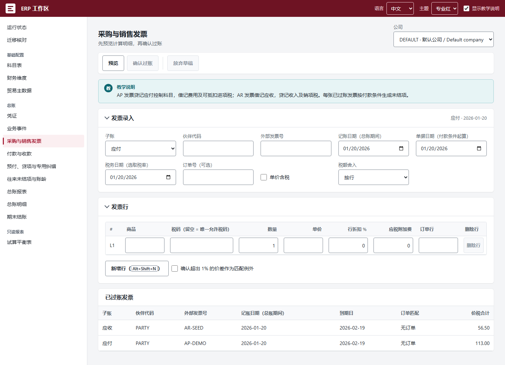
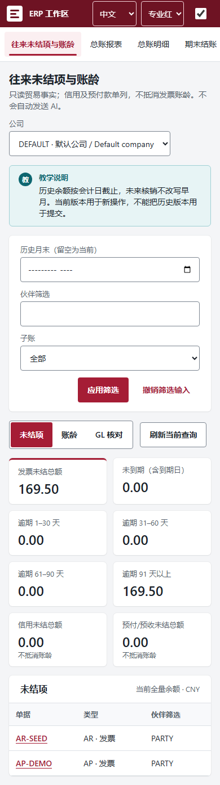
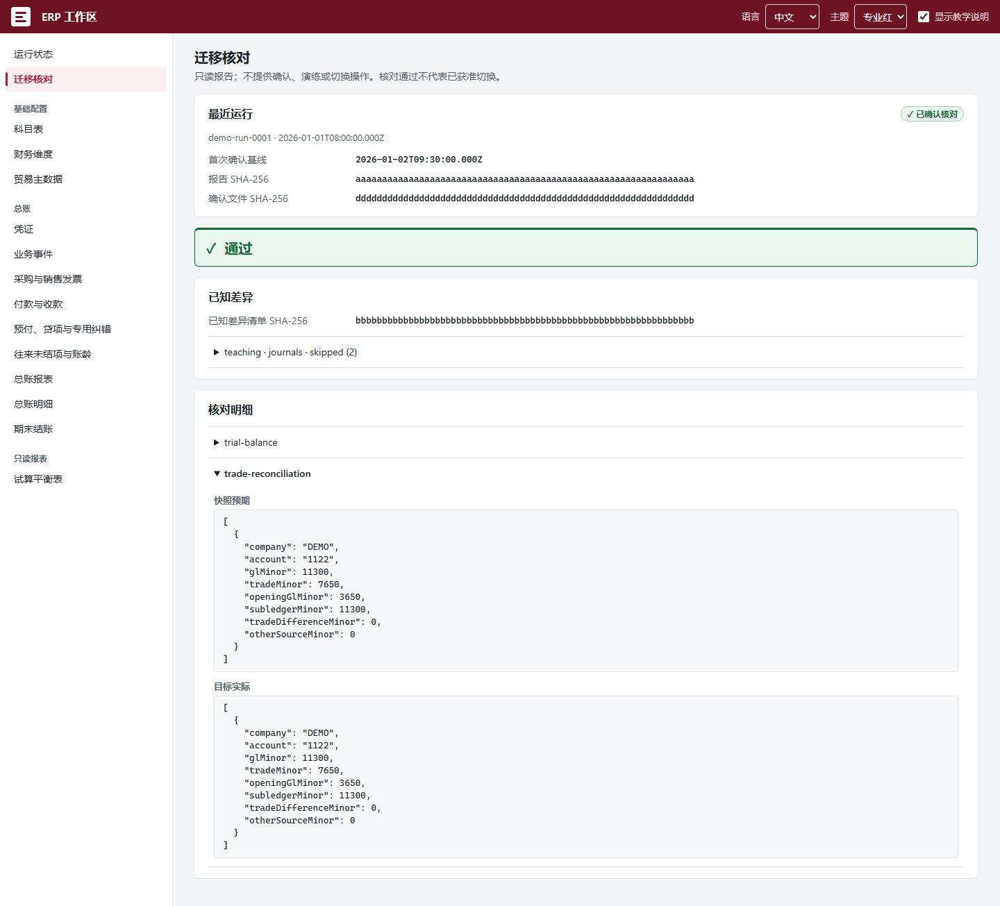

# 界面指南（v0.3.0 新界面；含 v0.4.0、v0.5.0 的变化）

> 本页正文描述 v0.3.0。v0.3.0 之后的 main（S4 随 v0.4.0 发布；S5 为 v0.5.0 发布候选，尚未发布）对少数细节做了调整，已在相应条目标出；v0.3.0 tag 中仍是旧写法。汇总见文末“v0.3.0 之后的变化”与“v0.4.0 之后的变化（S5）”。

v0.3.0 起全站使用统一的外壳和页面模板（UI-1）。界面改版本身不改会计规则、过账校验和键盘操作，变的是布局与提示方式；本版另有迁移核对页与旧账期初功能（见[备份与旧账工具](backup-and-legacy.md)）。流程图见 [界面外壳与页面模板](../flows/ui-shell-and-templates.md)。

## 外壳

- **顶栏**：深色品牌条（专业红或专业绿）。语言、主题、“显示教学说明”在顶栏右侧（原先在侧栏）。偏好仍只保存在当前浏览器。
- **侧栏**：248px，分组为基础配置 / 总账 / 只读报表（v0.11.0 起“总账”拆为三组，见文末），顶部有“运行状态”和“迁移核对”。窄屏已改为横向导航条，可左右滚动。v0.3.0 之后的 main 在“总账”组的“业务事件”与“采购与销售发票”之间新增“采购 / 销售订单”。
- **点击区**：窄屏（≤ 760px）或粗指针（触屏）下，按钮、输入、选择等控件 44px（v0.3.0 起）；桌面细指针下 v0.3.0 中部分页面为 44px；v0.3.0 之后的 main 仅在文末所列页面的指定控件改为 36px，其余控件不变；各控件的触控最小高度由各组件和页面类规则提供（v0.4.0 及更早，未被其他样式覆盖的 button / select 的 CSS 最小高度来自 `styles.css` 的全局基线，不保证所有控件或点击区；#126 删除后实际高度不变）。表格内金额链接（如期末结账）高 44px、宽 26–41px。390px 宽下页面不再横向溢出，宽表格在自身卡片内滚动。

## 页面模板

| 模板 | 用于 | 组成 |
| --- | --- | --- |
| 列表页 | 科目表、财务维度、贸易主数据、凭证、业务事件 | 页头 + 命令栏 + 筛选栏 + 卡片表格；新建 / 配置放在 FastTab |
| 单据页 | 凭证草稿、发票、付款与收款、预付 / 贷项 / 纠错 | FastTab 分区（如“常规”“分录行”）；预览 → 确认；消息条显示结果 |
| 报表页 | 往来未结项与账龄、总账报表 / 明细、期末结账、迁移核对 | 分段视图（`aria-pressed`）、KPI 卡、徽标、下钻链接 |

## 你会注意到的变化

- **徽标带符号**：不靠颜色区分，如账龄“✓ 未到期 / ! 逾期 1–60 天 / × 逾期 60 天以上”，对账“✓ 一致 / × 不一致”。
- **凭证草稿**：“常规”“分录行”两个分区；分录表底部有借贷合计，不平时显示“借贷不平”徽标，**仅为提示**，过账仍以服务端预览为准。预览仍是对话框。
- **付款与收款**：核销分配表上方有 KPI（应付 / 应收、已分配、剩余；核销合计、账面现金、折扣）。
- **预付、贷项与专用纠错**：取消、反向的确认按钮为红色危险按钮。
- **发票**：预览区有 KPI 与订单匹配徽标；行表在自身区域内滚动；无已过账发票时显示“尚无已过账发票”。
- **期末结账**：操作栏顺序为预览结账 → 确认结账 → 开放下一期间 → 重试原操作；新增“期间列表”卡片；结账区在期间准入区上方。结账规则不变，见[总账](ledger.md)。
- **AI 面板**：卡片化；“仅为候选，需人工确认。”始终显示，不受教学开关影响；候选结果带“候选 · 未保存”或“未通过校验”徽标。
- **凭证已过账列表**：v0.3.0 中“查看”按钮从行首显示并以省略号结尾（仍可能截断）。v0.3.0 之后的 main 见文末“凭证列表操作列”。

## 窄屏示例

## 迁移核对页

只读报告页，见[备份与旧账工具](backup-and-legacy.md)与[迁移核对流程图](../flows/migration-page-flow.md)。

> 截图来自虚构夹具，页面中的编码与金额不是真实账套数据；截图为 v0.3.0 的界面。

## v0.3.0 之后的变化（main，随 v0.4.0 发布）

以下变化在 v0.3.0 tag 中**不存在**，来源为各 PR 的“用户可见变化”；均不改会计规则和键盘操作。

- **只读“启用”列改为徽标**（科目表 #100、贸易主数据五个页签 #103）：原先是灰色禁用复选框（像能点），现为“✓ 启用 / ✓ Active”（成功色）或“停用 / Inactive”（中性），文字加符号，不只靠颜色；该列由 72px 加宽到 104px。编辑表单中的“启用”复选框不变。财务维度页该列同样变宽，仍显示居中的复选框。
- **凭证列表操作列**（#101）：最后一列表头为“操作 / Actions”；行内按钮可见文字为“查看 / 编辑”（View / Edit），不再把来源号拼进按钮，不再被截断；按钮的可访问名称（含来源号）不变，来源号仍在“来源编号”列。
- **窄屏品牌名**（#102）：宽度 ≤ 760px 时顶栏只显示品牌图标，标题“ERP 工作区”视觉隐藏但仍在无障碍树中；语言、主题、教学开关位置不变；1440 宽不变。
- **控件高度与列宽**：桌面（细指针、宽 > 760px）下财务维度、贸易主数据（#92）、发票、付款与收款、预付 / 贷项 / 纠错（#97）、期末结账（#98）中改用共享控件高度变量的输入、选择、按钮由 44px 改为 36px；**不是全站**；v0.4.0 发布时，未被其他样式覆盖的 button / select 的 CSS 最小高度来自 `styles.css` 的全局基线（不保证所有控件或点击区），v0.5.0（#126）起该规则已删除，改由各组件和页面类规则提供触控尺寸，实际高度不变。窄屏（≤ 760px）仍为 44px；模拟粗指针的桌面 Chrome 实测所列控件为 44px（#92 #97，无真机验证）。发票行编辑表格行高由 53 降为 45，仅指桌面细指针，列表行高不变。
- **其他样式**：表格内金额 / 科目链接静止为点线下划线，悬停或键盘聚焦为 2px 实线（账簿报表、试算平衡、期末结账，#98）；凭证新建 / 编辑去掉“框中框”，标题“凭证草稿”与 FastTab 左对齐（#99）；分段控件选中态改为浅主色底加描边、禁用的次要按钮不再有灰底（#89）；可横向滚动的宽表格右缘显示滚动阴影（#89 #92）。
- **发票“新增行”按钮**（#93）：可见文字为“新增行”加快捷键徽标 `Alt+Shift+N`（无括号）；可访问名称为“新增行”，快捷键仍由 `aria-keyshortcuts` 提供，行为不变。
- **迁移核对页**（#87）：新增页头与教学提示（“核对通过 ≠ 批准切换；切换须用户另行授权。”，仅教学开启时显示）；差异和核对明细展开后先显示“字段 / 快照预期 / 目标实际 / 差额”键值表（值不同的字段标“× 不符 / × Mismatch”），原始 JSON 默认折叠。页面仍只读。
- **外壳偏好警告**（#104）：浏览器偏好读取 / 保存失败时的“偏好设置警告”改为左侧 4px 实色条的警告消息条，符号为 `!`；文案与显示条件不变，关闭教学后仍显示。
- **期间准入保存提示**：见[贸易](trade.md)。

## v0.4.0 之后的变化（S5，v0.5.0，已发布）

以下变化在 v0.4.0 tag 中**不存在**，来源为各 PR 的“用户可见变化”；不改会计规则。S5 其余 PR 只把全局元素样式改成页面类 / 组件规则，同值，无可见变化。

- **迁移核对页的键值表**（#112）：“字段 / 快照预期 / 目标实际 / 差额”表放进自己的滚动区，不再超出折叠区右缘；窄屏放不下时在表格区域内横向滚动，页面不被撑宽；390px 宽下个别单元格可能多折一行。页面仍只读。
- **焦点落点更早**（#117、#123）：保存订单后焦点在提示出现的同一次提交中就落到提示上；凭证打开草稿、保存草稿、查看已过账凭证、确认过账、确认删除之后，以及业务事件点“查看”、忙碌结束后，焦点同一刻到位，不再晚一个任务。DOM 焦点更早落位，最终焦点位置不变；读屏播报时序未实测。其余 4 处在真实 Chrome 中未复现，保持原样。
- **触控尺寸来源**（#126）：全局 `button, select` 最小高度已删除，改由各组件和页面类规则提供；实际高度不变，分段按钮仍按共享变量减 6px。
- 已知（v0.5.0 时）：业务事件“待转队列”操作列按钮可能截成“…”（UI-11a），业务事件主数据保存失败后焦点晚一帧（FOCUS-02）；两项已在 v0.6.0 处理，见下。

## v0.5.0 之后的变化（S6，v0.6.0，已发布）

以下变化在 v0.5.0 tag 中**不存在**，来源为各 PR 的“用户可见变化”；不改会计规则。订单列表与预览见[贸易](trade.md#订单列表与保存前预览v060tord-03-132tord-04-138)。S6 其余 PR（D-7 类规则、旧账核对 CLI、E2E）无用户可见变化。

- **业务事件“待转队列”操作列**（UI-11a，#133）：“查看 / 预览（Ctrl+Enter）/ 撤回”三个按钮完整显示且都能点中；操作列变宽到 312px，前三列相应变窄；390px 下表格横向滚动宽度 560 → 760px，用 Tab 聚焦按钮时会被完整滚入可见区。
- **业务主数据保存失败后的焦点**（FOCUS-02，#135）：保存失败（如重复代码）后，焦点在保存按钮恢复可用的同一帧回到第一个可用输入框；最终焦点目标不变。B4 的成功保存 / 取消路径未经真实 Chrome 验证；读屏播报时序未实测。
- **迁移核对页 390 宽**（UI-12，#148）：键值表字段名、表头和普通值只在词边界换行，不再词内断开；放不下时在表内横向滚动。仅 ≤599px 生效，1440 宽不变。
- **标签页图标**（UI-13，#136）：新增 SVG 图标，首页不再请求 `/favicon.ico`。
- 已知（v0.6.0 时）：D-7 仍只是部分完成，订单列表 `button.cell-link` 的圆角还靠全局规则，无可见影响；已在 v0.7.0 完成，见下。

## v0.6.0 之后的变化（S7，v0.7.0，已发布）

以下变化在 v0.6.0 tag 中**不存在**，来源为各 PR 的“用户可见变化”；不改会计规则。

- **订单列表筛选**（TORD-05，#161）：见[贸易](trade.md#订单列表与保存前预览v060tord-03-132tord-04-138)中的“列表筛选”。新增迁移 017（只加一个索引 `trade_orders_party`），已有账套需先 migrate 到 017。
- **订单列表按开票状态筛选**（TORD-06，v0.12.0 发布，不在 v0.7.0；归入下文 S12 一节）：筛选栏“方向”之后多了一个“开票状态”下拉框（全部 / 未开票 / 部分开票 / 已开完），Tab 顺序为伙伴 → 方向 → 开票状态 → 订单日期起 → 订单日期止 → 应用 → 清除。新增迁移 019，已有账套需先 migrate 到 019。细节见[贸易](trade.md)中的“按开票状态筛选”。
- **D-7 完成**（UI-11e，#159）：`styles.css` 删除，订单号按钮的圆角改由 `trade-orders.css` 提供；#159 正文称 33 个页面状态 × 5 种变体计算值与像素差均为 0，无用户可见变化（发布前未重测）。
- S7 其余 PR（CI-01 #157 分片权重守卫、PROC-03 #156 发布 / Demo 流程文档、#160 任务表同步）无用户可见变化。

## v0.7.0 之后的变化（S8，v0.8.0，已发布）

- 订单详情的订单行表在“数量”后多了“已开票数量”“未开票数量”两列；没有剩余的行显示绿色“已开完”徽标。表下方的“开票”入口在有剩余数量时可点，所有行开完、读取中或读取失败时禁用。表最小宽 760 → 920 px（v0.15.0 起为 1040 px，见下），390 px 宽下在容器内横向滚动。（TINV-02，#172）
- 发票页可从订单链接打开并带入草稿：数量为未开票部分，已开完的行跳过；外部发票号和日期需自己填；焦点停在“外部发票号”。出错和确认提示见[贸易](trade.md#从订单开票v080tinv-01-171tinv-02-172)。（TINV-01，#171）
- S8 其余 PR（#168 计划、PROC-04 #169、PROC-05 #170 流程文档）无用户可见变化。

## v0.8.0 之后的变化（S9，v0.9.0，已发布）

- 订单列表多了最后一列“开票状态”（未开票 / 部分开票 / 已开完，带符号和文字）；订单页支持 `?company=&order=` 深链接。两者的细节、出错提示见[贸易](trade.md#订单与发票互相追溯统一离开确认v090tinv-03-179tinv-04-181)。（TINV-03，#179）
- 发票列表多了“来源订单”列：有来源时是进入订单详情的链接，没有来源显示“—”；390 px 宽下订单号换行，行高仍为 44。（TINV-04，#181）
- 发票、付款与收款、调整、报表、期间准入五页统一离开确认；报表和期间准入页由“直接阻止”改为“确认后可离开”；取消后退 / 前进会丢弃前进历史。（TINV-04，#181）
- 修复：真实 Chrome 中后退不弹确认框；过账进行中不再闪现“过账结果未知”；从订单开票偶发带入两次。（#181、FLAKE-06 / 07 #180）
- S9 其余 PR（#177 计划、PROC-06 #178 流程文档与注释）无用户可见变化。
## v0.9.0 之后的变化（S10，v0.10.0，已发布）

- 发票列表上方多了筛选栏：伙伴代码、方向（全部 / 采购 AP / 销售 AR）、记账日期起 / 止、应用 / 清除。无结果显示“没有符合条件的发票。”；筛选不进地址栏，刷新或切换账套后清空。细节见[贸易](trade.md#发票列表筛选v0100tinv-05-189)。（TINV-05，#189）
- 无用户可见变化：GATE-01 #188（离开确认的内部拆分）、PROC-07 #187（流程文档）、S10 计划 #186 与 #190。

## v0.10.0 之后的变化（S11，v0.11.0，已发布）

- 发票列表的“外部单号”现在是按钮，点击、Enter 或空格打开只读发票详情（抬头、行明细、合计、未结余额、核销与调整记录），Esc 或“关闭”返回；不写地址栏。细节见[贸易](trade.md#发票详情对话框v0110tinv-06-199200)。（TINV-06，#199、#200）
- 侧栏原“总账”组拆成“凭证与业务事件”（凭证、业务事件）、“贸易往来”（订单、发票、付款与收款、预付 / 贷项 / 纠错、往来报表）、“总账与结账”（总账报表、总账明细、期末结账）三组；链接文字、顺序和目标不变；窄屏（≤760 px）组标题仍隐藏。（UI-14，#197）
- 无用户可见变化：SLOT-01 #198、WEIGHT-01 #201 / #202、PROC-08 #196 及文档 PR。

## v0.11.0 之后的变化（S12，v0.12.0，已发布）

- **发票详情有深链接，筛选写入地址栏**：地址含 `invoice=`（详情）与 `party / side / from / to`（已应用的筛选）；刷新和书签可恢复，**不再是 v0.10.0 的“刷新清空筛选”**。只用“替换地址”，不新增浏览器历史、不触发离开确认；链接有误时有明确提示。细节见[贸易](trade.md#发票深链接与筛选写入地址栏v0120tinv-07-208)。（TINV-07，#208）
- **订单列表可按开票状态筛选**：筛选栏“方向”之后多了“开票状态”下拉框（全部 / 未开票 / 部分开票 / 已开完）。新增迁移 019（按订单保存开票状态，迁移时回填），已有账套需先 migrate 到 019。（TORD-06，#209）
- **发票页打磨**：筛选栏留白；匹配状态与未结项状态改为带符号的彩色徽标；详情合计在宽屏排成一行；数量、单价、折扣加千分位。细节见[贸易](trade.md#发票页打磨v0120tinv-08-219)。（TINV-08，#219）
- **页头说明**：期末结账页（含“贸易 / 税务”准入徽标与复选框中文化，UI-15 #206）和总账四页（科目表、财务维度、凭证、业务事件，UI-16 #210）各有一句页面说明。
- **通用加载 / 失败提示**：不再出现“主数据”字样（UI-17 #213）。
- 无用户可见变化：REFAC-01 #217（测试脚本拆分）、REFAC-02 #214（`BusinessEvents.tsx` 拆分，只搬移）、SLOT-02（开发者工具，#220，`e703971`）、S12 计划与任务书、S11 评审与回顾 #216 等文档 PR。

## v0.12.0 之后的变化（S13，v0.13.0 发布候选，尚未发布）

- **订单列表筛选写入地址栏**：应用后的筛选（伙伴、方向、开票状态、日期区间）写进地址，刷新、书签和分享链接都能恢复，**不再是“筛选不会被记住”**。只替换地址，不新增浏览器历史、不触发离开确认；链接里的筛选无效时整组忽略并提示、可一键“清除”。订单详情的数量、已开票数量、单价、折扣加千分位。细节见[贸易](trade.md#订单筛选写入地址栏与详情千分位v0130tord-07-223)。（TORD-07，#223）
- **旧账导入多了命令行演练**：`legacy-import --dry-run` 与[迁移操作手册](../migration-runbook.md)，只在虚构夹具上验证，界面无变化。细节见[备份与旧账工具](backup-and-legacy.md)。（M2-05a #227、M2-05b #232）
- 无用户可见变化：REFAC-01b #224、REFAC-03 #226、REFAC-03b #231（拆分，只搬移）、测试修正 #229、S13 计划与任务书 #222 / #225 / #228 / #230、v0.12.0 Demo #233。

## v0.14.0 的变化（S15，发布候选，尚未发布）

- **订单的已开票数量减去贷项数量**：订单详情、订单列表的“开票状态”列与筛选，把未作废贷项的数量从已开票数量中减去；被冲回的数量可以再开票。已有账套须 migrate 到 020，升级时按新口径一次性重算开票状态。细节见[贸易](trade.md)“贷项冲减已开票数量”。（TINV-09）

- **凭证页工具栏按钮改名**：“草稿 / 已过账”下拉框旁的按钮由“重试”（Retry）改为“刷新列表”（Refresh list）。它一直可点，作用是重新读取凭证列表，并不是重试失败的请求；只改文字，行为不变。账套读取失败时错误提示里的“重试”不变。（JV-FIX-01）

## v0.15.0 的变化（S16，已发布）

- **订单详情多一列“贷项冲回数量”**：订单行表在“未开票数量”之后、“单价”之前多了一列，显示该行未作废贷项冲回的数量（没有贷项时为 `0`，读取中为“…”）；“已开票数量”仍是净数。订单行表最小宽 920 → 1040 px，390 px 宽下仍在表格容器内横向滚动，需要向右滚动才能看到新列。细节见[贸易](trade.md)“订单详情里的数量”。已有账套无需 migrate（仍为迁移 020）。（TORD-08，#262）
- **订单页内部拆分**：只搬移代码，界面和行为不变。（REFAC-05b，#265）
- 无用户可见变化：CI-03 #261（测试支撑代码类型检查）、SLOT-03 #266（slot 采样规则）。

## v0.16.0 的变化（S17，发布候选，尚未发布）

- **订单列表与发票列表多一个“刷新列表”按钮**：筛选栏在“清除”之后多一个“刷新列表”（Refresh list）。点它按当前已应用的筛选从第一页重新读取；筛选栏里没点“应用”的输入保留，不改地址与浏览器历史，不弹离开确认，不清录入区草稿。Tab 顺序在“清除”之后多一站。无迁移，已有账套无需 migrate（仍为迁移 020）。细节见[贸易](trade.md)“刷新列表”。（TLIST-01，#271）
- 无用户可见变化：REFAC-07 #275（预付 / 贷项 / 纠错页内部拆分）、REFAC-08 #270（测试支撑代码拆分）、#273 设计文档、#274 发布流程文档。
